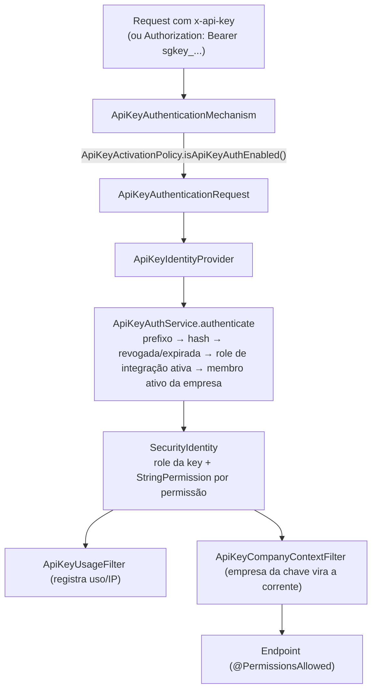

# API Keys (Quarkus) — visão geral

Autenticação por **API key** para integrações máquina-a-máquina. A chave é atrelada a uma **role de integração** (`for_integration`) e herda as permissões dela pelo mesmo RBAC do login JWT; o banco guarda só **hash + prefixo**, com expiração e revogação por chave. A extension também emite, lista e revoga chaves e oferece introspecção (`GET /apikeys/me`).

- Configuração: [[SeedGrid/Extensions/apikeys/Configuracao|Configuração do apikeys]]
- Exemplos: [[SeedGrid/Extensions/apikeys/Exemplos|Exemplos do apikeys]]
- Enums: [[SeedGrid/Extensions/apikeys/Enums|Enums do apikeys]]
- Porte Rust (crate `seedgrid-rust-crate-apikeys`): [[SeedGrid/Extensions/apikeys/Rust|Porte Rust]]

## Módulos Maven e coordenadas (Confirmado — `pom.xml`)

| Módulo | groupId | artifactId | Versão |
|---|---|---|---|
| parent | `br.com.seedgrid` | `seedgrid-apikeys-parent` | `2026.10.14` |
| runtime | `br.com.seedgrid` | `seedgrid-apikeys` | `2026.10.14` |
| deployment | `br.com.seedgrid` | `seedgrid-apikeys-deployment` | `2026.10.14` |
| integration-tests (não publicado) | `br.com.seedgrid` | `seedgrid-apikeys-integration-tests` | `2026.10.14` |

Parent: `br.com.seedgrid:seedgrid-parent:2026.07.02`. Status: `preview`.

Observações de empacotamento (Confirmado, impacto Não confirmado):
- O YAML está nomeado `quarkus-extesion.yaml` (grafia incorreta).

## Dependências SeedGrid

| Dependência | Versão (runtime) | Uso |
|---|---|---|
| `seedgrid-commons` | `2026.08.16` | `CurrentUserProvider`, paginação (`PageReq`/`PageResult`) |
| `seedgrid-security` | `2026.10.14` | `PasswordService` (hash), `User`/`Role`/`Permission`, `UserRepository`/`RoleRepository`, `CompanyRequestContext`, `PlatformCompanyService` |
| `seedgrid-security-deployment` (deployment) | `2026.09.25` | — |

O README declara: "Requer o `seedgrid-security` no host".

## Arquitetura e fluxo (Confirmado)



Pontos relevantes:
- Formato da chave: `sgkey_` + Base64 URL-safe sem padding de `seedgrid.apikeys.key-bytes` bytes aleatórios. O prefixo armazenado são os primeiros `seedgrid.apikeys.prefix-length` caracteres da parte aleatória; a chave crua é hasheada com `PasswordService.encode` e só aparece na resposta de criação. (`ApiKeyGeneratorService`)
- Header: `x-api-key` é **fixo** (`ApiKeyConstants.APIKEY_HEADER`), não configurável. `Authorization: Bearer` só é aceito se o token começar com `sgkey_`. O README recomenda `x-api-key`, porque com `smallrye-jwt` na classpath os dois mecanismos disputam o `Authorization`.
- `OPTIONS` não autentica. IP do cliente vem de `X-Forwarded-For` (primeiro valor) ou `X-Real-IP`.
- Chave revogada → `ApiKeyRevokedException`; expirada → `ApiKeyExpiredException`; role deixou de ser de integração ou foi desativada, ou dono saiu da empresa da chave → falha de autenticação (fail closed).
- Escopo por empresa (coluna `company_id` da `V600`): a chave guarda a empresa corrente de quem a criou; ao autenticar, `ApiKeyCompanyContextFilter` (`Priorities.AUTHORIZATION - 9`) fixa essa empresa como única permitida e corrente. Chave sem escopo não toca o contexto.
- Fora da empresa-plataforma, roles com qualquer permissão de audience `platform` não são elegíveis (`ApiKeyManagementService#listEligibleRoles`).

## API pública

### Endpoints REST (Confirmado — `ApiKeyManagementController`, `ApiKeyIntrospectionController`)

| Método | Path | Permissão | Descrição |
|---|---|---|---|
| `POST` | `/apikeys/role/{roleName}` | `APIKEY_CREATE` | Cria chave (`{name, expiresDays}`) → `201` com a chave crua |
| `GET` | `/apikeys/roles` | `APIKEY_CREATE` | Roles de integração elegíveis na empresa corrente |
| `GET` | `/apikeys/role/{roleName}` | `APIKEY_READ` | Lista chaves do usuário para a role |
| `GET` | `/apikeys?page=&size=` | `APIKEY_READ` | Lista chaves do usuário (paginada se `page` ou `size` vier; `size` padrão 10) |
| `POST` | `/apikeys/{publicId}/revoke` | `APIKEY_REVOKE` | Revoga (idempotente) |
| `GET` | `/apikeys/me` | `@Authenticated`, **só API key** (JWT → 401) | Introspecção: dono (`ownerPublicId`), role, permissões, expiração; sem e-mail do dono |

Os endpoints de gestão chamam `ensureManagementEnabled()` (`ApiKeyActivationPolicy#isApiKeyManagementEnabled`); `/apikeys/me` não.

### SPI / beans / anotações

| Símbolo | Tipo | Observação |
|---|---|---|
| `br.com.seedgrid.apikeys.spis.ApiKeyActivationPolicy` | SPI | `isApiKeyAuthEnabled()`, `isApiKeyManagementEnabled()`; padrão `DefaultApiKeyActivationPolicy` (`@DefaultBean`, ambos `true`). É a forma de "desligar" a extension — não há propriedade para isso. |
| `ApiKeyAwareCurrentUserProvider` | `CurrentUserProvider` `@Alternative @Priority(1)` | JWT tem precedência; com API key usa `publicId`/e-mail do dono e `apikey:<prefixo>` como nome; sem identidade, sentinelas do security |
| `ApiKeyIdentityProvider` | `IdentityProvider` | adiciona atributos `apikey.publicId`, `apikey.prefix`, `apikey.ownerId`, `apikey.ownerPublicId`, `apikey.ownerEmail`, `apikey.authType` |
| `ApiKeyPrincipal` | `Principal` | obtido em `identity.getPrincipal()` |
| `ApiKeyPermissionService#hasPermission` | bean | utilitário |

### Permissões (migrations)

`APIKEY_CREATE`, `APIKEY_READ`, `APIKEY_REVOKE` (`R__apikeys_seed.sql`), com `audience` nula (visível nos dois escopos).

## Anotações

_Fonte: código de `seedgrid-quarkus-ext-apikeys` (versão local 2026.10.22, não publicada)._

Nenhuma.

## SPIs

Detalhes de cada SPI (assinaturas, o que o padrão faz, implementações reais e exemplos): [[SeedGrid/Extensions/apikeys/SPIs|SPIs]].

_Fonte: código de `seedgrid-quarkus-ext-apikeys` (versão local 2026.10.22, não publicada)._

| SPI | Pacote | Implementação padrão (`@DefaultBean`) | Para que serve |
|---|---|---|---|
| `ApiKeyActivationPolicy` | `br.com.seedgrid.apikeys.spis` | `DefaultApiKeyActivationPolicy` | Política do host para ligar e desligar a API key. |
| `ApiKeyScopeRunner` | `br.com.seedgrid.apikeys.spis` | `DefaultApiKeyScopeRunner` | Executa a consulta da chave no ESCOPO de dados da requisicao (ex.: o banco do tenant). |

**Como substituir:** declare um bean CDI (`@ApplicationScoped`) que implemente a interface, **sem** `@Alternative` nem `@Priority`; a implementação padrão (`@DefaultBean`) cede. SPI "sem padrão" precisa de uma implementação do host (ou de outro módulo) para o recurso funcionar.

```java
@ApplicationScoped
public class MeuApiKeyActivationPolicy implements ApiKeyActivationPolicy {
    // implemente os métodos da interface
}
```

## Migrations (Confirmado)

`runtime/src/main/resources/db/migration/apikeys/`, faixa **V600–V699**, location `classpath:db/migration/apikeys`, histórico `sg_flyway_schema_history_apikeys`.

- `V600__apikeys_ddl.sql`: tabela `sg_api_keys` (só o hash e o prefixo da chave; datas em `timestamptz`; snapshot de usuário; `company_id` com **FK para `sg_companies`** e `owner_id` para `sg_users`, ambas `ON DELETE CASCADE`).
- `R__apikeys_seed.sql`: permissões `APIKEY_CREATE`, `APIKEY_READ` e `APIKEY_REVOKE` na role `ADMIN`, com `audience` nula (valem nos dois escopos).

Depende da security (`sg_users`, `sg_roles`, `sg_companies`): a `ApiKeysMigrations` migra a security antes. Quem roda as migrations é o host ou uma foundation (ex.: [[SeedGrid/Extensions/login-tenancy/Visao-geral|login-tenancy]]).

**Compressão das migrations (2026-10-27):** o histórico anterior (V600 a V607) virou **uma migration de DDL** e, onde há dados iniciais, **um seed repetível** (`R__*.sql`, idempotente). **Sem retrocompatibilidade: banco criado com a versão anterior deve ser recriado** (os checksums mudaram). Estrutura nova depois disso = a próxima `V` da faixa; permissão ou dado inicial novo = uma linha no `R__`.

## Testes existentes (não executados)

| Teste | Cobertura |
|---|---|
| `runtime/src/test/.../ApiKeyCompanyScopeTest` | roles elegíveis por audience; escopo por empresa na criação; dono que saiu da empresa; filtro de contexto |
| `runtime/src/test/.../ApiKeyIdentityProviderPermissionsTest` | permissões como `StringPermission`, atributo `authType`, chave inválida |
| `runtime/src/test/.../security/ApiKeyAwareCurrentUserProviderTest` | precedência JWT, dono da chave, sentinelas, whatsapp só do JWT |
| `integration-tests/.../ApiKeyFlowTest` | cria chave e autentica com permissões da role; chave inexistente |
| `integration-tests/.../ApiKeyIntrospectionTest` | `/apikeys/me`: conteúdo, não vaza chave/hash/e-mail, 401s, revogada, não empresta permissão de gestão |
| `integration-tests/.../SeedgridApikeysResourceTest`/`IT` | rota sem credencial é barrada |

## Limitações

- Nenhuma propriedade liga/desliga a autenticação ou a gestão; isso é feito via bean `ApiKeyActivationPolicy` (Confirmado).
- Cada request autenticada por API key grava uso em transação `REQUIRES_NEW` (`ApiKeyUsageService#registerUsage`) — custo de escrita por request (Inferência).
