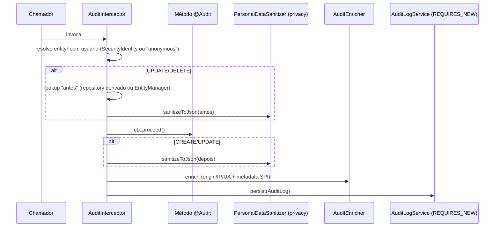

# SeedGrid Audit (Quarkus) — Visão geral

Trilha de auditoria declarativa: um método (ou classe) anotado com `@Audit` é interceptado; a extensão registra quem, o quê, quando, de onde (origin/IP/User-Agent) e o estado **antes/depois** da entidade, com mascaramento de dados pessoais delegado à lib `seedgrid-privacy`. Persistência plugável em PostgreSQL (JPA) ou MongoDB e API REST de leitura. **Confirmado** (`AuditInterceptor`, `README.md`).

- Configuração: [[SeedGrid/Extensions/audit/Configuracao|Configuração do audit]]
- Exemplos: [[SeedGrid/Extensions/audit/Exemplos|Exemplos do audit]]
- Enums: [[SeedGrid/Extensions/audit/Enums|Enums do audit]]
- [[SeedGrid/Extensions/audit/Rust|Porte Rust]] (crate `seedgrid-rust-crate-audit`)

## Módulos Maven e coordenadas

Todos com `groupId` `br.com.seedgrid`. Agregador `seedgrid-audit` versão **`2026.09.25`** (parent `seedgrid-parent` 2026.07.02). **Confirmado** (`pom.xml`).

| Módulo (pasta) | artifactId | Tipo |
|---|---|---|
| `seedgrid-quarkus-ext-audit-core/runtime` | `seedgrid-audit-core` | biblioteca runtime (sem deployment próprio, sem `quarkus-extension.properties`) |
| `seedgrid-quarkus-ext-audit-postgresql/runtime` | `seedgrid-audit-postgresql` | extensão Quarkus (strategy `JPA`) |
| `seedgrid-quarkus-ext-audit-postgresql/deployment` | `seedgrid-audit-postgresql-deployment` | deployment |
| `seedgrid-quarkus-ext-audit-mongodb/runtime` | `seedgrid-audit-mongodb` | extensão Quarkus (strategy `MONGODB`) |
| `seedgrid-quarkus-ext-audit-mongodb/deployment` | `seedgrid-audit-mongodb-deployment` | deployment |

O host adiciona **apenas** o módulo da strategy (`seedgrid-audit-postgresql` ou `seedgrid-audit-mongodb`); ambos já dependem de `seedgrid-audit-core`.

### Dependências SeedGrid e de framework
- `seedgrid-commons` e `seedgrid-privacy` (core). Ver [[SeedGrid/Extensions/commons/Visao-geral|commons]] e [[SeedGrid/Extensions/privacy/Visao-geral|privacy]].
- Core: `quarkus-arc`, `quarkus-jackson`, `quarkus-rest-jackson`, `quarkus-smallrye-jwt`, `quarkus-hibernate-validator`, `quarkus-smallrye-openapi`.
- PostgreSQL: `quarkus-jdbc-postgresql`, `quarkus-flyway`. MongoDB: `quarkus-mongodb-panache`.
- Integração opcional (por SPI, sem dependência Maven): `seedgrid-security` / `seedgrid-login-tenancy` (usuário corrente, metadata `companyPublicId`, escopo de leitura). **Inferência** a partir de comentários/README.

## Arquitetura e fluxo

- Interceptor: `@Audit` é `@InterceptorBinding`; `AuditInterceptor` tem `@Priority(APPLICATION + 200)`. Lê a anotação no método ou, em fallback, na classe. **Confirmado**.
- Resolução do repositório: `entityFqcn` com pacote `.entities` → `.repositories` + sufixo `Repository`. Plano de lookup: `lookupMethod` → `lookups` → `publicId` (se herda `br.com.seedgrid.commons.persistence.BaseEntity`/`BaseEntityPanache`) → `@Id` compatível com o 1º argumento. Sem repository derivável, usa `EntityManager` (active-record). **Confirmado** (`AuditInterceptor#resolveLookupPlan`, `#findViaActiveRecord`).
- Roteamento de persistência: `AuditPersistenceRouter` produz `AuditLogRepository`, `AuditLogUsersRepository`, `AuditLogEntitiesRepository` a partir do `AuditPersistenceProvider` cuja `strategy()` = `seedgrid.audit.persistence.strategy`. Sem provider → `IllegalStateException`. **Confirmado**.
- `PostgreSqlAuditPersistenceProvider`: usa o `EntityManager` CDI do host se resolvível; senão cria um `EntityManagerFactory` standalone (`audit-pu`, `PGSimpleDataSource`, dialeto PostgreSQL) a partir de `seedgrid.audit.jpa.*`. **Confirmado**.
- `MongoAuditPersistenceProvider`: usa `Instance<MongoDatabase>`; coleções `audit_logs`, `audit_log_users`, `audit_log_entities` e `counters` (sequência `audit_log_sequence`); índices criados de forma lazy. **Confirmado**. A extensão **não produz** um bean `MongoDatabase`: ele vem de `seedgrid-login-tenancy` (`LoginTenancyMongoAuditDatabaseProducer`, banco único, registrado só com o driver Mongo no classpath), de `seedgrid-subdomain-tenancy` (`TenantAwareMongoProducer`, banco por tenant), ambos `@DefaultBean`, ou de um producer da aplicação. **Confirmado**.
- Validação em build (`AuditProcessor#validateAuditUsage`, idêntico nos dois deployments): falha o build se `entityFqcn` vazio/inexistente, se `lookupMethod` e `lookups` forem usados juntos, se um campo de `lookups` não existir, se houver mais lookups que parâmetros, ou se o lookup implícito por PK for incompatível; avisa (warn) quando o repository derivado não existe. **Confirmado**.

## APIs públicas e pontos de integração

| Tipo | Símbolo | Descrição |
|---|---|---|
| Anotação | `br.com.seedgrid.audit.core.annotations.Audit` | `operation` (`AuditOperationEnum`, padrão `OTHER`), `description`, `entityFqcn` (obrigatório), `lookupMethod`, `lookups` (`AuditLookup[]`), `options` (`MaskRule[]` do privacy) |
| Anotação | `AuditLookup` | `field()` |
| Enum | `AuditOperationEnum` | `CREATE, UPDATE, DELETE, READ, OTHER` |
| Enum | `AuditPersistenceStrategy` | `MONGODB, JPA` |
| SPI | `core.spi.AuditPersistenceProvider` | liga strategy aos repositórios (fornecido pelos módulos de store) |
| SPI | `core.services.AuditMetadataContributor` | `Map<String,String> contribute()` mesclado em `AuditLog.metadata` |
| SPI | `core.spi.AuditReadScopeProvider` | força filtro `metaKey/metaValue` na leitura; default `DefaultAuditReadScopeProvider` (`@DefaultBean`, irrestrito) |
| SPI | `core.services.AuditRequestContextProvider` | origin/IP/UA; default `HttpAuditRequestContextProvider` (`@DefaultBean`; usa `Origin`→`Referer`→`Host`, `X-Forwarded-For`) |
| Bean | `core.services.AuditGateway` / `AuditGatewayImpl` (`@DefaultBean`) | `persist(AuditLog)` para auditoria programática (enriquece e persiste) |
| Utilitário | `core.services.AuditEmitter#emit(AuditLog)` | estático, best-effort (nunca lança) via `AuditGateway` |

### Endpoints REST (`AuditLogController`, todos `@PermissionsAllowed("LOG_READ")`)

| Método | Path | Descrição |
|---|---|---|
| GET | `/audit-logs` | lista; paginada se `page`/`size` (padrão de página 0, tamanho 10). Filtros: `idFrom`, `idTo`, `entity`, `operation`, `description`, `operationDateFrom`, `operationDateTo`, `userName`, `metaKey`, `metaValue` |
| GET | `/audit-logs/{id}` | por id; 404 se fora do escopo do `AuditReadScopeProvider` |
| GET | `/audit-logs/entities` | nomes de entidades (escopados) |
| GET | `/audit-logs/users` | usuários (escopados) |

**Confirmado** (`RestControllerPath`, `AuditLogController`). Os paths são fixos (não configuráveis).

## Migrations (PostgreSQL)

`seedgrid-quarkus-ext-audit-postgresql/runtime/src/main/resources/db/migration/audit/`: `V300__create_audit_tables.sql`, `V301__add_tech_operation.sql`, `V302__add_metadata.sql` (tabela `audit_log_metadata`), `V303__operation_date_time_timestamptz.sql` (converte `operation_date_time` para `TIMESTAMPTZ` usando `AT TIME ZONE 'UTC'`). Faixa **V300–V303**, tabela de histórico `flyway_schema_history_audit`. **Confirmado**. MongoDB não tem migrations.

## Testes (não executados)

| Local | Cobre |
|---|---|
| `audit-core/runtime/src/test/.../AuditInterceptorTest` | plano de lookup (publicId, lookups, lookupMethod, fallback por id) |
| `audit-core/.../HttpAuditRequestContextProviderTest` | comportamento sem requisição HTTP e `X-Forwarded-For` |
| `audit-core/.../AuditEnricherTest` | merge de metadata e tolerância a contribuidor com erro |
| `audit-postgresql/deployment/src/test/.../AuditProcessorTest` | validação de lookup implícito por PK e derivação de repository |
| `audit-postgresql/runtime/src/test/.../AuditMaskingTest` | mascaramento persistido no Postgres (Testcontainers) |
| `audit-postgresql/runtime/src/test/.../JpaAuditMetadataIT` | metadata, filtros e paginação JPA (Testcontainers) |
| `audit-mongodb/runtime/src/test/.../MongoAuditMetadataIT` | metadata em subdocumento e filtros (Testcontainers) |

## Limitações
- O standalone JPA só aceita URL `jdbc:postgresql:` (`IllegalArgumentException` caso contrário).
- Se ambos os módulos (postgresql e mongodb) estiverem no classpath, os dois `microprofile-config.properties` definem `seedgrid.audit.persistence.strategy` com mesmo ordinal — resultado não determinado. **Não confirmado**.
- Persistência em `REQUIRES_NEW`: o log é gravado mesmo que a transação principal falhe. Lookup que falha resulta em log sem before/after (warn/debug).
