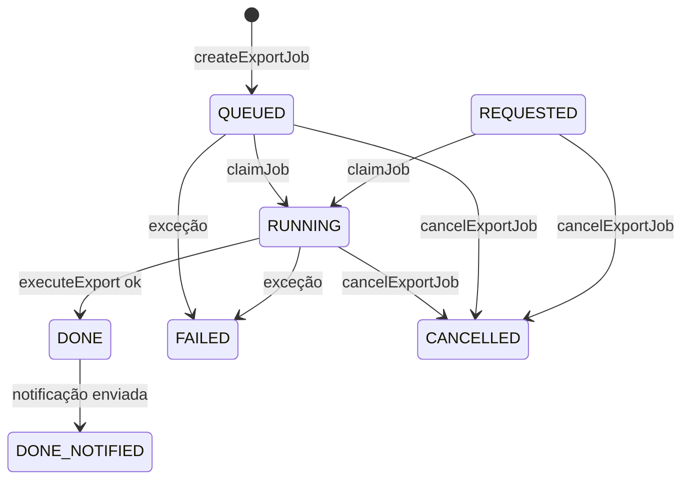

# Enums — backup (Quarkus)

Voltar: [[SeedGrid/Extensions/backup/Visao-geral|Visão geral do backup]] · [[SeedGrid/Extensions/backup/Configuracao|Configuração]] · [[SeedGrid/Extensions/backup/Exemplos|Exemplos]] · [[SeedGrid/Extensions/backup/Rust|Porte Rust]]

Nenhum enum desta extensão é tipo de propriedade de configuração (`BackupConfig` não usa enums; `mailer.start-tls` é `String`). Todos aparecem em DTOs REST e/ou colunas persistidas.

## 1. Índice

| Enum | Pacote/arquivo (`runtime/src/main/java/br/com/seedgrid/backup/`) | Usado em | Público? |
|---|---|---|---|
| [[SeedGrid/Extensions/backup/Enums#ExportStatus\|ExportStatus]] | `domains/ExportStatus.java` | `ExportJob.status` (coluna `export_jobs.status`), `ExportResponse.status`, `ExportJobRepository` | Sim |
| [[SeedGrid/Extensions/backup/Enums#ExportScope\|ExportScope]] | `domains/ExportScope.java` | `ExportRequest.scope`, `ExportResponse.scope`, `ExportJob.scope` (`export_jobs.scope`), `ExportContext.getScope()` (SPI) | Sim |
| [[SeedGrid/Extensions/backup/Enums#BackupFormat\|BackupFormat]] | `domains/BackupFormat.java` | `ExportRequest.format`, `ExportResponse.format`, `ExportJob.format` (`export_jobs.format`), SPI `BackupExporter#format()` | Sim |
| [[SeedGrid/Extensions/backup/Enums#ExportArtifact.ArtifactType\|ExportArtifact.ArtifactType]] | `entities/ExportArtifact.java` | `ExportArtifact.artifactType` (`export_artifacts.artifact_type`), `ExportResponse.artifacts[].type` | Sim |
| [[SeedGrid/Extensions/backup/Enums#ExportResult.ArtifactType\|ExportResult.ArtifactType]] | `spi/ExportResult.java` | `ExportResult.ArtifactData.type` (retorno do SPI `BackupExporter#export`) | Sim |

## ExportStatus

Arquivo: `domains/ExportStatus.java` — FQN `br.com.seedgrid.backup.domains.ExportStatus`.

| Valor | Significado | Efeito / onde é tratado | Observações |
|---|---|---|---|
| `REQUESTED` | Pedido recebido, ainda não enfileirado | `ExportJob#onCreate` atribui se `status` for nulo; `claimJob` aceita `REQUESTED`/`QUEUED`; conta como `isInProgress()` (permite cancelar) | **Confirmado**. O `createExportJob` já grava `QUEUED` (`ExportService:132`), então na prática o job nunca nasce `REQUESTED` pelo fluxo REST; o valor só aparece se algo persistir um job sem status |
| `QUEUED` | Na fila de processamento | Status inicial gravado por `createExportJob`; `BackupSchedulerService#processQueuedExports` (via `findQueuedJobs`) inicia; `claimJob` → `RUNNING` | **Confirmado** |
| `RUNNING` | Export em execução | Gravado em `claimJob`; conta para `max-concurrent-exports` (`ExportJobRepositoryImpl#countRunningJobs`); `isInProgress()` | **Confirmado** |
| `DONE` | Concluído, pronto para download | Gravado em `executeExport` (com `expiresAt = agora + retention-days`); download permitido; `findReadyForNotification` só seleciona jobs `DONE` | **Confirmado** |
| `DONE_NOTIFIED` | Concluído e solicitante notificado | Gravado por `NotificationSchedulerService` após `notifyReady` com sucesso; download permitido; terminal | **Confirmado** |
| `FAILED` | Falhou | `markJobFailed` (qualquer exceção do pipeline, inclusive `ExportValidationException` do exporter); terminal; `GET .../download` → `410` | **Confirmado** |
| `EXPIRED` | Artefato expirou | Existe no enum e conta como terminal não baixável (`410` no download), mas **nenhum código grava `EXPIRED`**: a limpeza por retenção (`BackupSchedulerService#cleanExpiredExports`) apaga job + artefatos em vez de marcar. Um job `DONE` com `expiresAt` vencido ainda não limpo fica `DONE`, mas `ExportJob#isDownloadable()` retorna `false` (`isExpired()`) | **Confirmado** (busca por `ExportStatus.EXPIRED` sem ocorrências fora do enum) |
| `CANCELLED` | Cancelado | Gravado por `cancelExportJob` (só se `isInProgress()`); terminal; `DELETE` posterior exclui job + artefatos | **Confirmado** |

**Campos e métodos** (construtor `(code, displayName, downloadable, terminal)`):

| Valor | `getCode()` | `getDisplayName()` | `isDownloadable()` | `isTerminal()` | `isInProgress()` |
|---|---|---|---|---|---|
| `REQUESTED` | `requested` | Export requested | não | não | sim |
| `QUEUED` | `queued` | Queued for processing | não | não | sim |
| `RUNNING` | `running` | Export in progress | não | não | sim |
| `DONE` | `done` | Ready for download | sim | não | não |
| `DONE_NOTIFIED` | `done-notified` | Ready for download and notified | sim | sim | não |
| `FAILED` | `failed` | Export failed | não | sim | não |
| `EXPIRED` | `expired` | Export expired | não | sim | não |
| `CANCELLED` | `cancelled` | Export cancelled | não | sim | não |

`fromCode(String)` compara `code` ignorando caixa e lança `IllegalArgumentException("Unknown export status code: ...")`; **nenhum código da extensão o chama** (Confirmado) — existe só como API do enum.

**Serialização**
- JSON: nome da constante (`"DONE_NOTIFIED"`); sem `@JsonValue`/`@JsonProperty` (Confirmado). `ExportResponse.status` sai assim.
- Banco: `@Enumerated(EnumType.STRING)` em `ExportJob.status`; coluna `status VARCHAR(20)` (V400). **Não há CHECK constraint** sobre os valores — só `chk_progress`. O comentário SQL da V400 lista `REQUESTED, QUEUED, RUNNING, DONE, FAILED, EXPIRED, CANCELLED` (**omite `DONE_NOTIFIED`**, só no comentário; o valor cabe em 20 caracteres e é gravado normalmente).

**Transições confirmadas no código**

(O comentário do Javadoc do enum mostra `FAILED → EXPIRED`; esse caminho **não** existe no código.)

**Onde é usado**: endpoints `GET /exports`, `GET /exports/{jobId}`, `GET /exports/{jobId}/download` (`410` quando terminal e não baixável), `DELETE /exports/{jobId}`; propriedades que o influenciam: `async-enabled`, `max-concurrent-exports`, `retention-days`, `notification.*` — ver [[SeedGrid/Extensions/backup/Configuracao|Configuração]]; entidade `ExportJob`; evento `SgUserEvent` (`data.status`: `"DONE"` ou `"FAILED"`).

## ExportScope

Arquivo: `domains/ExportScope.java` — FQN `br.com.seedgrid.backup.domains.ExportScope`.

| Valor | Significado | Efeito / onde é tratado | Observações |
|---|---|---|---|
| `DOMAIN` | Entidades de negócio (metamodel JPA) | `ExtractDataService` extrai entidades JPA, pulando pacotes de `seedgrid.backup.excluded-domain-entity-packages`; ambos exporters aceitam | **Confirmado**. Exporta `data/<entidade>.csv` / `.sql` |
| `RAW` | Tabelas do schema via `information_schema` | `ExtractDataService`; exclui `export_jobs`/`export_artifacts` | **Confirmado** |
| `CUSTOM` | Seleção de módulos (feature futura) | **Aceito pela API** (`POST /exports` retorna `201`), mas `validate()` dos dois exporters lança `ExportValidationException` e `switch` lança `ExportException`; como a validação ocorre em `executeExport`, o job termina `FAILED` com `errorMessage` ("CUSTOM scope not yet implemented for CSV/SQL dump export") | **Confirmado**. Existe no enum, mas nenhum código o trata com sucesso |

**Campos**: `(code, displayName, description)`; `getCode()` = `domain`/`raw`/`custom`; `fromCode(String)` ignora caixa e lança `IllegalArgumentException`, **não chamado** pela extensão.

**Serialização**: JSON pelo nome (`"DOMAIN"`); `ExportRequest.scope` é `@NotNull` (sem escopo → erro de validação). Banco: `@Enumerated(EnumType.STRING)` em `ExportJob.scope`, `scope VARCHAR(20)`, **sem CHECK constraint**; comentário SQL lista `DOMAIN, RAW, CUSTOM`.

**Onde é usado**: `POST /exports` (corpo), `ExportContext.getScope()`, manifest (`scope`), entidade `ExportJob`.

## BackupFormat

Arquivo: `domains/BackupFormat.java` — FQN `br.com.seedgrid.backup.domains.BackupFormat`.

| Valor | Significado | Efeito / onde é tratado | Observações |
|---|---|---|---|
| `CSV_ZIP` | ZIP com CSVs por tabela/entidade (portabilidade) | `CsvZipExporter#format()`; usa `seedgrid.backup.csv.*` | **Confirmado** |
| `SQL_DUMP_ZIP` | ZIP com `INSERT`s por tabela (restore técnico) | `SqlDumpZipExporter#format()`; `csv.*` não se aplica | **Confirmado**. O Javadoc fala em "schema, constraints, indexes, sequences", mas o exporter gera apenas `data/<tabela>.sql` com INSERTs (Confirmado em `SqlDumpZipExporter`) |

**Campos**: `(code, displayName, mimeType)`; `getCode()` = `csv-zip` / `sql-dump-zip`; `getMimeType()` = `application/zip` nos dois (nenhum chamador encontrado: o `mimeType` do artefato vem de `ArtifactData`); `fromCode` ignora caixa, **não chamado**.

**Serialização**: JSON pelo nome (`"CSV_ZIP"`); `@NotNull` em `ExportRequest.format`; formato sem exporter registrado → `IllegalArgumentException("Unsupported export format: ...")` no `POST`. Banco: `@Enumerated(EnumType.STRING)`, `format VARCHAR(20)`, **sem CHECK**; `SQL_DUMP_ZIP` tem 12 caracteres, cabe.

**Onde é usado**: `BackupExporterRegistry` (1 exporter por valor; duplicata falha no startup), `POST /exports`, manifest.

## ExportArtifact.ArtifactType

Arquivo: `entities/ExportArtifact.java` (enum aninhado) — FQN `br.com.seedgrid.backup.entities.ExportArtifact.ArtifactType`.

| Valor | Significado | Efeito / onde é tratado | Observações |
|---|---|---|---|
| `ZIP` | Arquivo principal do export | Único tipo que `ExportService#getDownloadArtifact` procura para o download; único tipo gerado pelos exporters embutidos | **Confirmado** |
| `MANIFEST` | `manifest.json` como artefato próprio | Só convertido em `mapArtifactType`; nenhum exporter embutido o produz (o manifest vai dentro do ZIP) | Existe no enum, mas nenhum código o produz; pode ser enviado por exporter customizado, que é gravado em `export_artifacts` mas não é baixável pela API |
| `CHECKSUMS` | `checksums.txt` como artefato próprio | idem | idem |
| `LOG` | Log de execução | idem | idem |

Sem campos. Serialização: JSON pelo nome (`ExportResponse.ArtifactInfo.type`); banco `@Enumerated(EnumType.STRING)`, `artifact_type VARCHAR(20)`, **sem CHECK** (comentário SQL lista os 4 valores).

## ExportResult.ArtifactType

Arquivo: `spi/ExportResult.java` (enum aninhado) — FQN `br.com.seedgrid.backup.spi.ExportResult.ArtifactType`.

Valores: `ZIP`, `MANIFEST`, `CHECKSUMS`, `LOG` — espelho exato do enum de entidade; `ExportService#mapArtifactType` converte 1:1 por `switch` exaustivo (**Confirmado**). Usado por quem implementa `BackupExporter` (campo `type` de `ExportResult.ArtifactData`). Não é serializado nem persistido diretamente. Para o efeito de cada valor veja a seção anterior.

## Internos

Nenhum enum privado ou interno encontrado em `runtime/src/main` além dos acima (Confirmado por busca de `enum`). Enums de testes ignorados.
