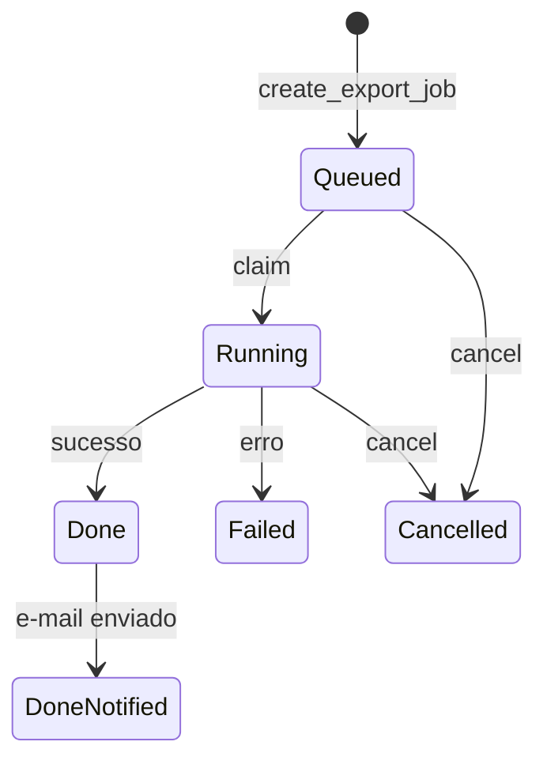

# backup — porte Rust (`seedgrid-rust-crate-backup`)

Porte da extensão Quarkus `seedgrid-quarkus-ext-backup`. Lado Java: [[SeedGrid/Extensions/backup/Visao-geral|Visão geral do backup (Java)]] · [[SeedGrid/Extensions/backup/Configuracao|Configuração do backup (Java)]]. Configuração Rust: [[SeedGrid/Extensions/backup/Configuracao-Rust|Configuração Rust do backup]].

Motor de **export** de dados de tenant: dump do Postgres para CSV compactado em ZIP, rastreio de jobs no banco, storage plugável (via filemanagement), auditoria (via audit), rate limit no create (via resilience) e notificação por e-mail. **Não** é backup de arquivos/SO e **não** tem restore. **Confirmado** (`src/lib.rs`).

## Identificação
| Item | Valor |
|---|---|
| Pacote Cargo | `seedgrid-rust-crate-backup` (lib `seedgrid_backup`) |
| Versão | workspace `2026.10.14` |
| Edição / MSRV | 2021 / 1.82 |
| Features Cargo | nenhuma |
| Dependências SeedGrid | `seedgrid-rust-crate-filemanagent` (lib `seedgrid_filemanagement`), `seedgrid-rust-crate-audit`, `seedgrid-rust-crate-resilience`, `seedgrid-rust-crate-cache`, `seedgrid-runtime` (eventos `UserEventSink`) |

## Fluxo
1. `ExportService::create_export_job` grava o job `QUEUED`; com `async_enabled`, dispara worker `tokio`: claim (`RUNNING`) → exporter → `DONE` (ou `FAILED`).
2. `ExtractDataService`: escopo **RAW** lê `information_schema.tables` (exclui `flyway_%` e tabelas internas `export_jobs`, `export_artifacts`, `audit_log*`) e faz `SELECT <col>::text`; **DOMAIN** usa o SPI `DomainDatasetProvider` do host (default vazio); **CUSTOM** gera erro.
3. `CsvZipExporter` (único exporter): ZIP nível 9 com `manifest.json`, `checksums.txt` (formato `sha256sum`) e `data/<nome>.csv` por dataset não vazio.
4. Retenção: `expires_at = agora + retention_days`; `BackupScheduler::clean_expired_exports` apaga expirados.
5. `BackupScheduler::spawn` roda `process_queued_exports` (a cada `queue_poll_interval`, respeita `max_concurrent_exports`) e `process_notifications` (a cada `notification.poll_interval`, com `max_retries`/`retry_delay`).
6. Notificação `EmailExportNotificationService`: `is_enabled = notification.enabled && mailer.from && mailer.host`; envio pelo SPI `Mailer` (default `LoggingMailer`; `SmtpMailer::from_config` para SMTP real via lettre).

Fonte: `src/service.rs`, `src/extract.rs`, `src/exporter.rs`, `src/scheduler.rs`, `src/notification.rs`, `src/email_smtp.rs`.

## API pública principal
| Símbolo | Papel |
|---|---|
| `BackupConfig` | config ([[SeedGrid/Extensions/backup/Configuracao-Rust\|Configuração Rust]]) |
| `BackupPlatform::assemble(Option<&PgPool>, BackupOverrides)` → `Option<Arc<BackupAssembly>>` | montagem a partir do ambiente (opt-in + migrations) |
| `BackupAssembly::build_service(pool)` / `config()` | `ExportService` por banco (single-DB ou por tenant) |
| `BackupOverrides { domain_provider, require_opt_in, auditor, user_events }` | seams do host; `Default`: `EmptyDomainDatasetProvider`, `require_opt_in = true`, `NoopAuditor`, sink no-op |
| `ExportService` | `create_export_job`, `get_export_status`, `list_export_jobs`, `cancel_export_job`, `delete_export_job`, `download_export_file`, `execute_export_async`… |
| `BackupScheduler` | `spawn`, `clean_expired_exports`, `process_queued_exports`, `process_notifications` |
| `router(BackupApiState)` / `router_with_resolver(...)` | rotas `/exports` |
| `rest::export_create_rate_limit()` | `SgRateLimit` (`export-create`, 10/hora) para o host acoplar |
| `migrate(&PgPool)` / `MIGRATOR` | migrations `0400`–`0402`, histórico `_sqlx_migrations_backup` |
| `openapi()` | spec utoipa |
| SPIs: `BackupExporter`, `DomainDatasetProvider`, `TenantProvider` (default `SingleTenantBackupProvider` → `public`), `CurrentUserProvider`, `PermissionGuard` (default `AllowAllPermissionGuard`), `ExportNotificationService`, `Mailer`, `TemplateBackupProvider`, `UserContactProvider` | `src/spi.rs`, `src/rest.rs` |

## Endpoints
| Método | Path | Permissão (host-enforced via `PermissionGuard`) |
|---|---|---|
| POST | `/exports` | `BACKUP_CREATE` (+ rate limit `export-create`) |
| GET | `/exports?page&size` | `BACKUP_READ` |
| GET | `/exports/{jobId}` | `BACKUP_READ` |
| DELETE | `/exports/{jobId}` | `BACKUP_DELETE` |
| GET | `/exports/{jobId}/download` | `BACKUP_DOWNLOAD` (410 para terminal expirado/falho) |

Fonte: `src/rest.rs` → `router`. O guard default (`AllowAllPermissionGuard`) libera tudo; as permissões `BACKUP_*` são aplicadas pelo host.

## Exemplo (de `rust/examples/seedgrid-backup-example/src/main.rs`)
```rust
let mut config = BackupConfig { async_enabled, storage: "filesystem".to_string(), ..BackupConfig::default() };
config.filesystem.base_path = base_path.to_string();
let config = Arc::new(config);
let fs_registry = Arc::new(FileStorageRegistry::new(BuiltInStorageFactories::all()).expect("storage registry"));
let extract = Arc::new(ExtractDataService::new(pool.clone(), Arc::new(EmptyDomainDatasetProvider)));
let exporter = Arc::new(CsvZipExporter::new(fs_registry.clone(), extract, config.clone()));
let exporter_registry = Arc::new(BackupExporterRegistry::new(vec![exporter as Arc<dyn BackupExporter>]).expect("exporter registry"));
let service = ExportService::new(exporter_registry, ExportJobRepository::new(pool), fs_registry,
    Arc::new(SingleTenantBackupProvider::new()), config, Arc::new(NoopAuditor));
```
O exemplo constrói `BackupConfig` à mão (não chama `from_env`).

## Testes
- Unitários em `src/*` (checksum, manifest, CSV/ZIP, config/durações).
- ITs `tests/csv_zip_exporter_it.rs`, `export_async_flow_it.rs`, `export_resource_it.rs`, `extract_data_it.rs`, `user_event_it.rs` com gate `BACKUP_TEST_DATABASE_URL` (`tests/common/mod.rs`).
- E2E Testcontainers: `rust/examples/seedgrid-backup-example/tests/`.
- **Não executados.**

## Limitações conhecidas

- `SQL_DUMP_ZIP` não tem exporter e `CUSTOM` retorna erro.
- `includeAttachments` é ignorado e `appVersion` é fixo em `1.0.0`.
- O mailer de notificação vem ligado por padrão.

## Enums
Equivalentes Java: [[SeedGrid/Extensions/backup/Enums|Enums do backup (Java)]].

| Enum | Arquivo | Java equivalente |
|---|---|---|
| `ExportStatus` | `src/enums.rs` | [[SeedGrid/Extensions/backup/Enums#ExportStatus\|ExportStatus]] |
| `ExportScope` | `src/enums.rs` | [[SeedGrid/Extensions/backup/Enums#ExportScope\|ExportScope]] |
| `BackupFormat` | `src/enums.rs` | [[SeedGrid/Extensions/backup/Enums#BackupFormat\|BackupFormat]] |
| `ArtifactType` | `src/enums.rs` | [[SeedGrid/Extensions/backup/Enums#ArtifactType\|ArtifactType]] (aninhado em `ExportArtifact`/`ExportResult` no Java) |
| `ExportError` | `src/error.rs` | exceções do backup |

Todos usam `#[serde(rename_all = "SCREAMING_SNAKE_CASE")]` (JSON igual ao nome Java) e são gravados como `VARCHAR` com o nome em maiúsculas (`as_str()`; leitura por `from_db`, que falha em valor desconhecido). `code()`/`from_code()` usam o código curto (`"done-notified"`, `"csv-zip"`…), case-insensitive.

### ExportStatus
| Valor | `as_str` / `code` | Efeito no Rust |
|---|---|---|
| `Requested` | `REQUESTED` / `requested` | estado inicial da entidade; o claim aceita `Requested` ou `Queued` (`service.rs`) |
| `Queued` | `QUEUED` / `queued` | gravado por `create_export_job`; `process_queued_exports` lê `status='QUEUED'` |
| `Running` | `RUNNING` / `running` | gravado no claim; `max_concurrent_exports` conta `status='RUNNING'` |
| `Done` | `DONE` / `done` | fim com sucesso; `process_notifications` lê `status='DONE'`; baixável |
| `DoneNotified` | `DONE_NOTIFIED` / `done-notified` | gravado pelo scheduler após o e-mail; baixável e terminal |
| `Failed` | `FAILED` / `failed` | falha no export; terminal |
| `Expired` | `EXPIRED` / `expired` | **existe no enum, mas nenhum código o atribui** (a limpeza de retenção apaga o job); terminal |
| `Cancelled` | `CANCELLED` / `cancelled` | gravado por `cancel_export_job`; terminal |

Métodos: `is_downloadable` (`Done`, `DoneNotified`), `is_terminal` (`DoneNotified`, `Failed`, `Expired`, `Cancelled`), `is_in_progress` (`Requested`, `Queued`, `Running`), `display_name`. Coluna `export_jobs.status VARCHAR(20)` (o comentário da migration lista os mesmos 8 valores; **sem CHECK constraint**). Valores iguais ao Java.


`cancel_export_job` cancela qualquer job em andamento (`Requested`, `Queued` ou `Running`); fora disso devolve `false`. Transições conferidas em `service.rs` e `scheduler.rs`.

### ExportScope
`Domain` (`DOMAIN`/`domain`), `Raw` (`RAW`/`raw`), `Custom` (`CUSTOM`/`custom`). `Domain` usa o `DomainDatasetProvider` do host; `Raw` dumpa as tabelas do schema; `Custom` falha com `CUSTOM scope not implemented` (`exporter.rs`). Coluna `export_jobs.scope VARCHAR(20)`. Iguais ao Java.

### BackupFormat
`CsvZip` (`CSV_ZIP`/`csv-zip`), `SqlDumpZip` (`SQL_DUMP_ZIP`/`sql-dump-zip`); `mime_type()` sempre `application/zip`. `SqlDumpZip` existe, mas não há exporter registrado (o `BackupExporterRegistry` falha se pedido). Coluna `export_jobs.format VARCHAR(20)`. Iguais ao Java.

### ArtifactType
`Zip`, `Manifest`, `Checksums`, `Log` (`ZIP`, `MANIFEST`, `CHECKSUMS`, `LOG`); coluna `export_artifacts.artifact_type VARCHAR(20)`. Só `Zip` é criado (`exporter.rs`) e consultado no download (`service.rs`); os demais existem no enum e no schema, sem código que os produza. Iguais ao Java.

### ExportError
`Export` → HTTP 500; `Validation` → 422; `Retrieval`, `Checksum`, `Storage`, `Database`, `Serde`, `Io` (mapeamento HTTP em `rest.rs`).
