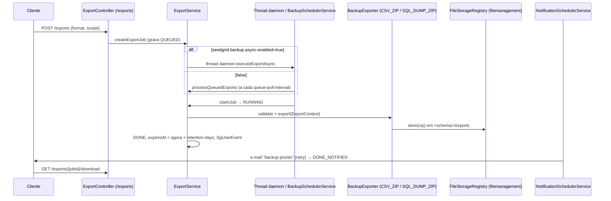

# Backup (extension Quarkus)

Extensão Quarkus para **exportação/backup de dados por tenant e por usuário** (portabilidade LGPD/GDPR): recebe pedidos via REST, cria jobs de export, executa-os de forma assíncrona, gera um ZIP (dados + `manifest.json` + `checksums.txt`), grava o artefato num storage plugável (via `seedgrid-filemanagement`), notifica o solicitante e expira o artefato após um período de retenção.

- Configuração: [[SeedGrid/Extensions/backup/Configuracao|Configuração do backup]]
- Exemplos: [[SeedGrid/Extensions/backup/Exemplos|Exemplos do backup]]
- Enums: [[SeedGrid/Extensions/backup/Enums|Enums do backup]] (`ExportStatus`, `ExportScope`, `BackupFormat`, `ArtifactType`)
- [[SeedGrid/Extensions/backup/Rust|Porte Rust]] (crate `rust/seedgrid-rust-crate-backup`)

## Funcionalidades (Confirmado)

| Funcionalidade | Onde |
|---|---|
| REST `/exports` (criar, listar, status, download, cancelar/excluir) | `runtime/.../controllers/ExportController.java` |
| Ciclo de vida do job `QUEUED → RUNNING → DONE/DONE_NOTIFIED/FAILED/CANCELLED` (`REQUESTED` e `EXPIRED` existem no enum, ver [[SeedGrid/Extensions/backup/Enums#ExportStatus|ExportStatus]]) | `domains/ExportStatus.java`, `services/ExportService.java` |
| Execução assíncrona em thread de plataforma daemon por job (`Thread.ofPlatform().daemon()`), com transações curtas (claim → export sem transação → gravação final) | `ExportService#createExportJob`, `ExportService#executeExport` |
| Fila: jobs `QUEUED` iniciados pelo scheduler respeitando teto global de jobs `RUNNING` | `schedulers/BackupSchedulerService#processQueuedExports` |
| Retenção: limpeza diária (cron fixo `0 1 0 * * ?`, 00:01) de jobs com `expiresAt` vencido + artefatos | `BackupSchedulerService#cleanExpiredExports`, `ExportJobRepositoryImpl#findExpiredJobs` |
| Notificação "backup pronto" por e-mail (Vert.x Mail) com retry | `schedulers/NotificationSchedulerService`, `services/EmailExportNotificationService` |
| Evento CDI `SgUserEvent` (canal `backup`, eventos `backup.finished.success` / `backup.finished.error`) disparado dentro da transação final (observers `AFTER_SUCCESS` recebem após o commit) | `ExportService#notifyRequester`, teste `ExportUserEventIT` |
| Exporters embutidos `CSV_ZIP` e `SQL_DUMP_ZIP` (INSERTs por tabela) | `exporters/CsvZipExporter.java`, `exporters/SqlDumpZipExporter.java` |
| Escopos `DOMAIN` (entidades JPA do metamodel) e `RAW` (tabelas do schema via `information_schema`) | `services/ExtractDataService.java`, `validate()` dos exporters |
| Isolamento por dono: status/download/cancel/delete/listagem filtram por `createUserPublicId` → não-dono recebe 404 | `ExportService#findOwnedJob`, `ExportJobRepository#findByPublicIdAndUser` |
| Rate limit no `POST /exports`: `@SgRateLimit(configKey = "export-create", permits = 10, window = 1, windowUnit = HOURS)` | `ExportController#createExport` |
| Auditoria `@SgAudit` em criar/cancelar/excluir/download | `ExportService` |
| Mapeamento de exceções: `ExportValidationException` → 422, `ExportException` → 500 (Problem Details) | `exceptions/BackupExceptionExtension.java` |

## Módulos Maven e coordenadas (Confirmado — `pom.xml`)

| Módulo | groupId:artifactId | Versão |
|---|---|---|
| parent (pom) | `br.com.seedgrid:seedgrid-backup-parent` | `2026.10.09` |
| runtime | `br.com.seedgrid:seedgrid-backup` | `2026.10.09` |
| deployment | `br.com.seedgrid:seedgrid-backup-deployment` | `2026.10.09` |

Parent: `br.com.seedgrid:seedgrid-parent:2026.07.02`. O host depende só do runtime; o deployment é ligado via `quarkus-extension-maven-plugin` (`META-INF/quarkus-extension.properties`).

## Dependências SeedGrid (Confirmado — `runtime/pom.xml`)

| Artefato | Versão | Uso |
|---|---|---|
| `seedgrid-commons` | 2026.10.08 | `CurrentUserProvider`, `UserContactProvider`, `BaseEntity`, `PageReq`, `SgUserEvent`, `BusinessException`/`SystemSeedGridException` (base `SeedGridException`) |
| `seedgrid-privacy` | 2026.07.08 | fixa convergência de versão (comentário no pom) |
| `seedgrid-filemanagement` | 2026.07.08 | `FileStorageRegistry`, `FileStorage`, `StorageKey`, `StorageOptions` |
| `seedgrid-resilience-core` (+ `-deployment` no deployment) | 2026.07.08 | `@SgRateLimit` |
| `seedgrid-audit-core` | 2026.07.08 | `@SgAudit` (o provider de persistência de auditoria é escolha do host) |
| `seedgrid-audit-postgresql` | 2026.07.08 | **somente `test`** |

Links: [[SeedGrid/Extensions/filemanagement/Visao-geral|filemanagement]], [[SeedGrid/Extensions/resilience/Visao-geral|resilience]], [[SeedGrid/Extensions/audit/Visao-geral|audit]], [[SeedGrid/Extensions/commons/Visao-geral|commons]].

Quarkus/terceiros: `quarkus-arc`, `vertx-mail-client`, `quarkus-qute`, `quarkus-hibernate-orm-panache`, `quarkus-jdbc-postgresql`, `quarkus-flyway`, `quarkus-rest-jackson`, `quarkus-scheduler`, `quarkus-hibernate-validator`, `quarkus-smallrye-openapi`, `commons-csv 1.11.0`, `commons-compress 1.26.0`, Lombok (provided). O e-mail usa `vertx-mail-client` diretamente (não há `quarkus-mailer`).

## Deployment (Confirmado — `deployment/.../BackupProcessor.java`)

- Feature `seedgrid-backup`.
- `ConfigMappingBuildItem(BackupConfig.class, "seedgrid.backup")`.
- Beans unremovable: `ExportService`, `ExtractDataService`, `BackupSchedulerService`, `NotificationSchedulerService`, `EmailExportNotificationService`, `BackupExporterRegistry`, `CsvZipExporter`, `SqlDumpZipExporter`, `DefaultTemplateBackupProvider`, `SingleTenantBackupProvider`, `ExportController`.
- Recurso nativo: `templates/backup-default/html/ready-notification.html`.
- Não há `*BuildTimeConfig`/`@ConfigRoot`.

## Arquitetura e fluxo



Observação (Confirmado): mesmo com `async-enabled=true`, o scheduler de fila também enxerga jobs `QUEUED`; `claimJob` só executa jobs em `REQUESTED`/`QUEUED`, o que evita dupla execução sequencial, mas não há lock pessimista explícito — concorrência entre os dois caminhos é **Não confirmado**.

## APIs públicas e pontos de integração

### Endpoints REST (Confirmado — `ExportController`, `RestControllerPath`)

| Método | Path | Permissão (`@PermissionsAllowed`) | Respostas |
|---|---|---|---|
| POST | `/exports` | `BACKUP_CREATE` | 201 + `ExportResponse`; rate limit `export-create` |
| GET | `/exports?page=&size=` | `BACKUP_READ` | 200 lista do usuário corrente |
| GET | `/exports/{jobId}` | `BACKUP_READ` | 200 / 404 |
| GET | `/exports/{jobId}/download` | `BACKUP_DOWNLOAD` | 200 `application/zip` / 404 (não pronto ou não-dono) / 410 (terminal não baixável) |
| DELETE | `/exports/{jobId}` | `BACKUP_DELETE` | 204 / 404 (cancela se em progresso; senão exclui job + artefatos) |

### SPIs

Detalhes de cada SPI (assinaturas, o que o padrão faz, implementações reais e exemplos): [[SeedGrid/Extensions/backup/SPIs|SPIs]].

_Fonte: código de `seedgrid-quarkus-ext-backup` (versão local 2026.10.22, não publicada)._

| SPI | Pacote | Implementação padrão (`@DefaultBean`) | Para que serve |
|---|---|---|---|
| `BackupExporter` | `br.com.seedgrid.backup.spis` | sem padrão | Service Provider Interface for backup exporters. |
| `ExportNotificationService` | `br.com.seedgrid.backup.spis` | `EmailExportNotificationService` | SPI for notifying users when an export is ready. |
| `ProgressCallback` | `br.com.seedgrid.backup.spis` | sem padrão | Progress callback interface. |
| `TemplateBackupProvider` | `br.com.seedgrid.backup.spis` | `DefaultTemplateBackupProvider` | SPI para renderizar templates de notificações de backup. |
| `TenantProvider` | `br.com.seedgrid.backup.spis` | `SingleTenantBackupProvider` | Optional provider for tenant context. |

**Como substituir:** declare um bean CDI (`@ApplicationScoped`) que implemente a interface, **sem** `@Alternative` nem `@Priority`; a implementação padrão (`@DefaultBean`) cede. SPI "sem padrão" precisa de uma implementação do host (ou de outro módulo) para o recurso funcionar.

```java
@ApplicationScoped
public class MeuBackupExporter implements BackupExporter {
    // implemente os métodos da interface
}
```

**Detalhes já documentados:**

| Tipo | Default | Como substituir |
|---|---|---|
| `spi.BackupExporter` | `CsvZipExporter` (`CSV_ZIP`), `SqlDumpZipExporter` (`SQL_DUMP_ZIP`) | novo bean CDI; `BackupExporterRegistry` falha no startup se houver 2 para o mesmo `BackupFormat` |
| `spi.TenantProvider` | `configs.SingleTenantBackupProvider` (`@DefaultBean`, tenant fixo `"public"`) | bean próprio (hosts multitenant) |
| `spi.ExportNotificationService` | `services.EmailExportNotificationService` (`@DefaultBean`) | bean próprio |
| `spi.TemplateBackupProvider` | `spi.impl.DefaultTemplateBackupProvider` (`@DefaultBean`; usa `templates/backup/ready-notification.html` do host, senão `templates/backup-default/html/ready-notification.html`; placeholders `{{jobId}}`, `{{format}}`, `{{scope}}`, `{{sizeBytes}}`, `{{finishedAt}}`) | bean próprio ou template no classpath do host |
| `commons.persistence.spi.CurrentUserProvider` | nenhum na extensão | **o host deve fornecer** |
| `commons.spi.UserContactProvider` | nenhum na extensão | necessário para o e-mail (destinatário via `provideByPublicId`) — Inferência: o host/commons fornece |

### Eventos
- `SgUserEvent(userPublicId, "backup", "backup.finished.success" | "backup.finished.error", {exportPublicId, status})` — só quando o job tem `createUserPublicId`.

## Persistência e migrations (Confirmado)

`runtime/src/main/resources/db/migration/backup/`, tabela de histórico Flyway `sg_flyway_schema_history_backup` (definida em `BackupMigrations.HISTORY_TABLE`):

| Arquivo | Conteúdo |
|---|---|
| `V400__backup_ddl.sql` | `sg_export_jobs` e `sg_export_artifacts` (PostgreSQL, `TIMESTAMPTZ`, FK `ON DELETE CASCADE`, coluna `active`) |
| `R__backup_seed.sql` | permissões `BACKUP_CREATE/READ/DOWNLOAD/DELETE` em `sg_permissions`, vinculadas ao papel `ADMIN`. Exige as tabelas da security: o host migra a security antes (a `backup` não depende dela por artefato) |

**Compressão das migrations (2026-10-27):** o histórico anterior (V400 a V403) virou **uma migration de DDL** e, onde há dados iniciais, **um seed repetível** (`R__*.sql`, idempotente). **Sem retrocompatibilidade: banco criado com a versão anterior deve ser recriado** (os checksums mudaram). Estrutura nova depois disso = a próxima `V` da faixa; permissão ou dado inicial novo = uma linha no `R__`.

## Anotações

_Fonte: código de `seedgrid-quarkus-ext-backup` (versão local 2026.10.22, não publicada)._

Nenhuma.

## Testes (não executados)

`runtime/src/test/java/br/com/seedgrid/backup/` (Quarkus DevServices PostgreSQL 16, migrations de teste em `db/testdata/backup`):
- `controllers/ExportResourceIT` — endpoints REST; `controllers/ExportAsyncFlowIT` — pipeline assíncrono real com `SingleTenantBackupProvider` (perfil com `async-enabled=true`).
- `exporters/CsvZipExporterIT`, `exporters/SqlDumpZipExporterIT` — geração de ZIP.
- `services/ExtractDataServiceIT` — extração RAW/DOMAIN e exclusões; `services/ExportUserEventIT` — `SgUserEvent` após commit (sucesso/falha).
- `configs/SingleTenantBackupProviderTest`, `utils/ChecksumUtilTest` — unitários.
- Suporte: `TestTenantProvider` (`@Alternative @Priority(1)`), `TestCurrentUserProvider`, `support/SampleDomainEntity`.

## Limitações

- `options` do `ExportRequest` (mapa livre) é serializado no job e repassado ao `ExportContext` (`getOptions()`/`getOption(key, default)`); os exporters embutidos não leem nenhuma opção — só exporters customizados podem usá-lo. **Confirmado** (`ExportService#buildExportContext`).
- Limpeza por retenção tem cron fixo (`0 1 0 * * ?`), não configurável. **Confirmado**.
- Banco: PostgreSQL (migrations, `information_schema`, `gen_random_uuid()`).
- `generateDownloadUrl` (URL assinada) lança `UnsupportedOperationException` no adapter padrão; download passa os bytes pela API.
- Notificação por e-mail fica **ativa por padrão** apontando para `smtp.gmail.com` sem credenciais (fallbacks do `microprofile-config.properties`) — ver [[SeedGrid/Extensions/backup/Configuracao|Configuração]].
- `appVersion("1.0.0")` fixo no manifest (TODO no código).
