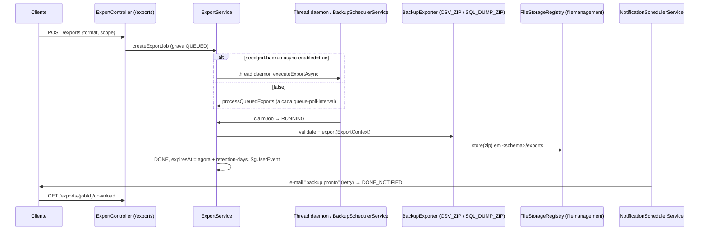

# Backup (extension Quarkus)

Extensão Quarkus para **exportação/backup de dados por tenant e por usuário** (portabilidade LGPD/GDPR): recebe pedidos via REST, cria jobs de export, executa-os de forma assíncrona, gera um ZIP (dados + `manifest.json` + `checksums.txt`), grava o artefato num storage plugável (via `seedgrid-filemanagement`), notifica o solicitante e expira o artefato após um período de retenção.

- Configuração: [[SeedGrid/Extensions/backup/Configuracao|Configuração do backup]]
- Exemplos: [[SeedGrid/Extensions/backup/Exemplos|Exemplos do backup]]
- Enums: [[SeedGrid/Extensions/backup/Enums|Enums do backup]] (`ExportStatus`, `ExportScope`, `BackupFormat`, `ArtifactType`)
- [[SeedGrid/Extensions/backup/Rust|Porte Rust]] (crate `rust/seedgrid-rust-crate-backup`)

## Funcionalidades (Confirmado)

| Funcionalidade | Onde |
|---|---|
| REST `/exports` (criar, listar, status, download, cancelar/excluir) | `runtime/.../controllers/ExportController.java` |
| Ciclo de vida do job `QUEUED → RUNNING → DONE/DONE_NOTIFIED/FAILED/CANCELLED` (`REQUESTED` e `EXPIRED` existem no enum, ver [[SeedGrid/Extensions/backup/Enums#ExportStatus|ExportStatus]]) | `domains/ExportStatus.java`, `services/ExportService.java` |
| Execução assíncrona em thread de plataforma daemon por job (`Thread.ofPlatform().daemon()`), com transações curtas (claim → export sem transação → gravação final) | `ExportService#createExportJob`, `ExportService#executeExport` |
| Fila: jobs `QUEUED` iniciados pelo scheduler respeitando teto global de jobs `RUNNING` | `schedulers/BackupSchedulerService#processQueuedExports` |
| Retenção: limpeza diária (cron fixo `0 1 0 * * ?`, 00:01) de jobs com `expiresAt` vencido + artefatos | `BackupSchedulerService#cleanExpiredExports`, `ExportJobRepositoryImpl#findExpiredJobs` |
| Notificação "backup pronto" por e-mail (Vert.x Mail) com retry | `schedulers/NotificationSchedulerService`, `services/EmailExportNotificationService` |
| Evento CDI `SgUserEvent` (canal `backup`, eventos `backup.finished.success` / `backup.finished.error`) disparado dentro da transação final (observers `AFTER_SUCCESS` recebem após o commit) | `ExportService#notifyRequester`, teste `ExportUserEventIT` |
| Exporters embutidos `CSV_ZIP` e `SQL_DUMP_ZIP` (INSERTs por tabela) | `exporters/CsvZipExporter.java`, `exporters/SqlDumpZipExporter.java` |
| Escopos `DOMAIN` (entidades JPA do metamodel) e `RAW` (tabelas do schema via `information_schema`) | `services/ExtractDataService.java`, `validate()` dos exporters |
| Isolamento por dono: status/download/cancel/delete/listagem filtram por `createUserPublicId` → não-dono recebe 404 | `ExportService#findOwnedJob`, `ExportJobRepository#findByPublicIdAndUser` |
| Rate limit no `POST /exports`: `@SgRateLimit(configKey = "export-create", permits = 10, window = 1, windowUnit = HOURS)` | `ExportController#createExport` |
| Auditoria `@SgAudit` em criar/cancelar/excluir/download | `ExportService` |
| Mapeamento de exceções: `ExportValidationException` → 422, `ExportException` → 500 (Problem Details) | `exceptions/BackupExceptionExtension.java` |

## Módulos Maven e coordenadas (Confirmado — `pom.xml`)

| Módulo | groupId:artifactId | Versão |
|---|---|---|
| parent (pom) | `br.com.seedgrid:seedgrid-backup-parent` | `2026.10.09` |
| runtime | `br.com.seedgrid:seedgrid-backup` | `2026.10.09` |
| deployment | `br.com.seedgrid:seedgrid-backup-deployment` | `2026.10.09` |

Parent: `br.com.seedgrid:seedgrid-parent:2026.07.02`. O host depende só do runtime; o deployment é ligado via `quarkus-extension-maven-plugin` (`META-INF/quarkus-extension.properties`).

## Dependências SeedGrid (Confirmado — `runtime/pom.xml`)

| Artefato | Versão | Uso |
|---|---|---|
| `seedgrid-commons` | 2026.10.08 | `CurrentUserProvider`, `UserContactProvider`, `BaseEntity`, `PageReq`, `SgUserEvent`, `BusinessException`/`SystemSeedGridException` (base `SeedGridException`) |
| `seedgrid-privacy` | 2026.07.08 | fixa convergência de versão (comentário no pom) |
| `seedgrid-filemanagement` | 2026.07.08 | `FileStorageRegistry`, `FileStorage`, `StorageKey`, `StorageOptions` |
| `seedgrid-resilience-core` (+ `-deployment` no deployment) | 2026.07.08 | `@SgRateLimit` |
| `seedgrid-audit-core` | 2026.07.08 | `@SgAudit` (o provider de persistência de auditoria é escolha do host) |
| `seedgrid-audit-postgresql` | 2026.07.08 | **somente `test`** |

Links: [[SeedGrid/Extensions/filemanagement/Visao-geral|filemanagement]], [[SeedGrid/Extensions/resilience/Visao-geral|resilience]], [[SeedGrid/Extensions/audit/Visao-geral|audit]], [[SeedGrid/Extensions/commons/Visao-geral|commons]].

Quarkus/terceiros: `quarkus-arc`, `vertx-mail-client`, `quarkus-qute`, `quarkus-hibernate-orm-panache`, `quarkus-jdbc-postgresql`, `quarkus-flyway`, `quarkus-rest-jackson`, `quarkus-scheduler`, `quarkus-hibernate-validator`, `quarkus-smallrye-openapi`, `commons-csv 1.11.0`, `commons-compress 1.26.0`, Lombok (provided). O e-mail usa `vertx-mail-client` diretamente (não há `quarkus-mailer`).

## Deployment (Confirmado — `deployment/.../BackupProcessor.java`)

- Feature `seedgrid-backup`.
- `ConfigMappingBuildItem(BackupConfig.class, "seedgrid.backup")`.
- Beans unremovable: `ExportService`, `ExtractDataService`, `BackupSchedulerService`, `NotificationSchedulerService`, `EmailExportNotificationService`, `BackupExporterRegistry`, `CsvZipExporter`, `SqlDumpZipExporter`, `DefaultTemplateBackupProvider`, `SingleTenantBackupProvider`, `ExportController`.
- Recurso nativo: `templates/backup-default/html/ready-notification.html`.
- Não há `*BuildTimeConfig`/`@ConfigRoot`.

## Arquitetura e fluxo



Observação (Confirmado): mesmo com `async-enabled=true`, o scheduler de fila também enxerga jobs `QUEUED`; `claimJob` só executa jobs em `REQUESTED`/`QUEUED`, o que evita dupla execução sequencial, mas não há lock pessimista explícito — concorrência entre os dois caminhos é **Não confirmado**.

## APIs públicas e pontos de integração

### Endpoints REST (Confirmado — `ExportController`, `RestControllerPath`)

| Método | Path | Permissão (`@PermissionsAllowed`) | Respostas |
|---|---|---|---|
| POST | `/exports` | `BACKUP_CREATE` | 201 + `ExportResponse`; rate limit `export-create` |
| GET | `/exports?page=&size=` | `BACKUP_READ` | 200 lista do usuário corrente |
| GET | `/exports/{jobId}` | `BACKUP_READ` | 200 / 404 |
| GET | `/exports/{jobId}/download` | `BACKUP_DOWNLOAD` | 200 `application/zip` / 404 (não pronto ou não-dono) / 410 (terminal não baixável) |
| DELETE | `/exports/{jobId}` | `BACKUP_DELETE` | 204 / 404 (cancela se em progresso; senão exclui job + artefatos) |

### SPIs

Detalhes de cada SPI (assinaturas, o que o padrão faz, implementações reais e exemplos): [[SeedGrid/Extensions/backup/SPIs|SPIs]].

_Fonte: código de `seedgrid-quarkus-ext-backup` (versão 2026.10.22, publicada no Maven Central)._

| SPI | Pacote | Implementação padrão (`@DefaultBean`) | Para que serve |
|---|---|---|---|
| `BackupExporter` | `br.com.seedgrid.backup.spis` | sem padrão | Service Provider Interface for backup exporters. |
| `ExportNotificationService` | `br.com.seedgrid.backup.spis` | `EmailExportNotificationService` | SPI for notifying users when an export is ready. |
| `ProgressCallback` | `br.com.seedgrid.backup.spis` | sem padrão | Progress callback interface. |
| `TemplateBackupProvider` | `br.com.seedgrid.backup.spis` | `DefaultTemplateBackupProvider` | SPI para renderizar templates de notificações de backup. |
| `TenantProvider` | `br.com.seedgrid.backup.spis` | `SingleTenantBackupProvider` | Optional provider for tenant context. |

**Como substituir:** declare um bean CDI (`@ApplicationScoped`) que implemente a interface, **sem** `@Alternative` nem `@Priority`; a implementação padrão (`@DefaultBean`) cede. SPI "sem padrão" precisa de uma implementação do host (ou de outro módulo) para o recurso funcionar.

```java
@ApplicationScoped
public class MeuBackupExporter implements BackupExporter {
    // implemente os métodos da interface
}
```

**Detalhes já documentados:**

| Tipo | Default | Como substituir |
|---|---|---|
| `spi.BackupExporter` | `CsvZipExporter` (`CSV_ZIP`), `SqlDumpZipExporter` (`SQL_DUMP_ZIP`) | novo bean CDI; `BackupExporterRegistry` falha no startup se houver 2 para o mesmo `BackupFormat` |
| `spi.TenantProvider` | `configs.SingleTenantBackupProvider` (`@DefaultBean`, tenant fixo `"public"`) | bean próprio (hosts multitenant) |
| `spi.ExportNotificationService` | `services.EmailExportNotificationService` (`@DefaultBean`) | bean próprio |
| `spi.TemplateBackupProvider` | `spi.impl.DefaultTemplateBackupProvider` (`@DefaultBean`; usa `templates/backup/ready-notification.html` do host, senão `templates/backup-default/html/ready-notification.html`; placeholders `{{jobId}}`, `{{format}}`, `{{scope}}`, `{{sizeBytes}}`, `{{finishedAt}}`) | bean próprio ou template no classpath do host |
| `commons.persistence.spis.CurrentUserProvider` | nenhum na extensão | **o host deve fornecer** |
| `commons.spis.UserContactProvider` | nenhum na extensão | necessário para o e-mail (destinatário via `provideByPublicId`) — Inferência: o host/commons fornece |

### Eventos
- `SgUserEvent(userPublicId, "backup", "backup.finished.success" | "backup.finished.error", {exportPublicId, status})` — só quando o job tem `createUserPublicId`.

## Persistência e migrations (Confirmado)

`runtime/src/main/resources/db/migration/backup/`, tabela de histórico Flyway `sg_flyway_schema_history_backup` (definida em `BackupMigrations.HISTORY_TABLE`):

| Arquivo | Conteúdo |
|---|---|
| `V400__backup_ddl.sql` | `sg_export_jobs` e `sg_export_artifacts` (PostgreSQL, `TIMESTAMPTZ`, FK `ON DELETE CASCADE`, coluna `active`) |
| `R__backup_seed.sql` | permissões `BACKUP_CREATE/READ/DOWNLOAD/DELETE` em `sg_permissions`, vinculadas ao papel `ADMIN`. Exige as tabelas da security: o host migra a security antes (a `backup` não depende dela por artefato) |

**Compressão das migrations (2026-10-27):** o histórico anterior (V400 a V403) virou **uma migration de DDL** e, onde há dados iniciais, **um seed repetível** (`R__*.sql`, idempotente). **Sem retrocompatibilidade: banco criado com a versão anterior deve ser recriado** (os checksums mudaram). Estrutura nova depois disso = a próxima `V` da faixa; permissão ou dado inicial novo = uma linha no `R__`.

## Notificação ao terminar o export (publicada em 2026-11-03, `backup` 2026.11.02)

> **Atualização (P186.F4, 2026-11-21):** **backup 2026.11.12** (commit `9030f83`, tag `v2026.11.12`, Nexus): `backup.finished` passa `actionable=true` e `backup.failed` `actionable=false` (payload continua só `{exportPublicId}`, sem URL). O download de export expirado ou falho devolve **410 com corpo JSON** e mensagem legível em português ("Este backup expirou ou falhou e não está mais disponível para download. Gere um novo backup."); antes as respostas de erro do download saíam com `Content-Type: application/zip`, o que impedia o cliente de ler a mensagem (corrigido para 404 e 410). **Exige user-notifications >= 2026.11.6.** Versão **2026.11.13** (dev-3, P187): só bump de dependências, mesmo contrato. Hosts que pinam via `subdomain-tenancy` 2026.11.22 recebem backup .13 e user-notifications .7. Testes: backup 67 verdes; **não testado** de ponta a ponta com o sino do front.

> Plano P130 (`backup` 2026.11.02, commits `af3e93c` e `7928d89`, no Maven Central). Ao terminar o export, com sucesso ou erro, o backup deixa uma notificação na caixa de quem pediu, pelo SPI opcional `ExportInboxNotifier` (tipos `backup.finished` e `backup.failed`, `payload` só `{exportPublicId}`; o download continua pela rota do backup). A dependência da [[SeedGrid/Extensions/user-notifications/Visao-geral|user-notifications]] é `provided`: sem ela o backup funciona igual, e falha da caixa só vira log. A conta de quem pediu fica na coluna nova `sg_export_jobs.inbox_account_public_id` (migration V401), então sobrevive a reinício do servidor. **Confirmado** (relato do dev-2).

## Anotações

_Fonte: código de `seedgrid-quarkus-ext-backup` (versão 2026.10.22, publicada no Maven Central)._

Nenhuma.

## Testes (não executados)

`runtime/src/test/java/br/com/seedgrid/backup/` (Quarkus DevServices PostgreSQL 16, migrations de teste em `db/testdata/backup`):
- `controllers/ExportResourceIT` — endpoints REST; `controllers/ExportAsyncFlowIT` — pipeline assíncrono real com `SingleTenantBackupProvider` (perfil com `async-enabled=true`).
- `exporters/CsvZipExporterIT`, `exporters/SqlDumpZipExporterIT` — geração de ZIP.
- `services/ExtractDataServiceIT` — extração RAW/DOMAIN e exclusões; `services/ExportUserEventIT` — `SgUserEvent` após commit (sucesso/falha).
- `configs/SingleTenantBackupProviderTest`, `utils/ChecksumUtilTest` — unitários.
- Suporte: `TestTenantProvider` (`@Alternative @Priority(1)`), `TestCurrentUserProvider`, `support/SampleDomainEntity`.

## Limitações

- **Atualização (P178, 2026-11-19): backup self-service por empresa.** A partir de backup 2026.11.10, login-tenancy 2026.11.15 e subdomain-tenancy 2026.11.17 (publicados) as permissões `BACKUP_*` passam a `audience` **NULL** (valem em qualquer audience, no front e no admin) e **todo `ADMIN` de uma filial** exporta, só os dados das empresas dele. `POST /exports` aceita `companyPublicIds` (opcional): cada id é validado contra o `allowedCompanies` do token e id fora da lista dá **403**; vazio = todas as empresas do token, **nunca a base inteira**. Quem tem `allCompanies` (administrador da plataforma) continua exportando tudo e também pode escolher empresas. O usuário com mais de uma empresa precisa mandar o header `X-Company-Id` (a security responde 400 sem ele). O job grava o **conjunto** de empresas exportadas (coluna `company_scope_companies`, migration `V403`).
  - **Com `audience` NULL o filtro por empresa é a única barreira contra o vazamento do P169.** Por isso, no export com escopo de empresa (não no do administrador da plataforma): tabela ou entidade sem coluna de empresa **não sai** (falha fechada); nenhuma coluna ou campo com `_hash`, `password`, `secret` ou `token` no nome sai, e `sg_api_keys` não sai (propriedades `seedgrid.backup.scoped-sensitive-column-patterns` e `seedgrid.backup.scoped-excluded-tables`).
  - **O que o backup do cliente leva e o que não leva.** Leva as tabelas com coluna de empresa (por exemplo `sg_accounts`, `sg_roles`, `sg_user_companies`, `sg_user_company_roles`, `sg_business_day_*` da empresa, `sg_entry_requests`, `sg_terms_acceptance`) e, por regra própria de cada host: os **usuários da empresa** pelo vínculo `sg_user_companies`, só com `id`, `public_id`, `email`, `name`, `whats_app`, `active`, `email_confirmed_at`, `created_at` e `updated_at`; os **anexos** (`sg_attachments`) cujo `owner_key` é o `publicId` da empresa; e as **notificações** do usuário (`sg_user_notification`). Não leva: dados de referência compartilhados (cities, exchange, ai-pricing, `sg_business_day_reference_holidays`), segurança e tokens (`sg_permissions`, `sg_role_permissions`, `sg_user_roles`, `sg_refresh_tokens`, `sg_password_history`, `sg_backup_codes` e afins), controle de tenant (`sg_tenants`, `sg_tenant_migration_state`, `sg_schema_release`) e do próprio backup (`sg_export_jobs`, `sg_export_artifacts`), além de auditoria, cobrança e planos (`sg_audit_log*`, `sg_billing_*`, `sg_plans`, `sg_plan_term*`, `sg_subscription_billing_cycles`, `sg_tenant_subscriptions`), que não têm coluna de empresa. A lista foi conferida no banco vivo do login-tenancy.
  - **Para que serve cada backup.** O **backup do cliente** (escopo de empresa, sem hash nem token; `email_hash` fica de fora) é **portabilidade e consulta**: o dono da empresa leva os próprios dados. Ele **não** restaura login e **não** é recuperação de desastre. O **backup da plataforma** (`allCompanies`) é a **base do futuro restore**: leva os hashes de senha e os hashes de busca (`email_hash`, `whats_app_hash`, `rep_*_hash`); por decisão do dono (P178.F0.D4 e F0.D6, 2026-11-19) ficam de fora, desde backup 2026.11.10, os tokens vivos (redefinição de senha, confirmação de e-mail, `sg_refresh_tokens`), o histórico de senhas (`sg_password_history`), o **2FA inteiro** (segredo TOTP, marcas de 2FA ativo e `sg_backup_codes`: o usuário restaurado volta sem 2FA e ativa de novo se quiser), as senhas temporárias (`temp_new_password`, `pending_bootstrap_password`) e os segredos de outras tabelas (cadastros pendentes, convites, login social, checkout, entrega de notificação). Um teste de guarda no `login-tenancy` reprova coluna nova com `secret`, `token`, `password`, `temp`, `pending` ou `two_factor` que não esteja entre as mantidas ou omitidas. **O módulo só exporta: não existe importador nem procedimento de restore** (o `SQL_DUMP_ZIP` leva só dados, sem DDL) e não há plano para criá-lo. Um restore futuro precisa das mesmas chaves `SEEDGRID_PRIVACY_CRYPTO_KEY` e `SEEDGRID_PRIVACY_SEARCH_KEY`; sem elas o e-mail restaurado não decifra e a busca por e-mail quebra.
  - **Notificações:** só saem as do escopo (`account_public_id` da empresa pedida, além do vínculo do usuário); um usuário de duas empresas não leva no backup de uma as notificações da outra (as versões login-tenancy 2026.11.13 e 2026.11.14, subdomain-tenancy 2026.11.15 e 2026.11.16 e backup 2026.11.8 e 2026.11.9 têm defeito ou não têm as omissões da plataforma e não devem ser usadas). Limite: 10 exports por hora **por usuário do token** (chave = tenant + método + usuário; `seedgrid.ratelimit.export-create`); desde backup 2026.11.10 o `X-Forwarded-For` não entra na chave (antes caía num balde global "anonymous"); a requisição recusada com 403 também conta. `POST /exports` responde 201.
- **Atualização (P169, 2026-11-18):** a partir de backup 2026.11.7 (publicado; a 2026.11.6 do Nexus é a com vazamento) o export `RAW` e o `DOMAIN` filtram pela empresa do pedido e o `RAW` respeita a exclusão por pacote; `BACKUP_*` passaram a `audience=platform` (**substituído pelo P178 acima: agora `audience` NULL**). Veja [[SeedGrid/Extensions/backup/Configuracao|Configuração]] e [[SeedGrid/Extensions/login-tenancy/Escopo-e-exclusao-no-dominio-do-host|Escopo e export no domínio do host]]. O texto a seguir descreve as **versões anteriores**.
- **O export (versões anteriores) não filtra linhas por empresa nem por pessoa** (conferido no código em 2026-11-01). `ExtractDataService` faz `SELECT * FROM <schema>.<tabela>` para cada entidade (`DOMAIN`) ou tabela (`RAW`); o dono do **job** é isolado por `createUserPublicId`, o **conteúdo** não. Em banco compartilhado (login-tenancy), quem tem `BACKUP_CREATE` exporta as linhas de todas as contas. Não conceda `BACKUP_CREATE` a usuário de cliente e exclua os pacotes de entidades do host em `seedgrid.backup.excluded-domain-entity-packages`. Para "exportar meus dados" o host precisa de endpoint próprio. Ver [[SeedGrid/Extensions/login-tenancy/Escopo-e-exclusao-no-dominio-do-host|Escopo, exclusão de conta e export no domínio do host]].
- `options` do `ExportRequest` (mapa livre) é serializado no job e repassado ao `ExportContext` (`getOptions()`/`getOption(key, default)`); os exporters embutidos não leem nenhuma opção — só exporters customizados podem usá-lo. **Confirmado** (`ExportService#buildExportContext`).
- Limpeza por retenção tem cron fixo (`0 1 0 * * ?`), não configurável. **Confirmado**.
- Banco: PostgreSQL (migrations, `information_schema`, `gen_random_uuid()`).
- `generateDownloadUrl` (URL assinada) lança `UnsupportedOperationException` no adapter padrão; download passa os bytes pela API.
- Notificação por e-mail fica **ativa por padrão** apontando para `smtp.gmail.com` sem credenciais (fallbacks do `microprofile-config.properties`) — ver [[SeedGrid/Extensions/backup/Configuracao|Configuração]].
- `appVersion("1.0.0")` fixo no manifest (TODO no código).
- **Não é exportação de relatório:** o export do backup é um ZIP de dados do tenant (CSV/SQL) para portabilidade, sem filtro, totais nem fuso. Não existe extension ou lib de relatório CSV/XLSX/PDF na plataforma (Confirmado: nenhuma extension da lista e nenhum `pom.xml` do repositório Java depende de biblioteca de planilha ou PDF); o produto implementa a exportação ou usa o produto seedgrid-report.
