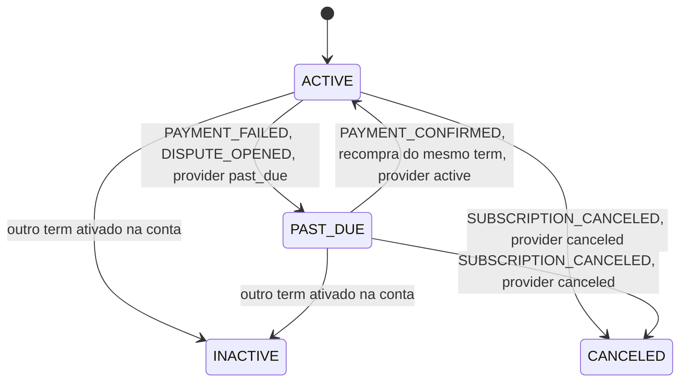

# Billing (Quarkus): enums

Voltar para [[SeedGrid/Extensions/billing/Visao-geral|Visão geral]] · [[SeedGrid/Extensions/billing/Configuracao|Configuração]]. Porte Rust: [[SeedGrid/Extensions/billing/Rust|Rust]].

Nenhum enum é tipo de propriedade de configuração. Nenhum tem `@JsonValue`/`@JsonProperty`: no JSON aparecem pelo **nome da constante** (Jackson padrão, case-sensitive). Todos os enums persistidos usam `@Enumerated(EnumType.STRING)` e as colunas são `varchar` **sem CHECK constraint** nas migrations, então o banco aceita qualquer texto. O módulo `seedgrid-billing-stripe` não define enums: só converte os do core.

## Índice

Arquivos em `java/seedgrid-quarkus-ext-billing/seedgrid-billing-core/runtime/src/main/java/br/com/seedgrid/billing/`.

| Enum | Arquivo | Usado em | Público? |
|---|---|---|---|
| `SubscriptionStatus` | `entities/SubscriptionStatus.java` | `sg_tenant_subscriptions.status`, `AdminSubscriptionRequest.status` | sim |
| `AccountStatus` | `entities/AccountStatus.java` | `accounts.status` | sim (entidade) |
| `PurchaseStatus` | `entities/PurchaseStatus.java` | `sg_billing_purchases.status` | sim (entidade) |
| `AccountHistoryType` | `entities/AccountHistoryType.java` | `sg_billing_account_history.type`; `AccountHistoryResponse.type` (String) | sim |
| `SubscriptionLifecycleEvent.Type` | `dtos/events/SubscriptionLifecycleEvent.java` | evento CDI e códigos `billing.*` | sim |
| `UserAccessEvent.Type` | `dtos/events/UserAccessEvent.java` | evento CDI e e-mails de acesso | sim |
| `BillingEventType` | `dtos/BillingEventType.java` | `BillingEvent.type` (SPIs), `sg_billing_events.type` | sim |
| `RecurringInterval` | `dtos/RecurringInterval.java` | `CreatePriceRequest`, `CreateMeteredPriceRequest`, `PriceInfo` | sim |
| `TiersMode` | `dtos/TiersMode.java` | `CreateMeteredPriceRequest.tiersMode` | sim |
| `AggregationFormula` | `dtos/AggregationFormula.java` | `CreateMeterRequest.aggregation` | sim |

## SubscriptionStatus
FQN `br.com.seedgrid.billing.entities.SubscriptionStatus`. STRING em `sg_tenant_subscriptions.status varchar(32)` (V509), sem CHECK. Sem campos nem métodos.

| Valor | Significado | Efeito / onde é tratado | Observações |
|---|---|---|---|
| `ACTIVE` | Assinatura em vigor. | Vigente = `ACTIVE` ou `PAST_DUE` já iniciada e não terminada (`Subscription#isResolvable`, `SubscriptionRepository`). Default no `@PrePersist`. | Confirmado. Cancelamento agendado (`cancelAtPeriodEnd`) segue `ACTIVE` até o provider avisar. |
| `PAST_DUE` | Pagamento falhou (dunning no provider). | Continua vigente para a UI e **sempre bloqueia consumo** (`SubscriptionAccessService`). Bloqueia o acesso geral só se `seedgrid.billing.access-gate.block-past-due=true` (ver [[SeedGrid/Extensions/billing/Configuracao|Configuração]]). | Confirmado. |
| `INACTIVE` | Substituída por outra assinatura (checkout de outro plano, fim do trial). | Deixa de ser vigente. `SubscriptionActivationService#activate` também fixa `endsAt = agora`. | Confirmado. |
| `CANCELED` | Encerrada. | Definida por `SUBSCRIPTION_CANCELED` e por `syncFromProvider` quando o provider diz `canceled`/`incomplete_expired`; preenche `endsAt` se nulo. | Confirmado. |

Mapeamento de status do provider (`SubscriptionActivationService#mapProviderStatus`): `active`, `trialing` → `ACTIVE`; `past_due`, `unpaid` → `PAST_DUE`; `canceled`, `incomplete_expired` → `CANCELED`; qualquer outro → nada muda.

Também pode ser enviado em `POST /admin/subscriptions` (`AdminSubscriptionRequest.status`, qualquer valor do enum; ausente = `ACTIVE`). O filtro `active`/`inactive` da listagem admin é texto livre, não este enum.

## AccountStatus
FQN `br.com.seedgrid.billing.entities.AccountStatus`. STRING em `accounts.status varchar(64)` (V502), sem CHECK.

| Valor | Significado | Efeito / onde é tratado | Observações |
|---|---|---|---|
| `PENDING_EMAIL_VERIFICATION` | Conta criada, e-mail ainda não verificado. | Default quando o status é nulo (`Account#prePersist`). | Confirmado. Nenhum código consulta esse valor. |
| `ACTIVE` | Conta ativa. | `AccountCreationService` grava `ACTIVE` ao criar a conta. | Confirmado. |
| `SUSPENDED` | Conta suspensa. | **Existe no enum, mas nenhum código grava ou trata esse valor.** Gravado direto no banco, não tem efeito. | Confirmado por busca no módulo. |

Na prática o status da conta não influencia o acesso: quem decide é a assinatura.

## PurchaseStatus
FQN `br.com.seedgrid.billing.entities.PurchaseStatus`. STRING em `sg_billing_purchases.status varchar(64)` (V509), sem CHECK.

| Valor | Significado | Efeito / onde é tratado | Observações |
|---|---|---|---|
| `PENDING` | Compra registrada, não confirmada. | Default em `Purchase#prePersist`. | Nenhum fluxo grava `PENDING` explicitamente. |
| `PAID` | Pagamento confirmado. | `SubscriptionBillingEventHandler#handlePayment` grava em `CHECKOUT_COMPLETED`/`PAYMENT_CONFIRMED`. `PurchaseRepository` filtra `PAID`. | Confirmado. |
| `FAILED` | Compra falhou. | **Existe no enum, mas nenhum código grava ou consulta esse valor.** `PAYMENT_FAILED` só altera a assinatura. | Confirmado. |
| `REFUNDED` | Reembolsada. | `REFUND_CREATED` marca a compra localizada por `providerReference`. | Confirmado. Como a consulta usa só `PAID`, deixa de contar. |

## AccountHistoryType
FQN `br.com.seedgrid.billing.entities.AccountHistoryType`. STRING em `sg_billing_account_history.type varchar(40)` (V511), sem CHECK. O método `static of(SubscriptionLifecycleEvent.Type)` faz `valueOf(type.name())`: os 9 primeiros valores **precisam** ter o mesmo nome das constantes de `SubscriptionLifecycleEvent.Type`.

| Valor | Significado | Efeito / onde é tratado | Observações |
|---|---|---|---|
| `ACTIVATED` | Assinatura ativada. | Gravado por `AccountHistoryService` ao receber o evento de ciclo de vida. | Espelha o evento. |
| `UPGRADED` | Upgrade. | Contado no overview (`BillingOverviewService`). | Espelha o evento. |
| `DOWNGRADE_SCHEDULED` | Downgrade agendado. | Contado no overview como downgrade. | Espelha o evento. |
| `DOWNGRADE_CANCELED` | Downgrade desfeito. | Só histórico. | Espelha o evento. |
| `CANCELLATION_REQUESTED` | Cancelamento pedido. | Só histórico. | Espelha o evento. |
| `CANCELED` | Cancelamento efetivado. | Só histórico. | Espelha o evento. |
| `REACTIVATED` | Reativada. | Só histórico. | Espelha o evento. |
| `PAST_DUE` | Pagamento pendente. | Só histórico. | Espelha o evento. |
| `TRIAL_ENDED` | Trial encerrado. | Só histórico. | Espelha o evento. |
| `UNITS_GRANTED` | Unidades extras concedidas no ciclo. | `AdminAccountService` (`POST /admin/accounts/{id}/grant-units`). | Só do admin. |
| `TRIAL_EXTENDED` | Dias a mais no trial. | `AdminAccountService` (`POST .../grant-trial-days`). | Só do admin. |

A resposta REST (`AccountHistoryResponse.type`) é `String`: sai o nome da constante.

## SubscriptionLifecycleEvent.Type
FQN `br.com.seedgrid.billing.dtos.events.SubscriptionLifecycleEvent.Type`. Não persistido diretamente (vira `AccountHistoryType`).

| Valor | Significado | Disparado por | Código de notificação |
|---|---|---|---|
| `ACTIVATED` | Nova assinatura ativada. | `SubscriptionBillingEventHandler#handlePayment` | `billing.subscription-activated` |
| `UPGRADED` | Plano de preço igual ou maior. | `SubscriptionChangeService` | `billing.subscription-upgraded` |
| `DOWNGRADE_SCHEDULED` | Downgrade agendado para o fim do ciclo. | `SubscriptionChangeService` | `billing.subscription-downgraded` |
| `DOWNGRADE_CANCELED` | Downgrade desfeito. | `SubscriptionChangeService` | `billing.downgrade-canceled` |
| `CANCELLATION_REQUESTED` | Cancelamento no fim do período pedido. | `SubscriptionChangeService` | `billing.cancellation-requested` |
| `CANCELED` | Assinatura encerrada. | `SubscriptionBillingEventHandler` (`SUBSCRIPTION_CANCELED`) | `billing.subscription-canceled` |
| `REACTIVATED` | Cancelamento agendado revertido. | `SubscriptionChangeService` | `billing.subscription-reactivated` |
| `PAST_DUE` | Pagamento falhou. | `SubscriptionBillingEventHandler` (`PAYMENT_FAILED`) | `billing.payment-past-due` |
| `TRIAL_ENDED` | Trial terminou; `reason` = `TIME` ou `QUOTA`. | `TrialEndedNotifier` (uma vez por assinatura) | `billing.trial-ended` |

Confirmado em `BillingLifecycleNotificationObserver` (switch exaustivo). `DISPUTE_OPENED` coloca a assinatura em `PAST_DUE`, mas **não dispara** este evento.

## UserAccessEvent.Type
FQN `br.com.seedgrid.billing.dtos.events.UserAccessEvent.Type`. Não persistido.

| Valor | Significado | Disparado por | Efeito |
|---|---|---|---|
| `LOSS_SCHEDULED` | Usuário escolhido para perder acesso quando o plano com menos vagas valer. | `SeatService` | `UserAccessEmailObserver` envia `accessLoss` com data. |
| `LOSS_APPLIED` | Perdeu o acesso agora. | `SeatService` | `accessLoss` imediato. |
| `RESTORED` | Estava escolhido, mas o downgrade foi desfeito. | `SeatService` | `accessRestored`. |

## BillingEventType
FQN `br.com.seedgrid.billing.dtos.BillingEventType`. Campo `BillingEvent.type`. Persistido por nome em `sg_billing_events.type varchar(50)` (idempotência do webhook). Evento Stripe não mapeado gera `UnsupportedEventException` e resposta 204.

| Valor | Significado | Efeito no `SubscriptionBillingEventHandler` | Origem no Stripe |
|---|---|---|---|
| `CHECKOUT_COMPLETED` | Checkout concluído. | Registra a compra `PAID` e ativa o term do metadata. Sem term, só registra a compra. | `checkout.session.completed` |
| `PAYMENT_CONFIRMED` | Fatura paga. | Regulariza `PAST_DUE`, efetiva a virada de ciclo, registra a compra e ativa o term se houver metadata. | `invoice.paid` |
| `PAYMENT_FAILED` | Falha de pagamento. | Marca `PAST_DUE` e dispara `PAST_DUE`. | `invoice.payment_failed` |
| `SUBSCRIPTION_CREATED` | Assinatura criada no provider. | **Existe no enum e o Stripe o emite, mas o handler não o trata** (cai no `default`, sem efeito). | `customer.subscription.created` |
| `SUBSCRIPTION_UPDATED` | Assinatura alterada. | Sincroniza status e `cancelAtPeriodEnd` com o provider. | `customer.subscription.updated` |
| `SUBSCRIPTION_CANCELED` | Assinatura cancelada. | `CANCELED` e dispara `CANCELED`. | `customer.subscription.deleted` |
| `REFUND_CREATED` | Reembolso. | Compra → `REFUNDED`. | `charge.refunded` |
| `DISPUTE_OPENED` | Disputa aberta. | Suspende (`PAST_DUE`) as assinaturas do customer. | `charge.dispute.created` |

## RecurringInterval
FQN `br.com.seedgrid.billing.dtos.RecurringInterval`.

| Valor | Significado | Efeito | Observações |
|---|---|---|---|
| `DAY` | Diário. | Stripe `Interval.DAY`; leitura `"day"`. | O core só usa `MONTH`. |
| `WEEK` | Semanal. | Stripe `WEEK`; leitura `"week"`. | idem |
| `MONTH` | Mensal. | Stripe `MONTH`. **Default** para `null` e para qualquer string desconhecida na leitura. | `PlanPublicationService` sempre envia `MONTH`. |
| `YEAR` | Anual. | Stripe `YEAR`; leitura `"year"`. | — |

## TiersMode
FQN `br.com.seedgrid.billing.dtos.TiersMode`.

| Valor | Significado | Efeito | Observações |
|---|---|---|---|
| `GRADUATED` | Cada faixa cobra seu preço pela parcela que cai nela (Javadoc). | Stripe `TiersMode.GRADUATED`; é o resultado para `null`. | O core não usa tiers. |
| `VOLUME` | Toda a quantidade é cobrada no preço da faixa do total (Javadoc). | Stripe `TiersMode.VOLUME`. | idem |

## AggregationFormula
FQN `br.com.seedgrid.billing.dtos.AggregationFormula`. Default `SUM` quando `null`.

| Valor | Significado | Efeito | Observações |
|---|---|---|---|
| `SUM` | Soma dos valores de uso. | Stripe `Formula.SUM`. Único usado pelo core (`PlanPublicationService`). | Default. |
| `COUNT` | Contagem de eventos. | Stripe `Formula.COUNT`. | — |
| `LAST` | Último valor do período. | **O provider Stripe não implementa**: cai em `SUM` (comentário no código: o SDK só expõe SUM e COUNT). | Confirmado em `StripeBillingProvider#toMeterFormula`. |

## Internos
Nenhum enum interno em `seedgrid-billing-core` nem em `seedgrid-billing-stripe` (fora dos testes).
