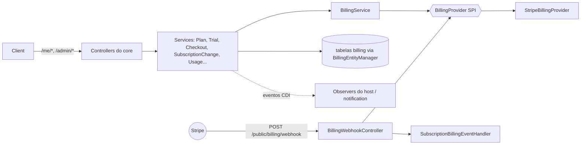

# Billing (Quarkus): visão geral

Assinaturas prontas para hosts Quarkus. Cobre planos, condições comerciais (terms), trial, checkout, portal do cliente, troca de plano, cancelamento, ciclo de cobrança, contadores de uso (franquia e excedente por contador) e webhook. Tudo é exposto em endpoints REST da própria extension. O gateway de pagamento fica atrás da SPI `BillingProvider`, e há um provider pronto para **Stripe**.

- Configuração: [[SeedGrid/Extensions/billing/Configuracao|Configuração do billing]]
- Exemplos: [[SeedGrid/Extensions/billing/Exemplos|Exemplos do billing]]
- Enums: [[SeedGrid/Extensions/billing/Enums|Enums do billing]]
- Porte Rust: [[SeedGrid/Extensions/billing/Rust|Porte Rust]]

> Segundo o README, "o host não conhece billing": ele adiciona a dependência e configura `seedgrid.billing.*`. Não escreve controller, entity, migration nem handler de webhook. Se cobra por uso, declara os contadores (`UsageMeterContributor`) e marca onde contar (`@SgConsumesUsage`). **Confirmado** (README e `integration-tests`, que sobem um app sem nenhuma classe de billing própria).

## Módulos Maven e coordenadas

Agregador: `br.com.seedgrid:seedgrid-billing:2026.10.14-1` (parent `br.com.seedgrid:seedgrid-parent:2026.07.02`).

| Submódulo | Parent | Artefatos | Papel |
|---|---|---|---|
| `seedgrid-billing-core` | `seedgrid-billing-parent:2026.10.14-1` | runtime `seedgrid-billing-core`, deployment `seedgrid-billing-core-deployment`, `integration-tests` (não publicado) | modelo, REST, regras, SPIs, migrations |
| `seedgrid-billing-stripe` | `seedgrid-billing-stripe-parent:2026.10.14-1` | runtime `seedgrid-billing-stripe`, deployment `seedgrid-billing-stripe-deployment`, `integration-tests` | `StripeBillingProvider` (stripe-java `26.12.0`) e `StripeProductBootstrap` |

O groupId é sempre `br.com.seedgrid`. As features Quarkus são `seedgrid-billing-core` e `seedgrid-billing-stripe`, declaradas em `SeedgridBillingProcessor` e `SeedgridBillingStripeProcessor`.

### Dependências SeedGrid (runtime do core)

| Artefato | Versão no pom | Para quê |
|---|---|---|
| `seedgrid-security` | 2026.10.08 | `Company`, `User`, `Permission`, `@SgPlatformScope`, `UserService.deactivateUserInCompany` |
| `seedgrid-commons` | 2026.10.08 | `ApiExceptionExtension`, `ProblemType`, `BaseEntity` |
| `seedgrid-audit-core` | 2026.09.25 | `@SgAudit` em serviços administrativos |
| `seedgrid-privacy` | 2026.07.27 | dependência declarada (uso específico não investigado) |
| `seedgrid-resilience-core` | 2026.07.08 | `@SgRateLimit` no webhook, checkout e portal |
| `seedgrid-notification-api` | 2026.10.08 (`seedgrid.notification.version`) | catálogo e publicação dos eventos `billing.*` |

Também depende do Quarkus: `arc`, `hibernate-orm`, `jdbc-postgresql`, `flyway`, `rest-jackson`, `hibernate-validator` e `smallrye-openapi`.

**Quem depende do billing:** `login-tenancy` e `subdomain-tenancy` (o billing não conhece nenhum deles). Ver [[SeedGrid/Extensions/login-tenancy/Visao-geral|login-tenancy]] e [[SeedGrid/Extensions/subdomain-tenancy/Visao-geral|subdomain-tenancy]].

## Arquitetura



Pacotes de `br.com.seedgrid.billing`:

| Pacote | Conteúdo |
|---|---|
| `annotations` | `@SgConsumesUsage`, `@SgRequiresPlanFeature` |
| `configs` | `BillingConfig`, mais um `@ConfigMapping` por grupo e `BusinessTimeZone` |
| `controllers` | `AdminPlan`, `AdminSubscription`, `AdminAccount`, `AdminBilling`, `Subscription`, `PlanCatalog`, `Usage`, `MeBilling`, `BillingWebhook`, `RestControllerPath` |
| `filters` | `BillingApiToggleFilter` (api.enabled), `AccessGateFilter` (bloqueio geral), `BillingApiOpenApiFilter` |
| `interceptors` | interceptors das duas anotações |
| `repositories` | JPA puro sobre `BillingEntityManager` |
| `services` | regras de negócio |
| `spis` (+`impl`) | pontos de extensão |
| `notifications` | `BillingNotificationCatalog`, `BillingLifecycleNotificationObserver`, `UserAccessEmailObserver` |

No **build**, o deployment coleta todo `@SgConsumesUsage` e cria o bean sintético `ConsumesUsageSites`. No **startup**, `UsageMeterCatalog` recusa um contador não declarado e informa o método na mensagem. **Confirmado** (`SeedgridBillingProcessor#consumesUsageSites`).

Modelo: `Plan` 1:N `PlanTerm` 1:N `PlanTermMeter`. `Account` 1:N `Subscription` (N:1 `PlanTerm`) 1:N `BillingCycle` 1:N `BillingCycleMeter`. `Account` 1:N `Purchase`. **Confirmado** (`entities/`).

## APIs públicas e pontos de integração

### Anotações

_Fonte: código de `seedgrid-quarkus-ext-billing` (versão local 2026.10.22, não publicada)._

| Anotação | Pacote | Onde se aplica | Atributos (padrão) | Para que serve |
|---|---|---|---|---|
| `@SgConsumesUsage` | `br.com.seedgrid.billing.annotations` | `METHOD`, `TYPE` | `meter`, `units` (`1`) | O metodo consome `#units()` unidades do contador `#meter()` da conta corrente. |
| `@SgRequiresPlanFeature` | `br.com.seedgrid.billing.annotations` | `METHOD`, `TYPE` | `value` (`""`), `message` (`""`) | O plano vigente da conta corrente precisa incluir a permissao `#value()`; senao 402 `FEATURE_NOT_IN_PLAN` (ou `TRIAL_EXPIRED`, se o trial venceu). |

**Detalhes já documentados:**

- `@SgConsumesUsage(meter = "...", units = 1)`: checa antes da execução e contabiliza só se o método retornar normalmente. O `meter` é obrigatório.
- `@SgRequiresPlanFeature(value = "PERMISSAO", message = "")`: responde 402 `FEATURE_NOT_IN_PLAN` (ou `TRIAL_EXPIRED`).

### SPIs

Detalhes de cada SPI (assinaturas, o que o padrão faz, implementações reais e exemplos): [[SeedGrid/Extensions/billing/SPIs|SPIs]].

_Fonte: código de `seedgrid-quarkus-ext-billing` (versão local 2026.10.22, não publicada)._

| SPI | Pacote | Implementação padrão (`@DefaultBean`) | Para que serve |
|---|---|---|---|
| `AccountCompaniesGateway` | `br.com.seedgrid.billing.spis` | `CompanyAccountCompaniesGateway` | As empresas de uma conta de billing, no banco onde elas moram. |
| `AccountMembersGateway` | `br.com.seedgrid.billing.spis` | `CompanyAccountMembersGateway` | Os usuarios de uma conta de billing, no banco onde eles moram. |
| `BillingAccountScope` | `br.com.seedgrid.billing.spis` | `UnrestrictedBillingAccountScope` | Implementado pelo host para restringir as contas que o usuario logado enxerga nas telas administrativas (`/admin/accounts`, `/admin/subscriptions` e os agregados de `/admin/billing/overview`). |
| `BillingCatalogProvider` | `br.com.seedgrid.billing.spis` | sem padrão | Capacidade OPCIONAL de gestão de catálogo (produtos/preços) no provider. |
| `BillingEventHandler` | `br.com.seedgrid.billing.spis` | `SubscriptionBillingEventHandler` | SPI que o host/aplicação deve implementar para processar eventos de billing. |
| `BillingProvider` | `br.com.seedgrid.billing.spis` | sem padrão | SPI principal que cada provider de billing deve implementar. |
| `BillingUsageProvider` | `br.com.seedgrid.billing.spis` | sem padrão | Capacidade OPCIONAL de cobrança por uso (meters/metered prices) no provider. |
| `CurrentAccountResolver` | `br.com.seedgrid.billing.spis` | `DefaultCurrentAccountResolver` | Quem esta chamando: usuario, empresa e conta de billing da requisicao corrente. |
| `PlanTermAdditionalFieldsValidator` | `br.com.seedgrid.billing.spis` | `DefaultPlanTermAdditionalFieldsValidator` | Regras do PRODUTO sobre os `additionalAttributes` de um term (ex.: `monthlyRequests` inteiro positivo). |
| `PlanTermUsageChecker` | `br.com.seedgrid.billing.spis` | `DefaultPlanTermUsageChecker` | "Este plano tem movimento?" alem das assinaturas, que o billing ja conta sozinho. |
| `UsageMeterContributor` | `br.com.seedgrid.billing.spis` | sem padrão | Os CONTADORES de uso do produto (requisicoes, MB armazenados, notas emitidas...). |

**Como substituir:** declare um bean CDI (`@ApplicationScoped`) que implemente a interface, **sem** `@Alternative` nem `@Priority`; a implementação padrão (`@DefaultBean`) cede. SPI "sem padrão" precisa de uma implementação do host (ou de outro módulo) para o recurso funcionar.

```java
@ApplicationScoped
public class MeuAccountCompaniesGateway implements AccountCompaniesGateway {
    // implemente os métodos da interface
}
```

**Detalhes já documentados:**

| SPI | Default | Assinatura principal |
|---|---|---|
| `BillingProvider` | — (fornecido por `seedgrid-billing-stripe`) | `createCheckout`, `createPortal`, `parseAndVerifyWebhook`, `changeSubscriptionPlan(..., List<String> newMeteredPriceIds)`, ... |
| `BillingCatalogProvider` | — (opcional; Stripe implementa) | `createPrice`, `ensureProduct`, `archivePrice`, ... |
| `BillingUsageProvider` | — (opcional; Stripe implementa) | `ensureMeter`, `createMeteredPrice`, `reportUsage` |
| `UsageMeterContributor` | nenhum contador | `List<UsageMeterDefinition> meters()` (`record UsageMeterDefinition(String code, String label)`) |
| `PlanTermAdditionalFieldsValidator` | `DefaultPlanTermAdditionalFieldsValidator` | `validate(PlanTerm, Map<String, JsonNode>)` |
| `PlanTermUsageChecker` | `DefaultPlanTermUsageChecker` | `isInUse(Collection<Long>)` |
| `CurrentAccountResolver` | `DefaultCurrentAccountResolver` | `requireCurrentUser()`, `requireCurrentAccount()`, `billingContactEmail()` |
| `AccountMembersGateway` | `CompanyAccountMembersGateway` | `activeUsers`, `isResponsible`, `deactivate`, `findByPublicIds` |
| `BillingAccountScope` | `UnrestrictedBillingAccountScope` | `Optional<Set<Long>> visibleCompanyIds()` |
| `BillingEventHandler` | `SubscriptionBillingEventHandler` | `handle(BillingEvent)` |

> **Inferência:** um host precisa de **exatamente um** bean `BillingProvider`. `BillingService` o injeta direto, e os testes usam dublês (`NoopBillingProvider`, `FakeBillingProvider`). Sem o módulo Stripe nem provider próprio, a injeção ficaria insatisfeita. Não executei para confirmar.

### Serviço programático
`UsageService#assertCanConsume(Account, String meter, int units)` e `UsageService#consume(Account, String meter, int units, String idempotencyKey)`. O `consume` é `@Transactional` e retorna `UsageConsumedEvent`.

### Endpoints REST (`RestControllerPath`)
| Método | Caminho | Acesso |
|---|---|---|
| GET/POST | `/admin/plans` | plataforma + `PLAN_READ`/`PLAN_CREATE` |
| GET/PUT/DELETE | `/admin/plans/{planId}` | plataforma + `PLAN_*` |
| GET/POST | `/admin/plans/{planId}/terms` | plataforma + `PLAN_TERM_*` |
| PATCH/DELETE | `/admin/plans/{planId}/terms/{termId}` | plataforma + `PLAN_TERM_*` |
| POST | `/admin/plans/{planId}/terms/{termId}/publish`, `/archive` | plataforma + `PLAN_TERM_*` |
| GET/PATCH | `/admin/plans/trial` | plataforma + `PLAN_TERM_*` |
| GET/POST | `/admin/subscriptions` | plataforma + `SUBSCRIPTION_*` |
| GET | `/admin/accounts`, `/admin/accounts/{accountId}`, `/admin/accounts/options`, `/admin/accounts/{accountId}/history` | plataforma + `ACCOUNT_READ`/`ACCOUNT_OPTIONS_READ` |
| POST | `/admin/accounts/{accountId}/grant-units`, `/grant-trial-days` | plataforma + `ACCOUNT_GRANT_USAGE` |
| GET | `/admin/billing/meters`, `/admin/billing/overview` | plataforma |
| GET | `/me/subscription`, `/me/plans`, `/me/usage` | autenticado |
| GET/POST | `/me/billing/checkout`, `/me/billing/checkout/preview` | autenticado |
| POST | `/me/billing/portal`, `/change-plan`, `/cancel`, `/reactivate`, `/cancel-scheduled-change`, `/trial-ended` | autenticado |
| GET | `/me/billing/change-preview`, `/invoices`, `/upcoming` | autenticado |
| GET/PUT | `/me/billing/downgrade-user-selection` | autenticado |
| POST | `/public/billing/webhook` | pública (assinatura do provider) |

Os caminhos são **Confirmados** em `RestControllerPath`. As permissões vêm do README. Com `seedgrid.billing.api.enabled=false`, todos os prefixos exceto o webhook respondem 404 e somem do OpenAPI (`RestControllerPath.API_PREFIXES`).

Rate limit via resilience (**Confirmado**, `@SgRateLimit`):

| configKey | Endpoint | Limite |
|---|---|---|
| `billing-webhook` | webhook | 300/min |
| `billing-checkout` | `POST /me/billing/checkout` | 30/min |
| `billing-portal` | `POST /me/billing/portal` | 30/min |

### Eventos CDI
| Evento | Tipos | Observação |
|---|---|---|
| `SubscriptionLifecycleEvent` | `ACTIVATED, UPGRADED, DOWNGRADE_SCHEDULED, DOWNGRADE_CANCELED, CANCELLATION_REQUESTED, CANCELED, REACTIVATED, PAST_DUE, TRIAL_ENDED` | Disparado dentro da transação. Após o commit, a extension publica `billing.*` no notification. |
| `UserAccessEvent` | `LOSS_SCHEDULED, LOSS_APPLIED, RESTORED` | A extension envia o e-mail (templates `templates/billing-default/`, sobrescrevíveis em `templates/billing/`). |
| `UsageConsumedEvent` | — | Um por consumo contabilizado, com o `meter`. |

### Stripe (`seedgrid-billing-stripe`)
- `StripeBillingProvider` implementa `BillingProvider`, `BillingCatalogProvider` e `BillingUsageProvider`.
- Mapeia os eventos Stripe para `BillingEventType`: `checkout.session.completed`, `invoice.paid`, `invoice.payment_failed`, `customer.subscription.created/updated/deleted`, `charge.refunded`, `charge.dispute.created`.
- Com chave `sk_test*`, cria customers presos a um Test Clock (desligável).
- `StripeProductBootstrap` garante o produto base no startup (best-effort).

## Migrations
`db/migration/billing`, de **V500 a V513** (tabela de histórico default `sg_flyway_schema_history_billing`):

| Versão | Conteúdo |
|---|---|
| V500 | `sg_billing_events` |
| V501 | permissões de checkout/portal |
| V502 | `sg_accounts`, `sg_plans`, `sg_plan_terms` |
| V503 | timestamps com fuso |
| V504 | `max_users`, `sg_plan_term_permissions` |
| V505 | plano/term TRIAL com IDs fixos |
| V506 | `trial_days` |
| V507 | `additional_attributes jsonb` |
| V508 | colunas `BaseEntity` |
| V509 | `sg_tenant_subscriptions`, `sg_subscription_billing_cycles`, `sg_billing_purchases` |
| V510 | permissões `PLAN_*`, `PLAN_TERM_*`, `SUBSCRIPTION_*` |
| V511 | `sg_billing_account_history`, permissões `ACCOUNT_*` |
| V512 | audiences |
| V513 | `sg_plan_term_meters`, `sg_billing_cycle_meters` |

**Confirmado** (arquivos SQL e README do core).

## Testes (não executados)
- `seedgrid-billing-core/runtime/src/test`: unitários Mockito sem Quarkus. Cobrem services (`UsageServiceTest`, `SeatServiceTest`, `TrialEndedNotifierTest`, `PlanPublicationServiceTest`...), filtros (`AccessGateFilterTest`, `BillingApiToggleFilterTest`, `BillingPathsTest`), `BillingEntityManagerTest` e notificações.
- `seedgrid-billing-core/integration-tests`: PostgreSQL via Testcontainers. Cobrem `SubscriptionFlowTest`, `UsageTest`, `FeatureGateTest`, `AccessGateEnabledTest`, `ApiDisabledTest`, `AdminAccountTest`, `AdminAccountScopeTest`, `AdminPlanTest`, `BillingOverviewTest`, `LegacyHostSchemaMigrationTest`, entre outros.
- `deployment/src/test`: smoke (`SeedgridBillingTest`, `SeedgridBillingDevModeTest`, `SeedgridBillingStripeTest`...).
- `seedgrid-billing-stripe/runtime/src/test`: `StripeBillingProviderTest`.

## Limitações
- Colunas antigas (`sg_plan_terms.overage_price`, `provider_overage_price_id`, `sg_subscription_billing_cycles.*_units`) continuam no banco, **inertes**, até o seedgrid-report migrar os dados (CHANGELOG 2026.10.08).
- O billing depende da security. Com Flyway nativo, o host precisa listar `db/migration/security` e `db/migration/billing` (comentário em `deployment/src/test/resources/application.properties`).
- O `microprofile-config.properties` do core redefine `quarkus.flyway.*` com ordinal 100. Ver [[SeedGrid/Extensions/billing/Configuracao|Configuração]], seção de frameworks.
- Os assuntos dos e-mails de acesso estão fixos em código, com "SeedGrid App" (`UserAccessEmails`). Não há propriedade para mudá-los.
- Não há job de expiração de trial: a verificação acontece a cada chamada.
