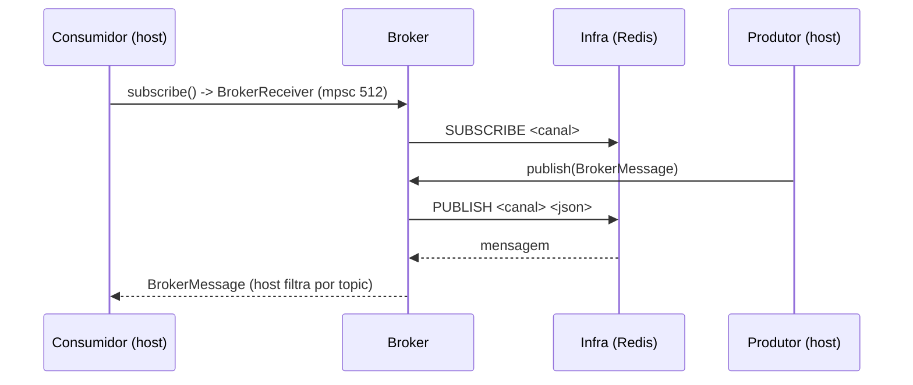

# broker — Visão geral (só Rust)

Abstração de **mensageria pub/sub** da plataforma SeedGrid. Define um contrato único (`Broker`) e backends que o implementam; o host programa contra o trait e escolhe o backend na composição (por configuração dele). **Não existe extensão Java equivalente** (**Confirmado**: não há `seedgrid-quarkus-ext-broker` em `java/`). Configuração: [[SeedGrid/Extensions/broker/Configuracao-Rust|Configuração Rust do broker]].

Caso de uso principal: o produto `seedgrid-pulse` (fora do `seedgrid-platform`), que escolhe o backend por `BROKER_PROVIDER`.

## Crates (sub-workspace)
Diretório `rust/seedgrid-rust-crate-broker/crates/`; as 5 crates são membros do workspace raiz `rust/Cargo.toml` e herdam `version` (`2026.10.14`), `edition` (**2024**), `license` (`MIT`), `authors` e dependências de `[workspace.package]`/`[workspace.dependencies]`. Não há `Cargo.toml` próprio na raiz de `seedgrid-rust-crate-broker` (era um workspace aninhado, absorvido — comentário em `rust/Cargo.toml`).

| Crate | Papel | Estado (**Confirmado** no código) |
|---|---|---|
| `seedgrid-broker-spi` | contrato: `Broker`, `BrokerMessage`, `BackendKind`, `BrokerReceiver`, `DynBroker` | estável |
| `seedgrid-broker-memory` | backend in-process (`tokio::sync::broadcast`) | funcional |
| `seedgrid-broker-redis` | backend Redis Pub/Sub (canal RESP único) | funcional |
| `seedgrid-broker-nats` | `NatsConfig` + `NatsBroker` | **scaffold**: `publish`/`subscribe` retornam erro "ainda nao foi implementado" |
| `seedgrid-broker-rabbitmq` | `RabbitMqConfig` + `RabbitMqBroker` | **scaffold**: idem |

Nenhuma crate tem features Cargo ou dependência de outras crates SeedGrid além do SPI.

## Contrato (`crates/seedgrid-broker-spi/src/lib.rs`)
```rust
pub type BrokerReceiver = mpsc::Receiver<BrokerMessage>;
pub type DynBroker = Arc<dyn Broker>;

pub struct BrokerMessage {
    pub topic: String,
    pub payload: Vec<u8>,
    pub headers: BTreeMap<String, String>, // #[serde(default)]
    pub key: Option<String>,               // omitido no JSON quando None
}
// BrokerMessage::new(topic, payload).with_header(k, v).with_key(k)

pub enum BackendKind { Memory, Redis, Nats, RabbitMq }

#[async_trait]
pub trait Broker: Send + Sync {
    fn backend_kind(&self) -> BackendKind;
    async fn publish(&self, message: BrokerMessage) -> Result<()>;   // anyhow::Result
    async fn subscribe(&self) -> Result<BrokerReceiver>;
}
```

## Fluxo

- **Canal único**: o `subscribe()` entrega **todas** as mensagens; `topic` é só um campo para roteamento no host, não um filtro do backend.
- Só chega o que foi publicado **depois** da inscrição (memory e redis).

## Comportamento por backend
| Backend | Detalhes (**Confirmado**) |
|---|---|
| memory | `MemoryBroker::new(capacity)` (mínimo 1; `Default` = 512). `publish` ignora a falta de inscritos (mensagem descartada, `Ok(())`). Cada `subscribe` cria uma task que repassa para um `mpsc` de 512. Se o assinante ficar para trás além da capacidade, `broadcast::Receiver::recv` retorna `Lagged` e o laço `while let Ok(..)` **termina** — a assinatura para de entregar sem erro (**Inferência** a partir da API do tokio; comportamento não testado no repositório). |
| redis | `RedisBroker::connect(url, channel)` abre o cliente e faz `PING`. `publish` serializa a mensagem em JSON (`serde_json`) e faz `PUBLISH` no canal. `subscribe` (serializado por mutex) abre um pubsub, assina o canal e repassa a um `mpsc` de 512; payloads que não decodificam são logados (`warn`) e descartados; fim do stream encerra a task. A função livre `seedgrid_broker_redis::connect(url, channel)` valida canal não vazio; `RedisBroker::connect` **não** valida. |
| nats / rabbitmq | `connect(config)` só guarda a config; `publish`/`subscribe` falham. |

## Exemplo (de `rust/examples/seedgrid-broker-example/src/main.rs`)
```rust
async fn build_broker() -> Result<DynBroker> {
    let provider = std::env::var("BROKER_PROVIDER").unwrap_or_else(|_| "memory".to_string());
    match provider.as_str() {
        "memory" => Ok(Arc::new(MemoryBroker::default())),
        "redis" => {
            let url = std::env::var("BROKER_REDIS_URL").unwrap_or_else(|_| "redis://localhost:6379".to_string());
            let channel = std::env::var("BROKER_REDIS_CHANNEL").unwrap_or_else(|_| "seedgrid".to_string());
            Ok(Arc::new(RedisBroker::connect(&url, &channel).await?))
        }
        other => anyhow::bail!("BROKER_PROVIDER desconhecido: {other} (use memory|redis)"),
    }
}

let mut rx = broker.subscribe().await?;          // assinar ANTES de publicar
broker.publish(BrokerMessage::new("pedidos.criado", br#"{"id":1}"#.to_vec())).await?;
let msg = rx.recv().await;
```
A leitura de env acima é do **exemplo**, não das crates.

## Testes
- Unitário: `publishes_to_subscribers` em `crates/seedgrid-broker-memory/src/lib.rs`.
- Nenhum teste nas crates redis/nats/rabbitmq/spi.
- E2E Testcontainers: `rust/examples/seedgrid-broker-example/tests/broker_e2e.rs` (memória + Redis).
- **Não executados.**

## Limitações
- NATS e RabbitMQ sem implementação.
- Sem reconexão automática no Redis (fim do stream encerra a assinatura).
- Sem garantia de entrega (pub/sub puro; perde mensagens sem assinante).

## Enums
Sem equivalente Java (módulo só Rust).

| Enum | Arquivo | Variantes |
|---|---|---|
| `BackendKind` | `crates/seedgrid-broker-spi/src/lib.rs` | `Memory`, `Redis`, `Nats`, `RabbitMq` |

`BackendKind` é devolvido por `Broker::backend_kind()` e não é serializado (sem serde); `Nats` e `RabbitMq` só são retornados pelos esqueletos, cujos `publish`/`subscribe` falham. A escolha do backend (`BROKER_PROVIDER=memory|redis` no exemplo) é texto do host, não este enum.
