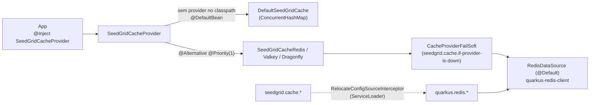

# SeedGrid Cache — Visão geral

> [!info] Library, não extension Quarkus
> `seedgrid-quarkus-lib-cache` é uma **library Java** (jars comuns com índice Jandex), **não** uma extension Quarkus com módulos `runtime`/`deployment`. Não há `@ConfigRoot`, build steps nem processors. Está documentada nesta estrutura apenas por uniformidade.

Configuração: [[SeedGrid/Extensions/cache/Configuracao|Configuração do cache]] · Enums: [[SeedGrid/Extensions/cache/Enums|Enums do cache]] · Exemplos: [[SeedGrid/Extensions/cache/Exemplos|Exemplos do cache]] · [[SeedGrid/Extensions/cache/Rust|Porte Rust]]

## Objetivo

Cache **agnóstico de provider**: uma única API (`SeedGridCacheProvider`) sobre Redis, Valkey ou Dragonfly (todos falam RESP e usam o mesmo `quarkus-redis-client`), com fallback in-memory quando nenhum provider distribuído está no classpath. O backend é escolhido **pela dependência** adicionada, não por propriedade. **Confirmado** (`pom.xml` raiz, `README.md`).

Funcionalidades (**Confirmado** em `SeedGridCacheProvider`):
- key/value `String`, `byte[]` e `long` com TTL (`Duration`);
- contador atômico `increment(key)` e `increment(key, ttl)` (INCR + EXPIRE só na 1ª chamada, via Lua);
- `delete(key)`;
- lock exclusivo por chave `withLock(key, ttl, Supplier)` — JVM `ReentrantLock` no default, `SET NX PX` + unlock por token (Lua) nos providers RESP;
- política de falha do backend configurável (`seedgrid.cache.if-provider-is-down`, WARN fail-soft / ERROR fail-closed);
- fachada de configuração `seedgrid.cache.*` como alias de `quarkus.redis.*`.

## Módulos Maven e coordenadas

| Módulo | groupId:artifactId | Versão | Papel |
|---|---|---|---|
| (agregador, `pom`) | `br.com.seedgrid:seedgrid-cache` | `2026.10.13` | parent dos módulos; importa `quarkus-bom` 3.30.8; parent `seedgrid-parent` 2026.07.02 |
| `seedgrid-cache-core` | `br.com.seedgrid:seedgrid-cache-core` | `2026.10.13` | SPI, `DefaultSeedGridCache` (in-memory), `CacheProviderFailSoft`, `SeedGridCacheConfigRelocateInterceptor` |
| `seedgrid-cache-redis` | `br.com.seedgrid:seedgrid-cache-redis` | `2026.10.13` | `SeedGridCacheRedis` |
| `seedgrid-cache-valkey` | `br.com.seedgrid:seedgrid-cache-valkey` | `2026.10.13` | `SeedGridCacheValkey` |
| `seedgrid-cache-dragonfly` | `br.com.seedgrid:seedgrid-cache-dragonfly` | `2026.10.13` | `SeedGridCacheDragonfly` |

Fonte: `java/seedgrid-quarkus-lib-cache/pom.xml` e `*/pom.xml`. **Confirmado.**

Dependências relevantes: `core` → `quarkus-arc` (provided), `smallrye-config-core` (provided). Providers → `seedgrid-cache-core`, `quarkus-redis-client` (compile). Nenhuma dependência de outras libs/extensions SeedGrid. **Confirmado.**

## Arquitetura



- **Seleção do bean** (**Confirmado** pelas anotações): `DefaultSeedGridCache` é `@ApplicationScoped @DefaultBean`; cada provider é `@ApplicationScoped @Alternative @Priority(1)` (alternativa habilitada globalmente). Colocar **dois** providers no classpath gera resolução ambígua — **Confirmado** como aviso em `README.adoc` ("colocar mais de um simultaneamente causa resolução ambígua"); não há teste que comprove.
- **Fail-soft** (**Confirmado**, `CacheProviderFailSoft`): `get/put/increment/delete` dos providers RESP são envolvidos; em `RuntimeException` do backend, `WARN` loga e devolve fallback (`Optional.empty()`, `0L`, no-op), `ERROR` loga e relança. `withLock` **não** é envolvido: falha de conexão propaga sempre, e lock não adquirido lança `IllegalStateException("Could not acquire lock: ...")` (sem espera/retry).
- **Alias de config** (**Confirmado**, `SeedGridCacheConfigRelocateInterceptor` + `META-INF/services/io.smallrye.config.ConfigSourceInterceptor`): `@Priority(Priorities.LIBRARY + 200)`, reloca todo nome `quarkus.redis.<x>` para `seedgrid.cache.<x>` e só cai no nome original se o relocado não tiver valor.
- Chaves de lock: `<key>:lock`. TTL `null`/zero/negativo = sem expiração (SET em vez de SETEX). `getLong` devolve vazio se o valor não for numérico. **Confirmado.**
- `DefaultSeedGridCache`: TTL em milissegundos com limpeza preguiçosa na leitura; `getBytes`/`putBytes` fazem cópia defensiva; `withLock` ignora o `ttl` (lock JVM local). **Confirmado.**

## APIs públicas e pontos de integração

| Tipo | Símbolo | Observação |
|---|---|---|
| Interface SPI | `br.com.seedgrid.cache.core.commons.spi.SeedGridCacheProvider` | `getString/putString`, `getBytes/putBytes`, `getLong/putLong`, `increment(key)`, `increment(key, ttl)`, `delete`, `<T> withLock(key, ttl, Supplier<T>)` |
| Bean CDI default | `...core.commons.spi.impl.DefaultSeedGridCache` | in-memory, `@DefaultBean` |
| Beans CDI alternativos | `SeedGridCacheRedis`, `SeedGridCacheValkey`, `SeedGridCacheDragonfly` | injetam `RedisDataSource` padrão (`@Default`) |
| Utilitário público | `CacheProviderFailSoft` (`get`, `run`, `Level.parse`, constante `PROP`) | usado pelos providers; reutilizável por quem implementar outro provider |
| SmallRye `ConfigSourceInterceptor` | `...core.config.SeedGridCacheConfigRelocateInterceptor` | registrado via ServiceLoader |

Não há endpoints REST, eventos CDI, migrations nem anotações próprias.

## Anotações

_Fonte: código de `seedgrid-quarkus-lib-cache` (versão local 2026.10.22, não publicada)._

| Anotação | Pacote | Onde se aplica | Atributos (padrão) | Para que serve |
|---|---|---|---|---|
| `@Covers` | `br.com.seedgrid.cache.testkit.contract` | `METHOD` | `value` | Declara quais erros do plano (E1..E21, ver `planos/cache/2026-10-19-annotations-do-cache.md`) um cenario da suite de contrato cobre. |
| `@SgCacheInterception` | `br.com.seedgrid.cache.core.annotations` | `TYPE`, `ANNOTATION_TYPE` | — | Binding INTERNO e transitivo dos interceptores de cache (`SgCacheResult` e as de invalidacao). |
| `@SgCacheInvalidate` | `br.com.seedgrid.cache.core.annotations` | `METHOD` | `cacheName`, `scope` (`CacheKeyScope.DEFAULT`), `afterInvocation` (`true`), `strict` (`false`) | Invalida UMA entrada de um cache de `SgCacheResult`: a que tem a MESMA chave que o metodo cacheado teria para estes argumentos. |
| `@SgCacheInvalidateAll` | `br.com.seedgrid.cache.core.annotations` | `METHOD` | `cacheName`, `scopeOnly` (`false`), `scope` (`CacheKeyScope.DEFAULT`), `afterInvocation` (`true`), `strict` (`false`) | Invalida TODAS as entradas de um cache de `SgCacheResult` (apaga o prefixo `sgc:{cacheName`:} com `deleteByPrefix`: `SCAN` + `UNLINK` nos servidores, nunca `KEYS`; custo proporcional ao keyspace por chamada, entao prefira `SgCacheInvalidate` quando souber a chave). |
| `@SgCacheKey` | `br.com.seedgrid.cache.core.annotations` | `PARAMETER` | — | Marca um parametro como parte da chave de `SgCacheResult`. |
| `@SgCacheResult` | `br.com.seedgrid.cache.core.annotations` | `METHOD` | `cacheName`, `ttl` (`""`), `scope` (`CacheKeyScope.DEFAULT`), `lock` (`false`) | Cacheia o RESULTADO do metodo: na primeira chamada com certos argumentos o metodo roda e o valor e' guardado; nas seguintes o valor guardado e' devolvido sem rodar o metodo. |

## SPIs

_Fonte: código de `seedgrid-quarkus-lib-cache` (versão local 2026.10.22, não publicada)._

| SPI | Pacote | Implementação padrão (`@DefaultBean`) | Para que serve |
|---|---|---|---|
| `SeedGridCacheProvider` | `br.com.seedgrid.cache.core.commons.spis` | `DefaultSeedGridCache` | SPI do cache (memória, Redis, Valkey, Dragonfly e o decorador de failover). |

**Como substituir:** declare um bean CDI (`@ApplicationScoped`) que implemente a interface, **sem** `@Alternative` nem `@Priority`; a implementação padrão (`@DefaultBean`) cede. SPI "sem padrão" precisa de uma implementação do host (ou de outro módulo) para o recurso funcionar.

```java
@ApplicationScoped
public class MeuSeedGridCacheProvider implements SeedGridCacheProvider {
    // implemente os métodos da interface
}
```

## Testes existentes (não executados)

| Local | Tipo | Cobre |
|---|---|---|
| `seedgrid-cache-core/src/test/.../SeedGridCacheConfigRelocateInterceptorTest` | unit | alias `seedgrid.cache.*` → `quarkus.redis.*`, fallback e precedência |
| `seedgrid-cache-{redis,valkey,dragonfly}/src/test/.../*ConfigAliasIT` + `*AliasTestResource` | `@QuarkusTest` + Testcontainers | prova end-to-end que só `seedgrid.cache.hosts` configura o `RedisDataSource` |
| `seedgrid-cache-{redis,valkey,dragonfly}/src/test/.../*IT` | integração (Testcontainers) | operações reais contra o servidor |
| `SeedGridCacheValkeyTest`, `SeedGridCacheDragonflyTest` | unit (Mockito) | seleção set/setex, INCR vs EVAL |

Nenhum teste cobre `seedgrid.cache.if-provider-is-down` (busca por `FailSoft`/`if-provider` em `src/test` sem resultado). Testes **não executados** nesta análise.

## Limitações

- Só o `RedisDataSource` `@Default` é usado; clientes nomeados não são suportados pelos providers. **Confirmado** (injeção sem qualifier).
- `withLock` não é fail-soft e não tem espera; `DefaultSeedGridCache.withLock` é local à JVM.
- Não há API genérica de objetos (apenas `String`/`byte[]`/`long`); serialização fica a cargo do app. **Confirmado** (comentário em `CatalogService` do exemplo).
- No Java `ERROR` é fail-closed; no Rust ambos os níveis são fail-soft. Ver [[SeedGrid/Extensions/cache/Rust|Porte Rust]].
- Clientes nomeados: `quarkus.redis.<nome>.*` também é relocado para `seedgrid.cache.<nome>.*` (relocate por prefixo) — ver [[SeedGrid/Extensions/cache/Configuracao|Configuração do cache]].
