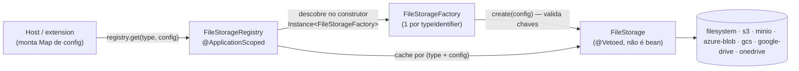

# SeedGrid File Management — Visão geral

> [!info] Library, não extension Quarkus
> `seedgrid-quarkus-lib-filemanagement` é uma **library Java** (jar único com índice Jandex), **não** uma extension Quarkus com `runtime`/`deployment`. Não há `@ConfigRoot`/`@ConfigMapping`: a lib **não lê MicroProfile Config** — recebe a configuração de cada storage num `Map<String, String>` passado pelo chamador. Documentada nesta estrutura por uniformidade.

Configuração: [[SeedGrid/Extensions/filemanagement/Configuracao|Configuração do filemanagement]] · Exemplos: [[SeedGrid/Extensions/filemanagement/Exemplos|Exemplos do filemanagement]] · [[SeedGrid/Extensions/filemanagement/Rust|Porte Rust]] (crate `seedgrid-rust-crate-filemanagent`)

## Objetivo

Uma API única de armazenamento de arquivos (`FileStorage`) com backends plugáveis — filesystem, AWS S3, MinIO, Azure Blob, Google Cloud Storage, Google Drive e OneDrive — criados **sob demanda** por factories e cacheados pelo `FileStorageRegistry`. A aplicação decide a organização de paths (via `prefix`). **Confirmado** (`pom.xml` description, `README.md`, código).

## Coordenadas e dependências

| Item | Valor |
|---|---|
| groupId:artifactId | `br.com.seedgrid:seedgrid-filemanagement` |
| Versão (pom) | `2026.07.08` |
| Parent | `br.com.seedgrid:seedgrid-parent:2026.07.02` |
| Obrigatórias | `quarkus-arc`, `quarkus-hibernate-validator` |
| **Optional** (o host precisa declarar para usar o backend) | AWS `s3` 2.21.42; `azure-storage-blob` 12.25.1; `google-api-client` 2.2.0, `google-api-services-drive` v3-rev197-1.25.0, `google-auth-library-oauth2-http` 1.20.0; `google-cloud-storage` 2.29.1; `minio` 8.5.9; `microsoft-graph` 5.80.0 + `azure-identity` 1.11.1; também `quarkus-hibernate-orm`, `quarkus-jdbc-postgresql`, `quarkus-flyway` |
| Dependências SeedGrid | nenhuma (desde 2026.07.08 não depende mais de `seedgrid-commons`, segundo comentário do exemplo) |

Fonte: `java/seedgrid-quarkus-lib-filemanagement/pom.xml`. **Confirmado.** Que o host precise declarar o SDK do backend escolhido está **Confirmado** (`mvn dependency:tree` de um produto, 2026-10-21: escopo `optional` não é transitivo; a skill `sg-new-product` declara o SDK do provider escolhido).

## Arquitetura



- **Descoberta** (**Confirmado**, `FileStorageRegistry`): o construtor itera `Instance<FileStorageFactory>`; dois factories com o mesmo `typeIdentifier()` → `DuplicateStorageException` (falha no boot); nenhum factory → apenas WARN.
- **Lazy + cache** (**Confirmado**): `get(type, config)` cria via `factory.create(config)` na primeira chamada e cacheia por `record CacheKey(type, cópia imutável do config)` — igualdade por conteúdo do mapa; configs diferentes do mesmo tipo geram instâncias distintas. `clearCache()` força recriação. Tipo sem factory → `StorageNotFoundException` (checked, propagada via `@SneakyThrows`).
- **Validação** só no primeiro uso: factories lançam `StorageConfigurationException` (unchecked); construtores de storage podem lançar `StorageInitializationException` (ex.: GCS sem credenciais ou bucket inexistente).
- As classes de storage são `@Vetoed` (não são beans CDI); os factories são `@ApplicationScoped`. **Confirmado** (todas as classes em `storages/` têm `@Vetoed`; criação sempre via `new` nos factories).

### Backends embutidos

| `typeIdentifier` | Factory | Implementação | `generateSignedUrl` |
|---|---|---|---|
| `filesystem` | `FilesystemStorageFactory` | `FilesystemStorage` | não suportado (default lança `UnsupportedOperationException`) |
| `s3` | `S3StorageFactory` | classe interna `S3StorageImpl` (a classe pública `storages/S3Storage` é `@Vetoed` e **não é usada** pelo factory) | presigned GET |
| `minio` | `MinIOStorageFactory` | `MinIOStorage` | presigned (expiry em segundos) |
| `azure-blob` | `AzureBlobStorageFactory` | `AzureBlobStorage` (cria o container se não existir) | SAS |
| `gcs` | `GoogleCloudStorageFactory` | `GoogleCloudStorage` (verifica se o bucket existe no init) | signed URL (TTL em minutos) |
| `google-drive` | `GoogleDriveStorageFactory` | `GoogleDriveStorage` (escopo `drive.file`) | **cria permissão pública `anyone/reader`** e devolve link; o TTL é ignorado (link precisa ser revogado manualmente) |
| `onedrive` | `OneDriveStorageFactory` | `OneDriveStorage` (Graph `me().drive()`, client credentials) | devolve `webUrl` do item; TTL ignorado; loga WARN |

Fonte: `factories/*.java`, `storages/*.java`. **Confirmado.**

## APIs públicas e pontos de integração

| Tipo | Símbolo | Observação |
|---|---|---|
| SPI | `spi.FileStorage` | `typeIdentifier()`, `store(filename, byte[], StorageOptions)`, `store(filename, InputStream, StorageOptions)` (default lê tudo em memória), `retrieve`, `stream`, `delete`, `exists`, `getMetadata`, `generateSignedUrl(key, ttl)` (default unsupported), `canHandle(key)` |
| SPI | `spi.FileStorageFactory` | `typeIdentifier()`, `create(Map<String,String>)` |
| Bean | `services.FileStorageRegistry` | `get(type, config)`, `get(StorageKey, config)`, `has(type)`, `getAvailableTypes()`, `getCreatedStorages()`, `clearCache()` |
| Domínio | `domains.StorageKey` | `type`, `bucket`, `path`; `toUri()`/`fromUri()`, fábricas `filesystem`, `s3`, `azureBlob`, `minio`, `of(...)` |
| Domínio | `domains.StorageOptions` | `prefix`, `contentType`, `publicRead` (false; só tem efeito no S3), `metadata` (gravado por Azure, GCS, Google Drive e MinIO); `defaults()`, `withPrefix()`, `fullPath()` |
| Domínio | `domains.FileMetadata` | `storageKey`, `filename`, `sizeBytes`, `contentType`, `createdAt`, `lastModifiedAt`, `metadata` (preenchidos conforme o backend) |
| Exceções | `StorageException` (checked), `StorageNotFoundException` (checked, estende `StorageException`), `StorageConfigurationException`, `StorageInitializationException`, `DuplicateStorageException` | — |

Extensão: o host cria um `@ApplicationScoped FileStorageFactory` com `typeIdentifier` novo; o registry o descobre. Sem endpoints REST, eventos ou migrations (apesar das deps optional de ORM/Flyway, não há entidades nem SQL no `src/main`).

**Consumidores no monorepo** (**Confirmado** por busca): `seedgrid-quarkus-ext-backup` (`ExportService#buildStorageConfig`, mapeia `seedgrid.backup.*` → chaves do mapa) — ver [[SeedGrid/Extensions/backup/Visao-geral|Visão geral do backup]]; `seedgrid-quarkus-ext-security` (`UserAvatarService#buildStorageConfig`) — ver [[SeedGrid/Extensions/security/Visao-geral|Visão geral do security]]; dependência declarada em `seedgrid-quarkus-ext-login-tenancy`.

## Anotações

_Fonte: código de `seedgrid-quarkus-lib-filemanagement` (versão local 2026.10.22, não publicada)._

Nenhuma.

## SPIs

Detalhes de cada SPI (assinaturas, o que o padrão faz, implementações reais e exemplos): [[SeedGrid/Extensions/filemanagement/SPIs|SPIs]].

_Fonte: código de `seedgrid-quarkus-lib-filemanagement` (versão local 2026.10.22, não publicada)._

| SPI | Pacote | Implementação padrão (`@DefaultBean`) | Para que serve |
|---|---|---|---|
| `FileStorage` | `br.com.seedgrid.filemanagement.spis` | sem padrão | Service Provider Interface for file storage backends. |
| `FileStorageFactory` | `br.com.seedgrid.filemanagement.spis` | sem padrão | Service Provider Interface for creating `FileStorage` instances. |

**Como substituir:** declare um bean CDI (`@ApplicationScoped`) que implemente a interface, **sem** `@Alternative` nem `@Priority`; a implementação padrão (`@DefaultBean`) cede. SPI "sem padrão" precisa de uma implementação do host (ou de outro módulo) para o recurso funcionar.

```java
@ApplicationScoped
public class MeuFileStorage implements FileStorage {
    // implemente os métodos da interface
}
```

## Testes existentes (não executados)

`src/test/java/...`: `StorageKeyTest`, `StorageOptionsTest`, `FileMetadataTest`, `FileStorageRegistryTest` (Mockito), `FileStorageRegistryFilesystemTest` (cache por config), `FilesystemStorageTest`, `StorageExceptionTest`, `FileStorageIntegrationTest` (`@QuarkusTest`, só `filesystem`). ~60 `@Test` por grep. Nenhum teste de backend de nuvem. **Não executados.**

## Limitações

- `publicRead` só tem efeito no S3 (ACL `public-read`). **Confirmado.**
- S3 (`S3StorageImpl`) devolve `StorageKey.of("s3", key)` **sem bucket**; `toUri()` vira `s3://<prefixo>/<arquivo>` e um `fromUri()` posterior interpretaria o primeiro segmento como bucket, mudando o `path`. Risco de round-trip ao persistir a URI — **Inferência** (não testado).
- `FilesystemStorage` monta caminhos com `Paths.get(basePath, ...)` sem normalizar nem barrar `..` — risco de path traversal se `filename`/`prefix` vierem do usuário. **Inferência.**
- `GoogleDriveStorage#generateSignedUrl` torna o arquivo público permanentemente.
