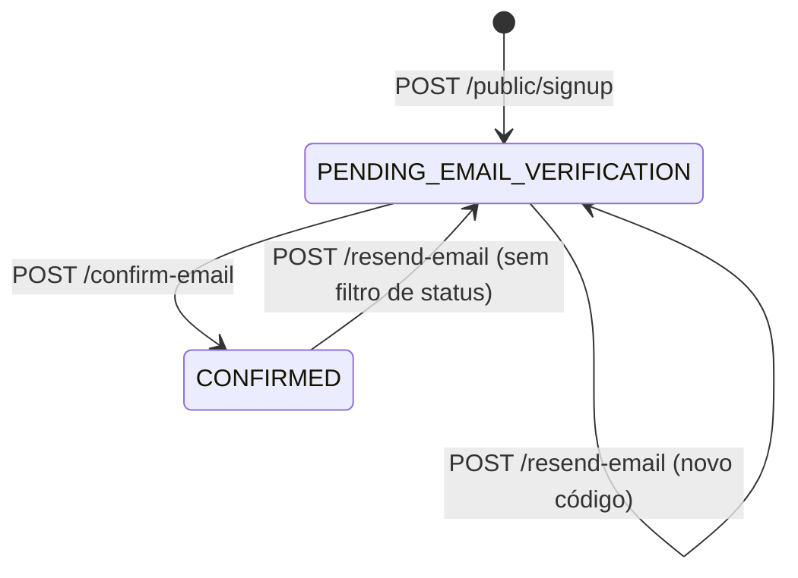

# Login-tenancy (Quarkus) — enums

Voltar: [[SeedGrid/Extensions/login-tenancy/Visao-geral|Visão geral do login-tenancy]] · [[SeedGrid/Extensions/login-tenancy/Configuracao|Configuração]]

## Índice

| Enum | Pacote/arquivo | Usado em | Público? |
|---|---|---|---|
| [[#SignupRequestStatus]] | `br.com.seedgrid.logintenancy.enums` — `runtime/src/main/java/br/com/seedgrid/logintenancy/enums/SignupRequestStatus.java` | coluna `sg_signup_request.status`; respostas de `POST /public/signup`, `/resend-email`, `/confirm-email` | Sim |
| [[#DocumentSignupStatus]] | `br.com.seedgrid.logintenancy.enums` — `.../enums/DocumentSignupStatus.java` | resposta de `GET /public/signup/document-status` (CPF ou CNPJ; antes `CnpjSignupStatus` e `cnpj-status`, 2026.10.22) | Sim |
| [[#FoundationModule]] | `br.com.seedgrid.logintenancy.configs` — `.../configs/FoundationModule.java` | `LoginTenancyModuleRegistry` (bean público), `activeModules` do status | Sim |

## SignupRequestStatus

FQN: `br.com.seedgrid.logintenancy.enums.SignupRequestStatus` — "Estado de uma solicitação de cadastro institucional pendente" (javadoc).

| Valor | Significado | Efeito / onde é tratado | Observações |
|---|---|---|---|
| `PENDING_EMAIL_VERIFICATION` | Solicitação criada, aguardando o código enviado por e-mail | Valor inicial (`SignupRequestEntity` `@PrePersist`, quando nulo); reatribuído no `resend-email`; filtro de `SignupRequestRepository#findPendingByDocument` (reaproveitamento da solicitação e `document-status = PENDING_CONFIRMATION`); índices únicos parciais da `V703` | Confirmado |
| `CONFIRMED` | Código confirmado: `Company` e usuário root criados | Atribuído em `LoginTenancySignupController#confirmEmail`; a linha sai dos índices parciais da V700 e vira histórico | Confirmado |

- **Persistência**: `@Enumerated(EnumType.STRING)`, coluna `status varchar(64) not null` (V700). Não há CHECK constraint; os índices parciais da V700 só referencia `'PENDING_EMAIL_VERIFICATION'` nos índices parciais (coerente com o enum).
- **JSON**: nome da constante (`SignupResponse.status`, `ConfirmSignupResponse.status`), serialização padrão do Jackson.
- **Observação (Confirmado)**: `SignupRequestRepository#findByEmail` não filtra por status; logo `resend-email` numa solicitação já `CONFIRMED` gera novo código e a devolve a `PENDING_EMAIL_VERIFICATION`.

## DocumentSignupStatus

FQN: `br.com.seedgrid.logintenancy.enums.DocumentSignupStatus` (antes `CnpjSignupStatus`, 2026.10.22) — situação de um documento (CPF ou CNPJ) na tela de cadastro, consultada antes do submit.

| Valor | Significado | Efeito / onde é tratado | Observações |
|---|---|---|---|
| `AVAILABLE` | Sem company e sem solicitação pendente: pode cadastrar | `DocumentStatusResponse.available()` — também devolvido para documento vazio | Confirmado |
| `REGISTERED` | Já existe `Company` com o documento: o caminho é o login | `DocumentStatusResponse.registered()` | Confirmado |
| `PENDING_CONFIRMATION` | Há solicitação `PENDING_EMAIL_VERIFICATION`: o caminho é o reenvio | `DocumentStatusResponse.pending(maskedEmail)` — único caso com `pendingEmailMasked` preenchido | Confirmado |

- **JSON**: campo `status` de `DocumentStatusResponse` com o nome da constante. Não é persistido.

## FoundationModule

FQN: `br.com.seedgrid.logintenancy.configs.FoundationModule` — módulos de foundation da v1 (contrato interno de ativação; "não representa conceito de tenant").

| Valor | Significado | Efeito / onde é tratado | Observações |
|---|---|---|---|
| `BILLING` | Módulo billing | `seedgrid.login-tenancy.modules.billing.enabled`: migrations de billing (`LoginTenancyMigrationService`) e conta+trial no signup (`LoginTenancyBillingProvisioner`) | Confirmado |
| `APIKEYS` | Módulo apikeys | `modules.apikeys.enabled`: migrations de apikeys | Confirmado |
| `BACKUP` | Módulo backup | `modules.backup.enabled`: migrations de backup | Confirmado |
| `FILEMANAGEMENT` | Módulo filemanagement | `modules.filemanagement.enabled`: só entra em `activeModules` (status/log) | Confirmado |

- Não é tipo de propriedade: cada constante tem sua propriedade booleana (ver [[SeedGrid/Extensions/login-tenancy/Configuracao|Configuração]]); o mapeamento é o `switch` de `LoginTenancyFoundationConfig#moduleEnabled`.
- **JSON**: em `GET /public/login-tenancy/status`, `activeModules` lista os nomes em minúsculas (`billing`, `apikeys`, `backup`, `filemanagement`), na ordem do enum.
- API: `LoginTenancyModuleRegistry#isActive(FoundationModule)`, `#activeModules()`.

## Internos

Nenhum.
