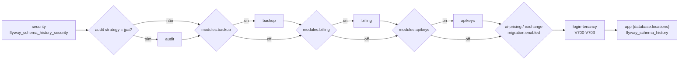

# Login-tenancy (Quarkus) — visão geral

Foundation **orquestradora** para aplicações **banco único, multi-empresa (pooled)**: um só PostgreSQL compartilhado por N companies, com isolamento **lógico** (escopo do token + providers SPI). Uma única dependência traz e "fia" os módulos de foundation da v1 (security, audit, billing-core, backup, apikeys, filemanagement, privacy, resilience), orquestra as migrations por módulo, coordena o bootstrap, expõe signup institucional (empresa + usuário root), status técnico e readiness. Não existe `seedgrid.login-tenancy.enabled`: a presença da dependência ativa o baseline.

- Configuração: [[SeedGrid/Extensions/login-tenancy/Configuracao|Configuração do login-tenancy]]
- Exemplos: [[SeedGrid/Extensions/login-tenancy/Exemplos|Exemplos do login-tenancy]]
- Enums: [[SeedGrid/Extensions/login-tenancy/Enums|Enums do login-tenancy]]
- Porte Rust (crate `seedgrid-rust-crate-login-tenancy`): [[SeedGrid/Extensions/login-tenancy/Rust|Porte Rust]]
- Alternativa com isolamento físico por tenant: [[SeedGrid/Extensions/subdomain-tenancy/Visao-geral|subdomain-tenancy]] (mutuamente exclusivas, segundo o README).

## Módulos Maven e coordenadas (Confirmado — `pom.xml`)

| Módulo | groupId | artifactId | Versão |
|---|---|---|---|
| parent | `br.com.seedgrid` | `seedgrid-login-tenancy-parent` | `2026.10.14-1` |
| runtime | `br.com.seedgrid` | `seedgrid-login-tenancy` | `2026.10.14-1` |
| deployment | `br.com.seedgrid` | `seedgrid-login-tenancy-deployment` | `2026.10.14-1` |

Parent: `br.com.seedgrid:seedgrid-parent:2026.07.02`. Status `preview`.

## Dependências SeedGrid (versões do `pom.xml` do parent)

| Artefato | Versão | Papel |
|---|---|---|
| `seedgrid-commons` | `2026.10.08` | embeddables `Address`/`Contact`, `ApiExceptionExtension` |
| `seedgrid-security` (+ `-deployment`) | `2026.10.14` | `Company`, `User`, `Role`, JWT, `EmailServiceInterface`, SPIs de escopo — ver [[SeedGrid/Extensions/security/Visao-geral|security]] |
| `seedgrid-audit-core`, `seedgrid-audit-postgresql` (`seedgrid-audit-mongodb` só gerenciado) | `2026.09.25` | auditoria e SPIs `AuditMetadataContributor`/`AuditReadScopeProvider` |
| `seedgrid-backup` (+ `-deployment`) | `2026.10.09` | backup |
| `seedgrid-billing-core` (+ `-deployment`) | `2026.10.14-1` | cobrança agnóstica; `AccountProvisioningService` |
| `seedgrid-apikeys` (+ `-deployment`) | `2026.10.14` | ver [[SeedGrid/Extensions/apikeys/Visao-geral|apikeys]] |
| `seedgrid-notification` (+ `-deployment`) | `2026.10.15` | catálogo de eventos, regras, outbox e envio por e-mail/WhatsApp; vem transitivamente, o host não precisa declará-la — ver [[SeedGrid/Extensions/notification/Visao-geral|notification]] |
| `seedgrid-filemanagement` | `2026.07.08` | arquivos |
| `seedgrid-privacy` | `2026.07.27` | mascaramento/criptografia de PII |
| `seedgrid-resilience-core` | `2026.10.13` | `@SeedGridRateLimit` |

O **provider de billing** concreto (`BillingProvider`) não vem embarcado: o host precisa fornecer (ex.: `seedgrid-billing-stripe`) ou o boot falha (README; o teste usa `NoopBillingProvider`). Também empacota `quarkus-mongodb-client` como dependência opcional (README) para a auditoria MongoDB.

## Arquitetura

### Ordem de inicialização (Confirmado)

| Prioridade | Componente | O que faz |
|---|---|---|
| 2000 (`APPLICATION`) | `LoginTenancyMigrationService#onStart` | Flyway por módulo no datasource único (Flyway nativo do Quarkus desligado) |
| 2100 | `LoginTenancyBootstrapService#onStart` | Só coordena/loga o bootstrap de admin (delegado ao security) e os módulos ativos |
| 2500 (padrão) | `FirstAdminBootstrapService` (security) | company default + primeiro admin |

### Migrations orquestradas (Confirmado — `LoginTenancyMigrationService`)

Cada módulo usa `classpath:db/migration/<modulo>` e a tabela `flyway_schema_history_<modulo>` (`ai-pricing` → `flyway_schema_history_ai_pricing`; `login-tenancy` → `flyway_schema_history_login_tenancy`); a aplicação usa `seedgrid.login-tenancy.database.locations` (padrão `classpath:db/migration/app`) e `flyway_schema_history`. Falha em qualquer módulo lança `MigrationExecutionException` e derruba o startup.

### Isolamento lógico por company

- `LoginTenancyAllowedCompaniesResolver` (SPI do security): memberships reais em `allowedCompanies`; membros da **default company** recebem super-leitura (`seeAll`) — usada no audit.
- `LoginTenancyLoginScopeResolver` e `LoginTenancyJwtTokenCustomizer` (SPIs do security): escopo do login e claim `audience` = `platform` se a empresa corrente é a default company (comparação por CNPJ via `DefaultCompanyConfig`), senão `client`.
- `CompanyAuditMetadataContributor` carimba `companyPublicId` na escrita do audit; `LoginTenancyAuditReadScopeProvider` força o filtro na leitura (sem contexto ⇒ nega).
- `LoginTenancyAccountUserActivationMailer` (SPI `AccountUserActivationMailer` do security): e-mail de ativação quando admin de empresa cria usuário em `/me/security/users`.
- `LoginTenancyBillingProvisioner`: ao `SignupConfirmedEvent` (AFTER_SUCCESS, `REQUIRES_NEW`) garante conta de billing com trial, se `modules.billing.enabled`.

## API pública

### REST (Confirmado — `RestControllerPath`)

| Método | Path | Rate limit (`configKey`, padrão) | Descrição |
|---|---|---|---|
| `POST` | `/public/signup` | `signup`, 10/min | Cadastro institucional → `202 {status, signupRequestId, emailDelivered}`. Reaproveita solicitação pendente do mesmo CNPJ+e-mail; outro e-mail no mesmo CNPJ → `409`. E-mail existente = vinculação de nova empresa (senha ignorada). |
| `GET` | `/public/signup/email-exists?email=` | `signup-email-exists`, 10/min | `{exists}` |
| `GET` | `/public/signup/cnpj-status?cnpj=` | `signup-cnpj-status`, 10/min | `{status: AVAILABLE\|REGISTERED\|PENDING_CONFIRMATION, pendingEmailMasked}` |
| `POST` | `/public/signup/confirm-email` | `signup-confirm-email`, 10/min | `{token}` (6 dígitos, com ou sem traço) → cria `Company` + usuário root com role `ADMIN` por conta, envia boas-vindas, dispara `SignupConfirmedEvent` |
| `POST` | `/public/signup/resend-email` | `signup-resend-email`, 5/h | Gera novo código e reenvia |
| `GET` | `/public/login-tenancy/status` | — | `app`, `activeModules`, `bootstrap`, `security.jwtIssuer`, `security.firstAdminConfigured`; `404` se `foundation.status.enabled=false` |
| health | readiness `login-tenancy-foundation` | — | `Connection.isValid(2)` no datasource; UP sem tocar o banco se `foundation.health.enabled=false` |

O código de verificação **não** volta na resposta do signup (`SignupResponse`): só chega pelo e-mail.

### Eventos, SPIs e beans

| Símbolo | Tipo | Uso |
|---|---|---|
| `br.com.seedgrid.logintenancy.dtos.SignupConfirmedEvent(cnpj, companyPublicId, corporateName, tradeName, rootEmail, representativeName)` | evento CDI | Pós-processamento de domínio no host |
| `br.com.seedgrid.logintenancy.spis.LoginTenancyTemplateProvider` | SPI (`DefaultLoginTenancyTemplateProvider` é `@DefaultBean`) | `signupConfirmation`, `signupWelcome`, `userActivation`. Override por bean ou por arquivo em `templates/logintenancy/<nome>.html` (fallback `templates/logintenancy-default/html/`) |
| `LoginTenancyConfig` / `LoginTenancyFoundationConfig` | `@ConfigMapping` / fachada CDI | ver [[SeedGrid/Extensions/login-tenancy/Configuracao|Configuração]] |
| `LoginTenancyModuleRegistry` | bean | `isActive(FoundationModule)`, `activeModules()` |
| `LoginTenancyMongoAuditDatabaseProducer` | producer `@DefaultBean` de `MongoDatabase` | registrado só se `com.mongodb.client.MongoClient` estiver no classpath (`LoginTenancyProcessor#registerMongoAuditDatabaseProducer`) |
| `LoginTenancyApiExceptionExtension` | `ApiExceptionExtension` | `SignupRequestNotFoundException`→404, `SignupRequestPendingException`→409, `RequiredRoleMissingException`→500 (`application/problem+json`) |

## Migrations próprias

`runtime/src/main/resources/db/migration/login-tenancy/`: `V700__signup_request.sql`, `V701__privacy_search_hashes.sql`, `V702__timestamps_com_fuso.sql`, `V703__signup_request_pendente_unica_por_cnpj.sql` (faixa 700). Há um `docs/RUNBOOK-remocao-da-V704.md` (não analisado em detalhe).

## Testes existentes (não executados)

| Teste | Cobertura |
|---|---|
| `runtime/src/test/.../LoginTenancyFoundationIT` | config com defaults, migrations por schema, company default, endpoint de status, readiness (PostgreSQL via Dev Services) |
| `.../controllers/SignupAccountRootIT` | confirmação torna o dono root da conta, não root global |
| `.../controllers/SignupBillingAccountIT` | confirmação cria conta de billing com trial |
| `.../controllers/SignupDedupIT` | reaproveitamento de pendente, conflito com outro e-mail, `emailDelivered`, `cnpj-status` |
| `.../spis/*Test` | metadata/escopo de audit, resolvedor de escopo de login, defaults de gestão de conta |
| `.../unit/LoginTenancyFoundationConfigTest`, `LoginTenancyModuleRegistryTest` | lógica da fachada e do registry |

## Limitações

- `modules.apikeys.enabled`, `modules.backup.enabled` e `modules.filemanagement.enabled` controlam só migrations e/ou o que aparece no status — **não** removem beans/endpoints desses módulos (Confirmado: não há outro consumo). Só `modules.billing.enabled` também alimenta `seedgrid.billing.api.enabled` e o provisionamento.
- `bootstrap.admin.enabled=false` não impede o security de criar o admin se `seedgrid.security.first-admin-user.email` estiver preenchido (só gera WARN).
- Company default é sempre garantida (sem flag).
- `seeAll` é global para membros da default company.
