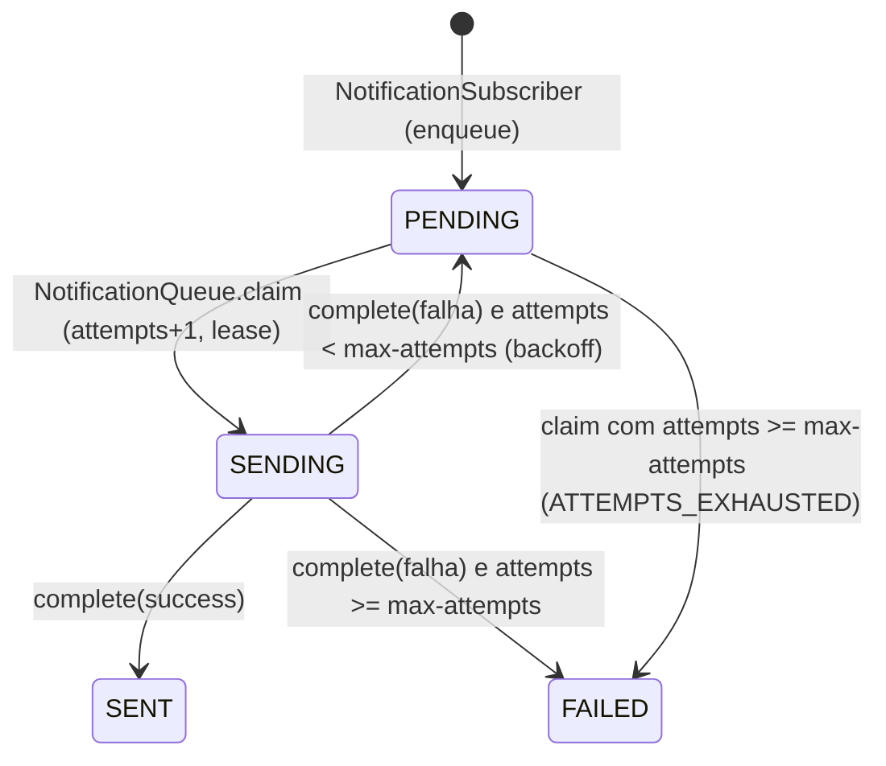

# Notification (Quarkus) — enums

Voltar: [[SeedGrid/Extensions/notification/Visao-geral|Visão geral do notification]] · [[SeedGrid/Extensions/notification/Configuracao|Configuração]]

## Índice

| Enum | Pacote/arquivo | Usado em | Público? |
|---|---|---|---|
| [[#Channel]] | `br.com.seedgrid.notification.config` — `runtime/src/main/java/br/com/seedgrid/notification/config/Channel.java` | `NotificationRule#channels`, `ConditionalRecipient#channel`, corpo do `PUT /admin/notifications/events/{code}`, resposta do `GET /admin/notifications/events`, coluna `sg_notification_delivery.channel` | Sim |

O módulo `api` (`seedgrid-notification-api`) não define enums.

## Channel

FQN: `br.com.seedgrid.notification.config.Channel`.

| Valor | Significado | Efeito / onde é tratado | Observações |
|---|---|---|---|
| `EMAIL` | Entrega por e-mail | `NotificationSubscriber` enfileira para `rule.emails()` (+ condicionais do canal); `NotificationTransport` envia com `Mailer` nomeado `security`; `RuleValidator` normaliza endereços (trim, minúsculas, validação) | Confirmado |
| `WHATSAPP` | Entrega por WhatsApp | Enfileira para `rule.phones()` (+ condicionais), com `rule.whatsappChannelId()`; `NotificationTransport` usa `WhatsAppApi#sendTextMessage`; exige telefone E.164 e instância; resposta sem `messageId` é falha | Confirmado |

- Sem campos nem métodos.
- **JSON**: nome da constante, sensível a maiúsculas (padrão Jackson): `"channels": ["EMAIL","WHATSAPP"]`; `ConditionalRecipient.channel` idem (nulo → `IllegalArgumentException` "Canal do destinatario condicional obrigatorio", devolvido como `400`). `GET /admin/notifications/events` devolve `channels: Channel.values()` (lista dos canais suportados, **não** atesta credenciais válidas).
- **Persistência**: a regra é gravada como JSON em `sg_notification_rule.rule_json`. A entrega grava `channel.name()` em `sg_notification_delivery.channel varchar(16)` com `CHECK (channel in ('EMAIL','WHATSAPP'))` (V1000) — **coerente** com as constantes. Em `NotificationTransport` o canal volta como string: valores fora de `EMAIL`/`WHATSAPP` lançam `IllegalStateException("Canal desconhecido")` (inalcançável com o CHECK).
- Adicionar uma constante exige: novo ramo no `NotificationSubscriber` (não há laço genérico), `RuleValidator` (a lista usa `c == Channel.EMAIL ? emails : phones`, tratando tudo que não é EMAIL como telefone), `NotificationTransport` e o CHECK da tabela.
- Usado em: sem propriedade de config; ver endpoints em [[SeedGrid/Extensions/notification/Visao-geral|Visão geral]].

## Status de entrega (não é enum Java)

`sg_notification_delivery.status` é `String` com `CHECK (status in ('PENDING','SENDING','SENT','FAILED'))` e constantes literais em `NotificationSubscriber`, `NotificationQueue` e `NotificationDeliveryRepository`; aparece em `GET /admin/notifications/deliveries`. Não existe enum Java para esses valores.

## Internos

Nenhum.
