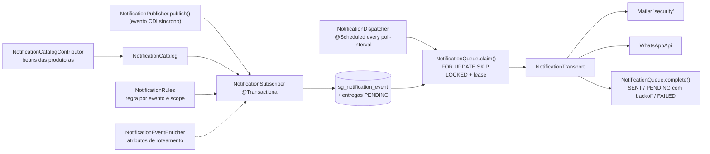

# Notification (Quarkus) — visão geral

Notificações administrativas da plataforma por **e-mail, WhatsApp ou ambos**, escolhidos por evento. Extensões produtoras declaram eventos (catálogo dinâmico) e os publicam por evento CDI síncrono; o motor grava uma **outbox transacional** e um worker agendado entrega com retry, lease e deduplicação. Não há crate Rust equivalente.

- Configuração: [[SeedGrid/Extensions/notification/Configuracao|Configuração do notification]]
- Exemplos: [[SeedGrid/Extensions/notification/Exemplos|Exemplos do notification]]
- Enums: [[SeedGrid/Extensions/notification/Enums|Enums do notification]]

## Módulos Maven e coordenadas (Confirmado — `pom.xml`)

| Módulo | groupId | artifactId | Versão | Papel |
|---|---|---|---|---|
| parent | `br.com.seedgrid` | `seedgrid-notification-parent` | `2026.10.15` | — |
| `api` | `br.com.seedgrid` | `seedgrid-notification-api` | `2026.10.15` | Contrato leve para extensões **produtoras**: `EventDefinition`, `NotificationEvent`, `NotificationCatalogContributor`, `NotificationEventEnricher`, `RoutingAttribute`, `NotificationPublisher`. Só depende de `quarkus-arc`; tem `beans.xml`. |
| `runtime` | `br.com.seedgrid` | `seedgrid-notification` | `2026.10.15` | Motor (subscriber): catálogo, regras, outbox, scheduler, transportes, REST, migrations |
| `deployment` | `br.com.seedgrid` | `seedgrid-notification-deployment` | `2026.10.15` | Feature `seedgrid-notification`, beans unremovable, registro das entidades JPA na PU |
| `integration-tests` | `br.com.seedgrid` | `seedgrid-notification-integration-tests` | `2026.10.15` | Testcontainers (PostgreSQL 16, MailHog) — perfil `-Pit` |

Parent: `br.com.seedgrid:seedgrid-parent:2026.07.02`. Status: `stable` (`quarkus-extension.yaml`). O pom da notification sobrescreve `quarkus.platform.version` para `3.30.6` (o parent declara 3.30.8).

## Dependências

| Dependência | Versão | Uso |
|---|---|---|
| `seedgrid-notification-api` | `${project.version}` | contratos |
| `br.com.seedgrid:seedgrid-whatsapp-core` (+ `-deployment`) | `2026.07.27` | `WhatsAppApi#sendTextMessage` — o provider (Evolution/Cloud) é escolhido pela extensão WhatsApp; ver [[SeedGrid/Extensions/whatsapp/Visao-geral|whatsapp]] |
| `seedgrid-commons` | `2026.10.08` (dependencyManagement) | — |
| `quarkus-mailer` | BOM | `@MailerName("security") Mailer` — o mesmo mailer nomeado do `seedgrid-security` |
| `quarkus-hibernate-orm`, `quarkus-agroal`, `quarkus-flyway`, `quarkus-scheduler`, `quarkus-security`, `quarkus-hibernate-validator`, `quarkus-rest-jackson` | BOM | — |

Integra como produtores (segundo o README): ai-pricing, billing e exchange — cada um depende só do `seedgrid-notification-api`. O `security` também só depende da `notification-api` (publica a falha de entrega de e-mail). Já `login-tenancy` e `subdomain-tenancy` dependem da extension completa (`seedgrid-notification` + `-deployment`): quem usa um tenancy recebe catálogo, regras, outbox e API administrativa sem declarar nada além do tenancy.

## Arquitetura e fluxo

Garantias e comportamento (Confirmado no código e em `docs/ARCHITECTURE.md`):
- Publicação síncrona dentro da transação de negócio; rollback desfaz marcador e entregas. Deduplicação por `(scope, event_code, event_id)`.
- Snapshot por canal/destinatário (texto, instância e destinatários congelados).
- Estados: `PENDING → SENDING → SENT`, ou volta a `PENDING` com backoff `retry-delay × 2^min(tentativas-1, 10)`, terminando em `FAILED` ao atingir `max-attempts`. Entrega **ao menos uma vez**.
- Templates em texto puro com `{variavel}` (substituição literal); assunto ≤ 300 caracteres sem CR/LF; corpo ≤ 16 000.
- WhatsApp sem `messageId` na resposta é falha (o provider no-op nunca conta como sucesso).
- Startup (`NotificationStartup`, `@Priority(APPLICATION + 1)`): valida a config, escolhe datasource (`datasource-name` → `master` → default) e roda Flyway próprio (`classpath:db/migration/notification`, tabela `flyway_schema_history_notification`, `baselineOnMigrate=true`). O dispatcher só trabalha depois disso (`isReady()`).
- Persistence unit escolhida **no build** (`NotificationProcessor#registerEntities`): `master` se existir datasource com esse nome, senão a PU default (`<default>`).
- Evento embutido: `platform.email-delivery-failed` (`OperationalNotificationCatalog`).

## API pública

### REST (Confirmado — `NotificationResource`, base `/admin/notifications`, `@Authenticated`)

| Método | Path | Permissão | Resultado |
|---|---|---|---|
| `GET` | `/admin/notifications/events` | `NOTIFICATION_READ` | `channels`, eventos instalados com a configuração atual, `routingAttributes` |
| `PUT` | `/admin/notifications/events/{code}` | `NOTIFICATION_UPDATE` | Substitui a regra (`NotificationRule`); `400` em regra inválida |
| `GET` | `/admin/notifications/deliveries?page=0&size=30` | `NOTIFICATION_READ` | Histórico paginado sem corpo/destinatário (`size` 1–200, `page` 0–100000) |

### Contratos Java (módulo `api`)

| Símbolo | Papel |
|---|---|
| `EventDefinition(code, group, label, description, variables, subjectTemplate, bodyTemplate)` | Código `[a-z][a-z0-9-]*[.][a-z][a-z0-9.-]*` (≤ 120); variáveis `[a-zA-Z][a-zA-Z0-9_]*` |
| `NotificationCatalogContributor#events()` | Bean CDI da produtora; códigos duplicados ou variáveis não declaradas impedem o startup |
| `NotificationEvent(id, code, variables)` | `id` estável (≤ 160) para deduplicar |
| `NotificationPublisher#publish(NotificationEvent)` | Dispara evento CDI síncrono; sem o runtime instalado, nada acontece |
| `NotificationEventEnricher#attributes(event)` / `#describe()` | Host fornece atributos de roteamento para destinatários condicionais |
| `RoutingAttribute(key, label, options)` / `RoutingAttribute.Option(value, label)` | Descrição para a tela |

Modelo de regra (runtime): `NotificationRule(enabled, channels, emails, phones, whatsappChannelId, conditionalRecipients)` com `Channel {EMAIL, WHATSAPP}` e `ConditionalRecipient(channel, address, attribute, value)`.

## Migrations

`runtime/src/main/resources/db/migration/notification/V1000__notification.sql` e `V1001__notification_permissions.sql`. Faixa reservada **1000–1099** (README). V1001 insere `NOTIFICATION_READ`/`NOTIFICATION_UPDATE` com `audience='platform'` (se a tabela `permissions` existir) e as vincula à role `ADMIN` (se `roles`/`role_permissions` existirem).

## Testes existentes (não executados)

| Teste | Cobertura |
|---|---|
| `api/src/test/.../NotificationPublisherTest` | publicação síncrona por `Event` |
| `runtime/src/test/.../NotificationRulesTest` | catálogo, duplicidade, variáveis, templates, normalização de e-mail/telefone E.164, instância WhatsApp, condicionais, limite de 50, JSON legado |
| `runtime/src/test/.../NotificationRoutingTest` | condicionais, `value=null`, enricher não sobrescreve variáveis, enricher com exceção ignorado, `describe` |
| `runtime/src/test/.../NotificationTransportTest` | WhatsApp no-op não marca `SENT` |
| `runtime/src/test/.../NotificationEntityManagerTest` | seleção da PU default/nomeada |
| `integration-tests/.../NotificationIT` | fluxo completo com PostgreSQL, MailHog e Evolution simulada (perfil `-Pit`) |

## Limitações

- `scope` **não** é resolução de company/tenant; a primeira versão atende alertas da plataforma.
- Sem UI, sem templates HTML, sem webhook de entrega, sem expurgo, sem reenvio manual, sem transação distribuída.
- Dados (destinatários e texto) ficam em claro no banco.
- `seedgrid.notification.datasource-name` afeta só o datasource das migrations; a PU das entidades é decidida no build (`master`/default). Configurar um datasource diferente pode separar schema e acesso JPA (Inferência — ver [[SeedGrid/Extensions/notification/Configuracao|Configuração]]).
- E-mail usa obrigatoriamente o mailer nomeado `security`; um host que substituiu o `EmailServiceInterface` do security por outro transporte precisa avaliar.
