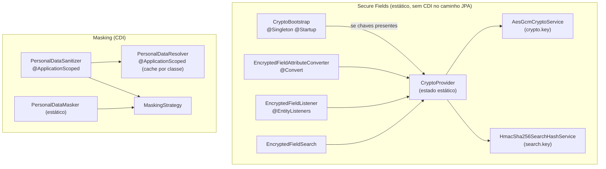

# SeedGrid Privacy — Visão geral

> [!info] Library, não extension Quarkus
> `seedgrid-quarkus-lib-privacy` é uma **library Java** (jar único com índice Jandex), **não** uma extension Quarkus com `runtime`/`deployment`. Não há `@ConfigRoot`/`@ConfigMapping`; a config é lida via `ConfigProvider`. Documentada nesta estrutura por uniformidade.

Configuração: [[SeedGrid/Extensions/privacy/Configuracao|Configuração do privacy]] · Enums: [[SeedGrid/Extensions/privacy/Enums|Enums do privacy]] · Exemplos: [[SeedGrid/Extensions/privacy/Exemplos|Exemplos do privacy]] · [[SeedGrid/Extensions/privacy/Rust|Porte Rust]]

## Objetivo

Primitivas de privacidade (LGPD/GDPR) para entidades JPA. **Confirmado** (`README.md`, código):
1. **Secure Fields** — cifra reversível de campos `String` no banco (AES-256-GCM, formato `v1:base64(iv):base64(ciphertext)`) e hash determinístico HMAC-SHA256 (hex, 64 chars) num campo irmão para busca por igualdade. **Opt-in** por `seedgrid.privacy.encryption.enabled` (padrão desligado → grava valor cru).
2. **Masking de PII** — redação one-way nas saídas (auditoria, export, e-mail, log, resposta de API) via `@SgPersonalData`/`@SgMaskRule` + `PersonalDataSanitizer`, ou valor a valor com `PersonalDataMasker`. Não usa chave e funciona nos dois modos.

## Coordenadas e dependências

| Item | Valor |
|---|---|
| groupId:artifactId | `br.com.seedgrid:seedgrid-privacy` |
| Versão (pom) | `2026.07.27` |
| Parent | `br.com.seedgrid:seedgrid-parent:2026.07.02` |
| Dependências | `quarkus-arc`, `quarkus-hibernate-orm`, `quarkus-jackson`; testes: `quarkus-junit5`, AssertJ, Mockito, PostgreSQL + Testcontainers |
| Dependências SeedGrid | nenhuma. É usada por `seedgrid-commons` (embeddables `Address`/`Contact`) e por extensions (audit, security, subdomain-tenancy — segundo o README) |

Fonte: `java/seedgrid-quarkus-lib-privacy/pom.xml`. **Confirmado.**

## Arquitetura

Fluxo do Secure Fields (**Confirmado**):
- **Escrita** (`EncryptedFieldAttributeConverter#convertToDatabaseColumn`): flag desligado → grava cru; ligado → cifra (valor já `v1:` não é recifrado).
- **Leitura** (`convertToEntityAttribute`): segue o **dado**, não o flag — valor `v1:...` é decifrado (exige `crypto.key`), valor cru volta como está.
- **Hash** (`EncryptedFieldListener`, `@PrePersist`/`@PreUpdate`): só se `@SgEncryptedField.searchField` estiver preenchido e o flag ligado; aplica `SearchNormalization` (`NONE`/`CANONICAL`/`EMAIL`), desce recursivamente em campos `@Embeddable` (profundidade máx. 5); o campo de hash deve ser **irmão** no mesmo objeto, senão `IllegalStateException`.
- **Busca**: `EncryptedFieldSearch#hashForSearch(valor[, normalização])` — usar a mesma normalização da anotação; `hashForSearch(valor)` usa `CANONICAL`.
- `CryptoBootstrap` (startup) configura os serviços se as chaves existirem; senão os serviços são criados lazy no primeiro uso.

## APIs públicas

| Pacote/Símbolo | Papel |
|---|---|
| `@SgEncryptedField(searchField, normalize)` | marca campo `String` sensível (cifra sempre AES-256-GCM e hash sempre HMAC-SHA256) |
| `EncryptedFieldAttributeConverter` | `AttributeConverter<String,String>` (`@Converter`, aplicar com `@Convert`) |
| `EncryptedFieldListener` | entity listener (`@EntityListeners`) |
| `EncryptedFieldSearch` | `hashForSearch(String)`, `hashForSearch(String, SearchNormalization)` |
| `CryptoProvider` (estático) | `isEncryptionEnabled()`, `looksEncrypted()`, `getCryptoService()`, `getSearchHashService()`, `getSecureSearch()`, `configure*()`, `setEncryptionEnabledForTests()`, `resetForTests()`; constantes dos nomes de propriedade |
| `CryptoService`, `SearchHashService`, `ValueNormalizer` (+ `AesGcmCryptoService`, `HmacSha256SearchHashService`, `DefaultValueNormalizer`) | interfaces/implementações substituíveis via `CryptoProvider.configure*` |
| `CryptoProperties` | POJO `cryptoKey`/`searchKey` |
| `masking.@SgPersonalData(type, maskWith)` | campo/getter com PII para redação |
| `masking.@SgMaskRule(field, type, maskWith, remove)` | regra por caminho (`cpf`, `endereco.cep`, `dependentes[].cpf`), usada por quem chama (ex.: `@SgAudit`) |
| `masking.MaskingStrategy` | `FULL`, `FORMAT`, `PARTIAL`, `HASH` (SHA-256), `TEMPLATE`, `REMOVE` |
| `masking.PersonalDataSanitizer` (bean) | `sanitizeToJson(value, sourceType, rules)`, `sanitizeToJson(value, rules)`, `sanitize(value, type[, rules])` (fail-closed) |
| `masking.PersonalDataResolver` (bean) | `resolveRules(Class)` |
| `masking.PersonalDataMasker` (estático) | `mask(value, strategy, param)`, `cpf()`, `cnpj()`, `cep()` |

Sem endpoints REST, eventos CDI ou migrations (as colunas cifradas/hash são do host; o exemplo usa `length = 512` para cifrado e `64` para hash).

## Anotações

_Fonte: código de `seedgrid-quarkus-lib-privacy` (versão local 2026.10.22, não publicada)._

| Anotação | Pacote | Onde se aplica | Atributos (padrão) | Para que serve |
|---|---|---|---|---|
| `@SgEncryptedField` | `br.com.seedgrid.privacy` | `FIELD` | `searchField` (`""`), `normalize` (`SearchNormalization.NONE`), `cryptoAlgorithm` (`CryptoAlgorithm.AES_256_GCM`), `searchAlgorithm` (`SearchAlgorithm.HMAC_SHA256`) | Marca um campo `String` como sensivel: cifrado no banco (reversivel) e, opcionalmente, pesquisavel por igualdade via um campo auxiliar de hash deterministico. |
| `@SgMaskRule` | `br.com.seedgrid.privacy.masking` | `` | `field`, `type` (`MaskingStrategy.FULL`), `maskWith` (`"***"`), `remove` (`false`) | Regra de mascaramento por caminho de campo, aplicada por quem chama o `PersonalDataSanitizer` (ex.: regras específicas de um endpoint, que vencem as anotações `SgPersonalData` do modelo). |
| `@SgPersonalData` | `br.com.seedgrid.privacy.masking` | `FIELD`, `METHOD` | `type` (`MaskingStrategy.FULL`), `maskWith` (`"***"`) | Marca um campo (ou getter) como dado pessoal (LGPD/GDPR) que deve ser mascarado quando o objeto for redigido pelo `PersonalDataSanitizer` (ex.: trilha de auditoria, export). |

## SPIs

_Fonte: código de `seedgrid-quarkus-lib-privacy` (versão local 2026.10.22, não publicada)._

Nenhuma.

## Testes existentes (não executados)

`src/test/java/br/com/seedgrid/privacy/`: `AesGcmCryptoServiceTest`, `HmacSha256SearchHashServiceTest`, `DefaultValueNormalizerTest`, `SearchNormalizationTest`, `EncryptedFieldAttributeConverterTest`, `EncryptedFieldListenerTest`, `EncryptionEnabledFlagTest`, `EncryptedFieldEmbeddableJpaTest` (JPA com `PrivacyTestPersistenceUnitInfo`, PostgreSQL/Testcontainers), `masking/{MaskingStrategy,PersonalDataMasker,PersonalDataResolver,PersonalDataSanitizer}Test`. ~57 anotações `@Test`/`@ParameterizedTest` por grep. Exemplo com testes de integração: `platform-examples/examples/seedgrid-privacy-example` (`CustomerEncryptionTest`, `PrivacySchemaBootstrapTest`). **Não executados.**

## Limitações

- **Validação no boot é parcial**: o `CryptoBootstrap` **não** verifica o flag nem a ausência de chaves; a falha ocorre no primeiro persist/hash/decifra. Por outro lado, uma chave **presente e inválida** (Base64 inválido ou < 32 bytes) lança no `CryptoBootstrap` mesmo com o flag desligado. **Confirmado** pelo código; que a exceção em bean `@Startup` aborta o boot é **Inferência**.
- `crypto.key` com mais de 32 bytes passa no `KeyDecoder` (mínimo 32) mas o AES só aceita 16/24/32 bytes — falharia no primeiro `encrypt` (**Inferência**, comportamento do JCE). Use exatamente 32 bytes.
- Estado global estático em `CryptoProvider` (não é bean CDI) — compartilhado por toda a JVM.
- Para e-mail use `SearchNormalization.EMAIL`; `CANONICAL` remove a pontuação e faria e-mails diferentes colidirem (Javadoc de `SearchNormalization`).
- Trocar de modo com dados existentes exige migração: desligado→ligado deixa registros antigos crus e sem hash; ligado→desligado exige a chave para ler valores `v1:`.
