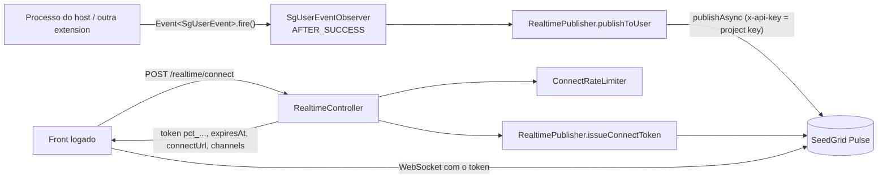

# Realtime (Quarkus) — visão geral

Avisos em tempo real para o **usuário logado** através do **SeedGrid Pulse** (serviço externo de publish/subscribe). A extension entrega ao front um token curto de conexão ao Pulse e repassa ao Pulse todo `SgUserEvent` da plataforma, sem código de negócio no host.

- Configuração: [[SeedGrid/Extensions/realtime/Configuracao|Configuração do realtime]]
- Exemplos: [[SeedGrid/Extensions/realtime/Exemplos|Exemplos do realtime]]
- Enums: a extension não define enums (nem Java nem de contrato com o Pulse).
- Porte Rust (crate `seedgrid-rust-crate-realtime`): [[SeedGrid/Extensions/realtime/Rust|Porte Rust]]

## Funcionalidades (Confirmado)

| Funcionalidade | Onde |
|---|---|
| `POST /realtime/connect` (autenticado): emite o token de conexão do usuário **da sessão** (nunca do corpo do request) | `RealtimeController#connect()` |
| Bean injetável `RealtimePublisher` (`publishToUser`, `issueConnectToken`, `isEnabled`) | `RealtimePublisher` |
| Observer de `SgUserEvent` (`seedgrid-commons`) em `TransactionPhase.AFTER_SUCCESS` → publica para o usuário | `SgUserEventObserver#onUserEvent` |
| Rate limit de emissão de token por usuário (janela fixa de 1 min, em memória, por instância) | `ConnectRateLimiter#tryAcquire` |
| "Nunca derruba quem chama": desligado = no-op; Pulse fora do ar = log WARN e segue | `RealtimePublisher#publishToUser` |

## Módulos Maven e coordenadas (Confirmado — `pom.xml`)

| Módulo | groupId | artifactId | Versão |
|---|---|---|---|
| parent | `br.com.seedgrid` | `seedgrid-realtime-parent` | `2026.10.08` |
| runtime | `br.com.seedgrid` | `seedgrid-realtime` | `2026.10.08` |
| deployment | `br.com.seedgrid` | `seedgrid-realtime-deployment` | `2026.10.08` |

Parent: `br.com.seedgrid:seedgrid-parent:2026.07.02`. `quarkus-extension.properties` exige Quarkus `[3.30,)`. Status no `quarkus-extension.yaml`: `preview`.

## Dependências

| Dependência | Versão | Observação |
|---|---|---|
| `br.com.seedgrid:seedgrid-commons` | `2026.10.08` | Só `SgUserEvent` e `CurrentUserProvider`; exclui `quarkus-hibernate-orm` e `quarkus-hibernate-orm-panache` (a extension não tem banco). |
| `br.com.seedgrid:seedgrid-pulse-publisher` | `2026.10.0` | SDK do Pulse (`PulsePublisher`, `ConnectToken`, `IssueConnectTokenInput`, `PublishMessageInput`). |
| `quarkus-arc`, `quarkus-rest-jackson`, `quarkus-security` | BOM | — |

Requisito implícito (Inferência, pelo uso de `CurrentUserProvider` e `@Authenticated`): o host precisa de um mecanismo de autenticação e de um `CurrentUserProvider` que devolva o `publicId` do usuário (no ecossistema SeedGrid, o `JwtCurrentUserProvider` do `seedgrid-security`, segundo o javadoc de `TestCurrentUserProvider`).

## Arquitetura e fluxo

- O `RealtimePublisher` monta o `PulsePublisher` uma vez, no construtor: só se `seedgrid.realtime.enabled=true` **e** houver `pulse.base-url` e `pulse.project-key` não vazios. Caso contrário fica desligado (com log ERROR se estava ligado mas incompleto). (Confirmado — `RealtimePublisher#connect`)
- `SgUserEventObserver` só publica depois do commit; se a transação desfizer, não publica. (Confirmado)
- O Pulse fingido nos testes expõe `POST /api/v1/connect-tokens` e `POST /api/v1/messages`, e o header usado é `x-api-key`. (Confirmado em `RealtimeEnabledTest`; são detalhes do SDK do Pulse, não desta extension.)

## API pública e pontos de integração

### Endpoint REST

| Método | Path | Segurança | Respostas |
|---|---|---|---|
| `POST` | `/realtime/connect` (sob o root path REST do host, se houver) | `@Authenticated` | `200 {enabled:false}` (desligado); `200 {enabled:true, token, expiresAt, connectUrl, channels}`; `401` sem usuário (inclusive o UUID zerado `00000000-0000-0000-0000-000000000000` do provider padrão); `429` com `Retry-After` (segundos); `503` se o Pulse falhar |

`RealtimeConnectResponse` usa `@JsonInclude(NON_NULL)`; `expiresAt` é epoch em **segundos**; `channels` ausente = todos os da conta. (Confirmado)

### Beans / eventos

| Símbolo | Tipo | Uso |
|---|---|---|
| `br.com.seedgrid.realtime.services.RealtimePublisher` | `@ApplicationScoped`, unremovable | `publishToUser(String channel, String event, String userPublicId, Map<String,Object> data)`; `issueConnectToken(String userPublicId)` (lança `IllegalStateException` se desligado); `isEnabled()` |
| `br.com.seedgrid.commons.events.SgUserEvent` | evento CDI (do commons) | `new SgUserEvent(userPublicId, channel, event, data)` — observado pela extension |
| `br.com.seedgrid.realtime.configs.RealtimeConfig` | `@ConfigMapping` | ver [[SeedGrid/Extensions/realtime/Configuracao|Configuração]] |

O deployment (`SeedgridRealtimeProcessor`) registra a feature `seedgrid-realtime`, o `ConfigMappingBuildItem` e torna `RealtimePublisher`, `ConnectRateLimiter` e `SgUserEventObserver` unremovable.

## Migrations

Nenhuma (a extension não tem banco). (Confirmado)

## Testes existentes (não executados)

| Teste | O que cobre |
|---|---|
| `runtime/src/test/.../RealtimeEnabledTest` | 401 sem sessão; token do usuário da sessão com a project key; `subject` do request ignorado; 503 com Pulse fora; `SgUserEvent` vira publicação; erro do Pulse não chega a quem disparou |
| `runtime/src/test/.../RealtimeDisabledTest` | desligado: `{enabled:false}` e nenhuma chamada ao Pulse |
| `runtime/src/test/.../services/ConnectRateLimiterTest` | limite por usuário, reabertura da janela, `0` desliga |
| `FakePulse` (WireMock) / `TestCurrentUserProvider` | infraestrutura de teste |

## Limitações

- O rate limit é **em memória e por instância**: com N réplicas o limite efetivo por usuário é até N × `connect-rate-per-minute` (Inferência a partir de `ConnectRateLimiter`, que usa `ConcurrentHashMap` local). As janelas antigas não são removidas do mapa (Inferência: não há limpeza no código).
- A configuração é lida uma vez na construção do `RealtimePublisher` (bean `@ApplicationScoped`); mudar config exige reinício (Inferência).
- `data` deve carregar apenas identificadores, nunca conteúdo (recomendação do README; não há validação no código).
- O `NO_USER` (UUID zerado) é uma convenção do `DefaultCurrentUserProvider` do commons; outros providers que devolvam outro sentinela não são tratados (Inferência).
