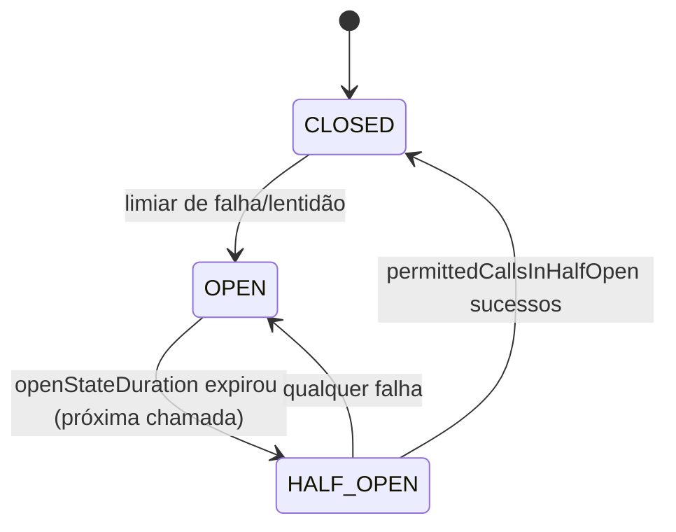

# SeedGrid Resilience — Enums

Todos os enums ficam em `runtime/src/main/java/br/com/seedgrid/resilience/core/runtime/`. Enums de teste não foram considerados. Visão geral: [[SeedGrid/Extensions/resilience/Visao-geral|Visão geral]]; propriedades: [[SeedGrid/Extensions/resilience/Configuracao|Configuração]]; equivalentes Rust: [[SeedGrid/Extensions/resilience/Rust|Rust]].

## Índice

| Enum | Pacote/arquivo | Usado em | Público? |
|---|---|---|---|
| [[#RateLimitAlgorithm]] | `ratelimiter.enums` | `@SeedGridRateLimit#algorithm`, propriedade `seedgrid.ratelimit.{configKey}.algorithm` | Sim |
| [[#KeyScope]] | `circuitbreaker.enums` (pacote do CB, mas só o rate limit usa) | `@SeedGridRateLimit#scope` | Sim |
| [[#SlidingWindowType]] | `circuitbreaker.enums` | `@SeedGridCircuitBreaker#windowType`, `CircuitBreakerConfig`, propriedade `seedgrid.circuitbreaker.{name}.window-type` | Sim |
| [[#CircuitState]] | `circuitbreaker.enums` | `CircuitDecision#state()` (retorno do SPI `CircuitBreakerStore#allowCall`), estado persistido no cache | Sim |

## RateLimitAlgorithm

Arquivo: `ratelimiter/enums/RateLimitAlgorithm.java` — FQN `br.com.seedgrid.resilience.core.runtime.ratelimiter.enums.RateLimitAlgorithm`.

| Valor | Significado | Efeito / onde é tratado | Observações |
|---|---|---|---|
| `FIXED_WINDOW` | Janela fixa (default da anotação) | `RateLimitService#resolveStrategy` → `FixedWindowAlgorithm` | **Confirmado** |
| `TOKEN_BUCKET` | Balde de tokens | → `TokenBucketAlgorithm`; `burstCapacity` só tem efeito aqui | **Confirmado** |
| `SLIDING_WINDOW` | Janela deslizante | → `SlidingWindowAlgorithm` | **Confirmado** |

- Campos/métodos: nenhum (enum puro). `switch` exaustivo sem `default` em `resolveStrategy`.
- Serialização: não é persistido nem exposto em JSON. Na config é lido como `String` e convertido por `RateLimitAlgorithm.valueOf(v.trim().toUpperCase().replace('-', '_'))` — aceita `token-bucket`, `Token_Bucket` etc.; valor inválido lança `IllegalArgumentException` **na chamada** (não no boot). Só é lido quando a anotação tem `configKey`.
- Usado em: [[SeedGrid/Extensions/resilience/Configuracao|`seedgrid.ratelimit.{configKey}.algorithm`]]; anotação `@SeedGridRateLimit`.
- Todas as constantes são tratadas.

## KeyScope

Arquivo: `circuitbreaker/enums/KeyScope.java` — FQN `br.com.seedgrid.resilience.core.runtime.circuitbreaker.enums.KeyScope`.

| Valor | Significado | Efeito / onde é tratado | Observações |
|---|---|---|---|
| `METHOD` | Limite por método (default) | `RateLimitService#buildKey`: `scopePart` = `methodSignature` (`Classe#metodo(tipos)`) | **Confirmado** |
| `CLASS` | Limite compartilhado por classe | `scopePart` = `invocation.getTarget().getClass().getName()` | **Confirmado**; é a classe do alvo (pode ser subclasse/proxy CDI — **Inferência**) |
| `GROUP` | Limite compartilhado por grupo lógico | `scopePart` = `ann.group()`; se vazio/blank cai em `methodSignature` | **Confirmado** |

- Campos/métodos: nenhum.
- Serialização: não é lido da config (só atributo da anotação); entra apenas na chave de cache `rl:{tenant}[:{operation}]:{scopePart}:{identity}`.
- Observação: o enum vive no pacote `circuitbreaker.enums`, mas o circuit breaker não o usa.

## SlidingWindowType

Arquivo: `circuitbreaker/enums/SlidingWindowType.java` — FQN `br.com.seedgrid.resilience.core.runtime.circuitbreaker.enums.SlidingWindowType`.

| Valor | Significado | Efeito / onde é tratado | Observações |
|---|---|---|---|
| `COUNT_BASED` | Janela por contagem (default) | `CacheBackedCircuitBreakerStore#evaluateThresholds`: sem corte temporal (`windowStart = Long.MIN_VALUE`) | **Confirmado** |
| `TIME_BASED` | Janela por tempo | `windowStart = now - slidingWindowSize*1000`; `slidingWindowSize` vira **segundos**; entradas com timestamp `<= windowStart` são ignoradas | **Confirmado** |

- Campos/métodos: nenhum. O código só compara com `TIME_BASED`; qualquer outro valor se comportaria como `COUNT_BASED`.
- Serialização: não é persistido no estado do cache. Na config: `String` → `valueOf(v.trim().toUpperCase().replace('-', '_'))`; inválido → `IllegalArgumentException` na chamada. Só é lido quando a anotação tem `name` preenchido (`CircuitBreakerConfigResolver#resolve`).
- Usado em: [[SeedGrid/Extensions/resilience/Configuracao|`seedgrid.circuitbreaker.{name}.window-type`]]; `@SeedGridCircuitBreaker#windowType`; `CircuitBreakerConfig`.

## CircuitState

Arquivo: `circuitbreaker/enums/CircuitState.java` — FQN `br.com.seedgrid.resilience.core.runtime.circuitbreaker.enums.CircuitState`.

| Valor | Significado | Efeito / onde é tratado | Observações |
|---|---|---|---|
| `CLOSED` (ordinal 0) | Chamadas passam; métricas gravadas | `doAllowCall` permite; `doRecord` grava no ring e avalia limiares | Estado inicial e fallback de ordinal inválido. **Confirmado** |
| `OPEN` (ordinal 1) | Chamadas negadas | `doAllowCall`: se `elapsed >= openStateDurationMs` → `HALF_OPEN`, senão `deny(restante)`; `doRecord` ignora resultados | **Confirmado** |
| `HALF_OPEN` (ordinal 2) | Sondagem com até `permittedCallsInHalfOpen` chamadas | permite até o limite, depois `deny(0)`; falha → `OPEN`; `permittedCallsInHalfOpen` sucessos → `CLOSED` (zera o ring) | **Confirmado** |

- Campos/métodos: nenhum.
- Persistência: **por ordinal** — `circuitState.ordinal()` (int de 4 bytes) no blob binário do cache (`serialize`/`deserialize`); ordinal fora de 0..2 → `CLOSED`. **Reordenar ou inserir constantes quebra estados já gravados e a compatibilidade com o Rust** (ver [[SeedGrid/Extensions/resilience/Rust|Rust]]). Sem JSON, sem tabela SQL/CHECK.
- Exposição: `CircuitDecision#state()` retorna `CLOSED`/`HALF_OPEN` em `allow` e sempre `OPEN` em `deny`; nenhum código do módulo lê `state()` (o interceptor usa só `allowed()` e `retryAfterMs()`).

A transição `CLOSED → OPEN` está em `CacheBackedCircuitBreakerStore` (`s.circuitState = CircuitState.OPEN` após `evaluateThresholds`).

## Internos

Nenhum enum interno em `src/main`; os 4 acima são públicos. Enum do JDK no contrato: `java.time.temporal.ChronoUnit` em `@SeedGridRateLimit#windowUnit` (default `SECONDS`) e `#minSpacingUnit` (default `MILLIS`).

## Notas Rust

- Grafia em PascalCase (`Closed`, `HalfOpen`, `CountBased`…); valor de string inválido causa `panic!`.
- `TimeUnit` aceita só `Millis`, `Seconds`, `Minutes`, `Hours`.
