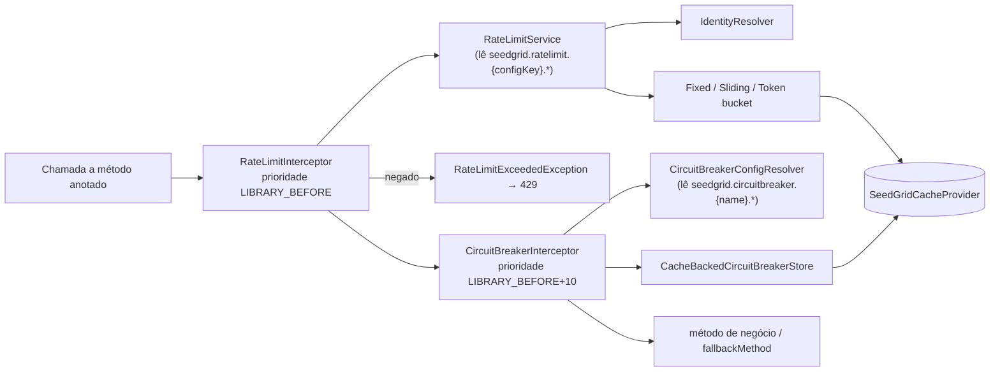

# SeedGrid Resilience (Quarkus) — Visão geral

Extension Quarkus de **rate limiting** e **circuit breaker** declarativos. O desenvolvedor anota métodos/classes CDI com `@SeedGridRateLimit` ou `@SeedGridCircuitBreaker`; interceptors CDI aplicam a regra e guardam o estado no `SeedGridCacheProvider` (lib `seedgrid-cache`), de modo que, com um provider distribuído (Redis/Valkey/Dragonfly), o limite/circuito é compartilhado entre instâncias. A anotação define os valores padrão; com `configKey` (rate limit) ou `name` (circuit breaker) os valores podem ser sobrescritos por properties em runtime.

- Configuração completa: [[SeedGrid/Extensions/resilience/Configuracao|Configuração do resilience]]
- Enums (`RateLimitAlgorithm`, `KeyScope`, `SlidingWindowType`, `CircuitState`): [[SeedGrid/Extensions/resilience/Enums|Enums do resilience]]
- Exemplos: [[SeedGrid/Extensions/resilience/Exemplos|Exemplos do resilience]]
- Crate equivalente: [[SeedGrid/Extensions/resilience/Rust|Porte Rust]]
- Dependência de cache: [[SeedGrid/Extensions/cache/Visao-geral|Visão geral do cache]]

> Não é baseada em MicroProfile Fault Tolerance / SmallRye Fault Tolerance: não há dependência `quarkus-smallrye-fault-tolerance` nem uso de `@Retry`/`@CircuitBreaker` do MP. Propriedades no formato `<classe>/<método>/<Anotação>/<param>` **não** se aplicam. **Confirmado** (poms e imports).

## Módulos e coordenadas

| Módulo | groupId | artifactId | Versão | Papel |
|---|---|---|---|---|
| raiz (`pom.xml`) | `br.com.seedgrid` | `seedgrid-resilience-core-parent` | `2026.10.13` | POM agregador; parent `seedgrid-parent:2026.07.02`. Módulos: `deployment`, `runtime` |
| `runtime` | `br.com.seedgrid` | `seedgrid-resilience-core` | `2026.10.13` | Anotações, interceptors, serviços, SPI, filtros JAX-RS. Gera `META-INF/jandex.idx` (jandex-maven-plugin) |
| `deployment` | `br.com.seedgrid` | `seedgrid-resilience-core-deployment` | `2026.10.13` | `SeedgridResilienceCoreProcessor`: só registra a feature `seedgrid-resilience-core` |
| `integration-tests` | `br.com.seedgrid` | `seedgrid-resilience-core-integration-tests` | — | **Não** listado em `<modules>` do POM raiz; contém apenas um recurso "hello" de template |

Observações:
- `quarkus-extension.yaml`: nome "SeedGrid Resilience Core", status `preview`.

## Dependências

| Dependência | Escopo | Uso |
|---|---|---|
| `io.quarkus:quarkus-arc` | compile | CDI / interceptors |
| `br.com.seedgrid:seedgrid-cache-core:2026.10.13` | compile | `SeedGridCacheProvider` (`increment`, `getBytes`, `putBytes`, `withLock`) |
| `jakarta.ws.rs:jakarta.ws.rs-api` | provided | `RateLimitExceptionMapper`, `RateLimitContainerResponseFilter` |
| `io.quarkus:quarkus-vertx-http` | provided | `IpIdentityResolver` (injeção opcional de `HttpServerRequest`) |
| `seedgrid-cache-redis`, `quarkus-redis-client`, testcontainers, mockito | test | Testes |

Provider de cache: o `seedgrid-cache-core` traz `DefaultSeedGridCache` como `@DefaultBean` (em memória); os providers `seedgrid-cache-redis`/`-valkey`/`-dragonfly` são `@Alternative`. Sem um provider distribuído no classpath, o estado de rate limit/circuit breaker fica **por processo** (`DefaultSeedGridCache`, `@DefaultBean` em `seedgrid-cache-core`; o teste `SeedgridResilienceCoreTest` sobe sem provider nem config). **Confirmado**.

## Arquitetura e fluxo

### Rate limit (`@SeedGridRateLimit`)
1. `RateLimitInterceptor` resolve a anotação: método → método na classe alvo → hierarquia de classes → interfaces.
2. `RateLimitService#tryAcquire`: se `configKey` não vazio e `seedgrid.ratelimit.{configKey}.enabled=false`, permite sem contar. Senão resolve identidade, permits, janela, min-spacing, burst e algoritmo (config vence anotação quando há `configKey`), valida (`permits > 0`, `window > 0`, `burstCapacity >= 0`, `minSpacing >= 0`, senão `IllegalArgumentException`).
3. Chave no cache: `rl:{tenant}:{operation}:{scope}:{identity}` (sem `operation` quando vazio). `tenant` vem do atributo `tenantId` do `SeedGridInvocationContext` (padrão `no-tenant`); `operation` do atributo `operation`. `scope`: `METHOD` → assinatura do método; `CLASS` → nome da classe alvo; `GROUP` → `group` (ou assinatura se vazio).
4. Algoritmos:
   - `FIXED_WINDOW`: `cache.increment(key, window)`. **Não aplica `minSpacing`** (o campo é ignorado nesse algoritmo — **Confirmado**).
   - `SLIDING_WINDOW`: lista de timestamps sob `withLock`; aplica `minSpacing`.
   - `TOKEN_BUCKET`: capacidade = `burstCapacity` (ou `permits` se 0), reposição `permits/window`; aplica `minSpacing`.
5. Negado → `RateLimitExceededException`; `RateLimitExceptionMapper` (JAX-RS) responde **429** com `X-RateLimit-Limit`, `X-RateLimit-Remaining: 0`, `X-RateLimit-Reset` e `Retry-After` (segundos, arredondados para cima).
6. Permitido e `emitHeaders=true` → `RateLimitHeaderCarrier` (ThreadLocal) e `RateLimitContainerResponseFilter` acrescentam `X-RateLimit-Limit/Remaining/Reset` à resposta.

### Circuit breaker (`@SeedGridCircuitBreaker`)
1. `CircuitBreakerInterceptor` resolve a anotação (método → método na classe alvo → hierarquia).
2. Kill switch: `seedgrid.circuitbreaker.{name}.enabled=false` → chama o método direto.
3. Nome do circuito = `name` ou, se vazio, assinatura `Classe#metodo(tipos)`. Chave no cache: `cb:{nome}`.
4. `CacheBackedCircuitBreakerStore` (sob `withLock` de 1 s): estados `CLOSED` → `OPEN` (taxa de falha ≥ `failureRateThreshold` ou, se `slowCallDurationThresholdMs > 0`, taxa de lentas ≥ `slowCallRateThreshold`, após `minimumNumberOfCalls`) → `HALF_OPEN` após `openStateDurationMs` → `CLOSED` quando `permittedCallsInHalfOpen` sondas têm sucesso, ou volta a `OPEN` na primeira falha.
5. Janela: ring buffer de tamanho `slidingWindowSize`. Em `TIME_BASED`, `slidingWindowSize` é **também** a duração em segundos da janela (e o tamanho máximo do buffer). Alterar `slidingWindowSize` descarta o estado salvo. TTL do estado: `max(openStateDurationMs*2, 1h)`.
6. Exceções: conta como falha se for subclasse de algum `recordExceptions` e não de `ignoreExceptions` (ignore vence).
7. Circuito aberto → `CircuitBreakerOpenException(circuitName, retryAfterMs)`; com `fallbackMethod`, chama o fallback. O fallback também é chamado em **qualquer** exceção do método (mesmo as ignoradas). Assinaturas procuradas, em ordem: `(params..., TipoDaExceção ou superclasse)`, `(params...)`, `()`; precisa ser método **público** (`Class#getMethod`).

## APIs públicas e pontos de integração

| Tipo | Símbolo | Descrição |
|---|---|---|
| Anotação (InterceptorBinding) | `...ratelimiter.annotations.SeedGridRateLimit` | `permits`, `window`, `windowUnit`, `algorithm`, `burstCapacity`, `minSpacing`, `minSpacingUnit`, `identity`, `group`, `scope`, `emitHeaders`, `configKey` (detalhes em [[SeedGrid/Extensions/resilience/Configuracao\|Configuração]]) |
| Anotação (InterceptorBinding) | `...circuitbreaker.annotations.SeedGridCircuitBreaker` | `name`, `slidingWindowSize`, `windowType`, `failureRateThreshold`, `slowCallDurationThresholdMs`, `slowCallRateThreshold`, `minimumNumberOfCalls`, `openStateDurationMs`, `permittedCallsInHalfOpen`, `recordExceptions`, `ignoreExceptions`, `fallbackMethod` |
| SPI | `...ratelimiter.spi.IdentityResolver` | `String resolve(SeedGridInvocationContext ctx)`; prontos: `IpIdentityResolver` (X-Forwarded-For → X-Real-IP → remote address → `anonymous`), `AnonymousIdentityResolver` |
| SPI | `...circuitbreaker.spi.CircuitBreakerStore` | `allowCall`, `onSuccess`, `onError`; implementação `CacheBackedCircuitBreakerStore` (`@ApplicationScoped`, sem `@DefaultBean`) |
| SPI | `...ratelimiter.algorithm.RateLimitAlgorithmStrategy` | `acquire(SeedGridCacheProvider, RateLimitRequest)` |
| Contexto | `...core.SeedGridInvocationContext` / `ThreadLocalSeedGridInvocationContext` | `set/clear/runWith/callWith`; atributos `tenantId` e `operation` entram na chave do rate limit. A extension **não** popula esse contexto: o host precisa fazê-lo (senão usa `EmptySeedGridInvocationContext`) |
| Beans CDI | `RateLimitService`, `RateLimitService.Clock`, `CircuitBreakerConfigResolver`, algoritmos | `@ApplicationScoped` |
| Exceções | `RateLimitExceededException` (mapeada para 429), `CircuitBreakerOpenException` | `CircuitBreakerOpenException` **não** tem `ExceptionMapper` na extension — **Inferência**: em endpoint REST sem fallback vira erro 500 se o host não mapear |
| JAX-RS | `RateLimitExceptionMapper`, `RateLimitContainerResponseFilter` (`@Provider`) | Headers `X-RateLimit-*`, `Retry-After` |

Endpoints REST próprios: nenhum no runtime (o `integration-tests` tem só `GET /seedgrid-resilience-core` de template). Migrations: nenhuma. Eventos: nenhum.

## Testes existentes (não executados)

| Local | Tipo | Cobre |
|---|---|---|
| `runtime/src/test/.../ratelimiter/RateLimitAlgorithmsIT.java` | IT com Redis (Testcontainers, `disabledWithoutDocker`) | Os 3 algoritmos: limite, reset, min-spacing, burst, refill |
| `runtime/src/test/.../circuitbreaker/CircuitBreakerStoreIT.java` | IT com Redis | Transições de estado, slow calls, record/ignore, janela por tempo, persistência |
| `runtime/src/test/.../ratelimiter/services/RateLimitServiceConfigOverrideTest.java` | Unitário (Mockito `Config`) | Overrides `seedgrid.ratelimit.checkout.*`, kebab-case em `algorithm`, sem `configKey` ignora config |
| `runtime/src/test/.../circuitbreaker/configs/CircuitBreakerConfigResolverTest.java` | Unitário | Overrides `seedgrid.circuitbreaker.payments.*`, sem `name` ignora config, `enabled` |
| `runtime/src/test/.../ratelimiter/spi/IpIdentityResolverTest.java`, `AnonymousIdentityResolverTest.java` | Unitário | Resolução de identidade |
| `deployment/src/test/.../SeedgridResilienceCoreTest.java`, `SeedgridResilienceCoreDevModeTest.java` | QuarkusUnitTest / DevModeTest | Boot sem camada HTTP e sem config |

## Limitações
- `minSpacing` não tem efeito com `FIXED_WINDOW`.
- O kill switch do rate limiter (`enabled=false`) ainda emite headers `X-RateLimit-*` (limite = `permits` da anotação), quando `emitHeaders=true`.
- Valores inválidos de `algorithm`/`window-type` só falham na chamada (`IllegalArgumentException` de `Enum.valueOf`), não no boot.
- `CircuitBreakerOpenException` sem mapper HTTP.
