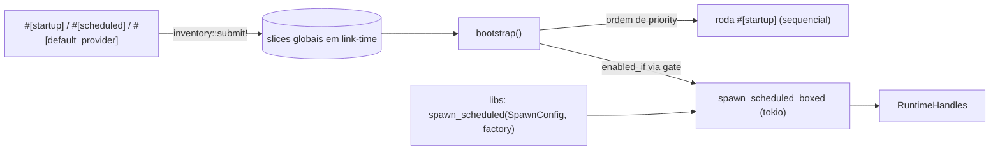

# runtime — Visão geral (só Rust: `seedgrid-runtime` + `seedgrid-macros`)

Par de crates que reproduz em Rust, **em tempo de compilação**, o auto-wiring do Quarkus/CDI que os hosts SeedGrid têm no Java: anotar funções e chamar um único `bootstrap()`. Não há extensão Java equivalente (é infraestrutura do lado Rust). Configuração e referência dos atributos das macros: [[SeedGrid/Extensions/runtime/Configuracao-Rust|Configuração Rust do runtime]].

| Crate | Papel |
|---|---|
| `seedgrid-runtime` (lib `seedgrid_runtime`) | registro `inventory`, `bootstrap()`/`RuntimeHandles`, motor de agendamento (cron/intervalo), eventos ao usuário (`events`); reexporta as macros, `inventory` e `anyhow` |
| `seedgrid-macros` (lib `seedgrid_macros`, `proc-macro = true`) | attribute macros `#[startup]`, `#[scheduled]`, `#[default_provider]`, `#[rate_limit]`, `#[circuit_breaker]`, `#[audited]` e o derive `#[derive(PersonalData)]` |

Ambas: versão do workspace `2026.10.14`, edição 2021, MSRV 1.82, sem features Cargo. `seedgrid-runtime` depende de `seedgrid-macros`, `inventory 0.3`, `tokio`, `chrono`; resilience, cache e audit são só **dev-dependencies** (exemplo/teste). Recomendação do README: depender só de `seedgrid-runtime` (o código gerado usa `::seedgrid_runtime::...`); a exceção é `#[derive(PersonalData)]`, que gera `::seedgrid_privacy::...` e é reexportado pela crate privacy.

## Mapeamento CDI/Quarkus → Rust
| Java | Rust | Fase |
|---|---|---|
| `@Observes StartupEvent` / `@Startup` + `@Priority` | `#[startup(priority = N)]` (menor roda antes) | 1 |
| `@Scheduled(cron / every)` | `#[scheduled(cron = "...")]` / `#[scheduled(every = "...")]` | 1 |
| gate `{config.key}` do `@Scheduled` | `#[scheduled(..., enabled_if = "ENV_VAR")]` | 1 |
| `ConcurrentExecution.SKIP` / `PROCEED` | `concurrent = false` (padrão) / `true` | 1 |
| `@DefaultBean` | `#[default_provider(spi, provider, priority)]` + `resolve_spi` (só metadados; maior prioridade vence) | 1 |
| `@SeedGridRateLimit` | `#[rate_limit(...)]` → `seedgrid-resilience` | 2 |
| `@SeedGridCircuitBreaker` | `#[circuit_breaker(...)]` → `seedgrid-resilience` | 2 |
| `@Audit` | `#[audited(...)]` → `seedgrid-audit` | 3 |
| `@PersonalData` / `@EncryptedField` | `#[derive(PersonalData)]` → `seedgrid-privacy` | — |
| `Event<SgUserEvent>` + `@Observes(AFTER_SUCCESS)` | `events::UserEventSink` / `SgUserEvent` | — |
| boot / shutdown do container | `bootstrap()`, `bootstrap_with(opts)` / `RuntimeHandles::shutdown()` | 1 |

Fonte: `rust/seedgrid-runtime/src/lib.rs`.

## Arquitetura

- Fase 1 usa `inventory`: o linker precisa manter os símbolos (funciona em binários, exemplos e testes de integração; numa lib nunca referenciada pelo binário, itens podem ser descartados — caveat do README).
- Fases 2/3 **não** usam `inventory`: são interceptors por função que embrulham o corpo e obtêm dependências via funções-provider sem argumentos (`service`, `cache`, `auditor`).
- `startup` com erro: `fail_fast = true` (padrão) aborta o boot; senão loga e continua. Erros de `#[scheduled]` só são logados (a task sobrevive).

## API pública (`seedgrid-runtime`)
| Grupo | Símbolos | Fonte |
|---|---|---|
| Boot | `bootstrap()`, `bootstrap_with(BootstrapOptions)`, `BootstrapOptions { fail_fast, run_startup, run_scheduled, gate }`, `BootstrapOptions::with_gate`, `default_gate`, `EnabledGate` | `src/bootstrap.rs` |
| Handles | `RuntimeHandles::{scheduled_task_count, task_names, abort_all, shutdown}` | idem |
| Agendamento programático (para libs) | `spawn_scheduled(SpawnConfig, factory) -> JoinHandle`, `SpawnConfig::{new, concurrent, with_initial_delay}`, `RunSchedule::{cron, every, from_spec}`, `JobFactory` | `src/scheduler.rs` |
| Cron / duração | `CronSchedule::{parse, matches, next_after}` (quartz de 6 campos: `*`, `?`, `*/n`, `a-b`, `a,b`; dia da semana 0=domingo, aceita 7), `parse_duration` (`ms`, `s`, `m`, `h`, `d`; zero → `None`) | `src/cron.rs` |
| Registro | `StartupItem`, `ScheduledItem`, `ScheduleSpec`, `SpiBinding`, `TaskRunner`, `BoxFuture`, `resolve_spi`, `startup_items_sorted`, `scheduled_items` | `src/registry.rs` |
| Eventos | `events::{SgUserEvent, UserEventSink, NoopUserEventSink, noop_user_event_sink}` | `src/events.rs` |

## Quem usa no workspace (**Confirmado** por grep)
| Crate | O que usa |
|---|---|
| backup | `events::{UserEventSink, SgUserEvent, noop_user_event_sink}` (aviso de export concluído) |
| realtime | `events::*` (implementa `UserEventSink`), `parse_duration` |
| subdomain-tenancy | `spawn_scheduled`, `RunSchedule`, `SpawnConfig`, `CronSchedule`, `events` |
| privacy | `#[derive(PersonalData)]` (via `seedgrid-macros`) |
| — | Nenhuma crate de plataforma usa `#[startup]`, `#[scheduled]`, `#[rate_limit]`, `#[circuit_breaker]` ou `#[audited]` fora dos exemplos/testes do runtime |

## Exemplo (de `rust/seedgrid-runtime/examples/quickstart.rs`)
```rust
use anyhow::Result;
use seedgrid_runtime::{scheduled, startup};

#[startup(priority = 10)]
async fn seed_database() -> Result<()> { Ok(()) }

#[scheduled(every = "2s")]
async fn heartbeat() -> Result<()> { Ok(()) }

#[scheduled(cron = "0 0 * * * *")]
async fn hourly_report() -> Result<()> { Ok(()) }

#[tokio::main]
async fn main() -> Result<()> {
    let handles = seedgrid_runtime::bootstrap().await?;
    tokio::time::sleep(std::time::Duration::from_millis(5100)).await;
    handles.shutdown().await;
    Ok(())
}
```
Fases 2/3 completas: `rust/seedgrid-runtime/examples/resilience_audit.rs` (`cargo run -p seedgrid-runtime --example resilience_audit`). API programática (doc de `src/scheduler.rs`):
```rust
let schedule = RunSchedule::cron("0 0 * * * ?").expect("cron valido");
let handle = spawn_scheduled(SpawnConfig::new("nightly_cleanup", schedule), || async { Ok(()) });
```

## Testes
`rust/seedgrid-runtime/tests/macros.rs` (coleta e ordem de `#[startup]`, gate `enabled_if` ligado/desligado, task disparando, `default_provider`) e `tests/resilience_audit.rs` (macros de Fase 2/3); unitários em `src/cron.rs`. **Não executados.**

## Limitações
- `#[startup]`/`#[scheduled]` não recebem argumentos; a função deve ser `async fn() -> anyhow::Result<()>` ou `-> ()`.
- Empate de `priority` tem ordem indefinida.
- `#[default_provider]` registra só metadados (sem DI real) — roadmap do README.

## Enums
Sem equivalente Java. Públicos:

| Enum | Arquivo | Variantes / uso |
|---|---|---|
| `ScheduleSpec` | `seedgrid-runtime/src/registry.rs` | `Cron(&'static str)` ou `Every(&'static str)` — gerado por `#[scheduled(cron=…)]` / `#[scheduled(every=…)]` (exatamente um dos dois) |
| `RunSchedule` | `seedgrid-runtime/src/scheduler.rs` | `Interval(Duration)` ou `Cron(CronSchedule)` — schedule já compilado (`RunSchedule::cron`, `every`, `from_spec`); `None` se a expressão for inválida |

As macros (`seedgrid-macros`) não definem enums; o derive `PersonalData` usa `SearchNormalization` ([[SeedGrid/Extensions/privacy/Rust#Enums|Enums do privacy Rust]]).
