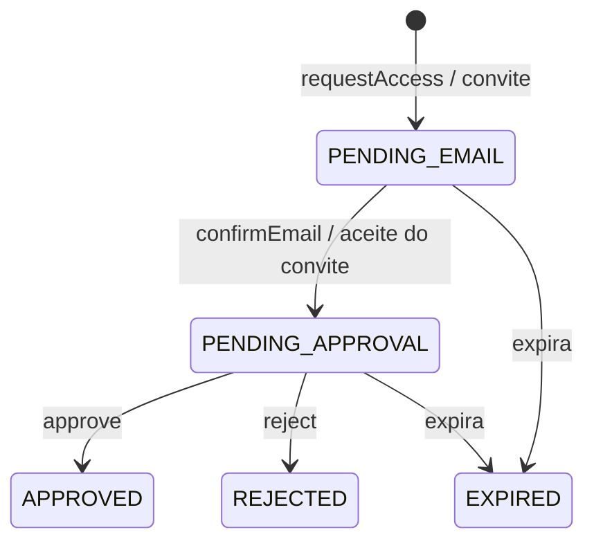

# security — Enums (Quarkus)

Voltar para [[SeedGrid/Extensions/security/Visao-geral|Visão geral do security]] · [[SeedGrid/Extensions/security/Configuracao|Configuração]] · [[SeedGrid/Extensions/security/Rust|Porte Rust]]

Caminho-base: `java/seedgrid-quarkus-ext-security/runtime/src/main/java/br/com/seedgrid/security/`. Os módulos `deployment` e testes não declaram enums de contrato.

## Índice

| Enum | Pacote/arquivo | Usado em | Público? |
|---|---|---|---|
| [[SeedGrid/Extensions/security/Enums#TwoFactorMethodType\|TwoFactorMethodType]] | `twofactors/TwoFactorMethodType.java` | Corpo de `POST /2f/enable` e `POST /2f/setup/confirm`, resposta de enable, estratégias 2FA, config `2f.allowed-methods` (por código textual) | Sim |
| [[SeedGrid/Extensions/security/Enums#EntryRequestStatus\|EntryRequestStatus]] | `entities/EntryRequestStatus.java` | Coluna `entry_requests.status`, self-enter, job de limpeza | Sim (persistido) |
| [[SeedGrid/Extensions/security/Enums#EntryRequestOrigin\|EntryRequestOrigin]] | `entities/EntryRequestOrigin.java` | Coluna `entry_requests.origin`, self-enter | Sim (persistido) |
| [[SeedGrid/Extensions/security/Enums#UserCreateOptions.Delivery\|UserCreateOptions.Delivery]] | `services/UserCreateOptions.java` (enum aninhado) | API Java para quem cria usuário por fluxo próprio (`UserService#createUser`) | Sim (API de bean) |

## TwoFactorMethodType

Arquivo: `…/security/twofactors/TwoFactorMethodType.java` — FQN `br.com.seedgrid.security.twofactors.TwoFactorMethodType`. Javadoc: helper de tipo para os métodos 2FA padrão; o código do método é guardado como **String** no banco para permitir implementações custom.

| Valor | Significado | Efeito / onde é tratado | Observações |
|---|---|---|---|
| `EMAIL` | Código de uso único por e-mail | `EmailTwoFactorStrategy#getMethodCode`; `TwoFactorController` exige e-mail confirmado para ativar | Confirmado |
| `WHATSAPP` | Código de uso único por WhatsApp | `WhatsappTwoFactorStrategy#getMethodCode`; ativação exige WhatsApp do usuário e `2f.whatsapp.channel-id`; `MeProfileController` compara com o método primário | Confirmado |
| `TOTP` | Código de app autenticador | `TotpTwoFactorStrategy#getMethodCode`; `TwoFactorController` (setup/confirm e disable); `TwoFactorService` grava como método primário ao confirmar | Confirmado |
| `BACKUP_CODE` | Código de backup | Existe no enum, mas **nenhum código o referencia** (não há estratégia com esse código; o fallback por backup code em `TwoFactorService` usa `BackupCodeService` direto). Enviá-lo em `method` passa na desserialização, mas não há estratégia registrada para ele | Confirmado (busca por referências) |

- **Campos/métodos:** `getCode()` (igual ao nome da constante) e `static fromCode(String)` — comparação `equalsIgnoreCase`, retorna `null` se não achar. `fromCode` não é chamado em lugar nenhum do módulo.
- **JSON:** sem `@JsonValue`/`@JsonCreator`; o Jackson usa o **nome exato** (maiúsculas, case-sensitive) em `Enable2FADTO.method`, `SetupConfirmDTO.method` e `Enable2FAResponseDTO.method`. Valor desconhecido → erro de desserialização (400).
- **Persistência:** o enum **não** é persistido; `users.two_factor_primary_method` é `VARCHAR(32)` com o código textual (`User#enableTwoFactor(String)`). Não há CHECK constraint (V202), então estratégias custom (ex.: `SMS`) podem ser gravadas.
- **Config:** `seedgrid.security.2f.allowed-methods` é `List<String>` (não usa o enum); os valores são normalizados com `trim().toUpperCase()` e cruzados com as estratégias registradas. Ver [[SeedGrid/Extensions/security/Configuracao|Configuração §2.5]].
- **Observação:** como o DTO usa o enum, um método custom (`SMS`) não pode ser ativado por `POST /2f/enable` (o corpo é rejeitado) mesmo estando em `allowed-methods`. *Inferência* a partir do tipo do campo `method`.

## EntryRequestStatus

Arquivo: `…/security/entities/EntryRequestStatus.java` — FQN `br.com.seedgrid.security.entities.EntryRequestStatus`. Sem Javadoc; significados deduzidos do tratamento.

| Valor | Significado | Efeito / onde é tratado | Observações |
|---|---|---|---|
| `PENDING_EMAIL` | Aguardando confirmação do e-mail (OTP no signup público; aceite do convite) | Estado inicial de `requestAccess` e do convite (`SelfEnterService`); `confirmEmail`/`resendEmail` exigem este estado; o job expira registros neste estado | Confirmado |
| `PENDING_APPROVAL` | Aguardando aprovação administrativa | `EntryRequest#markEmailConfirmed` e `#markInvitationAccepted` levam a este estado; `approve`/`reject` só aceitam este estado; listagem "to-approve" | Confirmado |
| `APPROVED` | Aprovada; usuário criado | `EntryRequest#approve`; elegível a purga | Confirmado |
| `REJECTED` | Rejeitada por um administrador | `EntryRequest#reject`; elegível a purga | Confirmado |
| `EXPIRED` | Expirada | `EntryRequest#expire` (ao aprovar/confirmar uma solicitação vencida) e `EntryRequestRepository#expireOldRequests` (PENDING_EMAIL/PENDING_APPROVAL com `expiresAt` vencido); elegível a purga | Confirmado |

- **Persistência:** `@Enumerated(EnumType.STRING)` em `entry_requests.status` (`VARCHAR(30)`). **CHECK** `chk_entry_request_status` (V201) aceita exatamente `PENDING_EMAIL, PENDING_APPROVAL, APPROVED, REJECTED, EXPIRED` — igual às constantes.
- **JSON:** `EntryRequestDTORes.status` é do tipo `EntryRequestStatus`, serializado pelo nome da constante (sem `@JsonValue`).
- **Purga:** `EntryRequestCleanupJob` apaga `APPROVED/REJECTED/EXPIRED` mais antigos que `self-enter.cleanup.purge-after` ([[SeedGrid/Extensions/security/Configuracao|Configuração]]).

Convite com `invite-needs-approval=false` chama `approve` logo após o aceite (vai direto a `APPROVED`).

## EntryRequestOrigin

Arquivo: `…/security/entities/EntryRequestOrigin.java` — FQN `br.com.seedgrid.security.entities.EntryRequestOrigin`.

| Valor | Significado | Efeito / onde é tratado | Observações |
|---|---|---|---|
| `PUBLIC` | Pedido criado pelo signup público | `SelfEnterService#requestAccess`; confirmação/reenvio de e-mail exigem esta origem; também é o default em `@PrePersist` quando nulo e o `DEFAULT 'PUBLIC'` da coluna | Confirmado |
| `INVITE` | Pedido criado por convite administrativo | `SelfEnterService` (convite); aceite/complete/reenvio de convite exigem esta origem; repositório consulta convites pendentes | Confirmado |

- **Persistência:** `@Enumerated(EnumType.STRING)`, coluna `origin VARCHAR(20) NOT NULL DEFAULT 'PUBLIC'` (V217). **Não há CHECK constraint** para `origin` (diferente de `status`).
- Relações: `public-enabled` rege `PUBLIC`; `invite-enabled` rege `INVITE` — [[SeedGrid/Extensions/security/Configuracao|Configuração §2.6]].

## UserCreateOptions.Delivery

Arquivo: `…/security/services/UserCreateOptions.java` — FQN `br.com.seedgrid.security.services.UserCreateOptions.Delivery` (enum aninhado no record `UserCreateOptions`). Define como as credenciais iniciais chegam ao usuário criado por `UserService#createUser(dto, options)`.

| Valor | Significado | Efeito / onde é tratado | Observações |
|---|---|---|---|
| `SECURITY_WELCOME_EMAIL` | E-mail de boas-vindas do security | `UserService#deliverInitialCredentials` chama `EmailServiceInterface#sendWelcomeEmail`; é o default (`UserCreateOptions.defaults()` e quando `delivery` é nulo) | Confirmado |
| `NONE` | Nenhum envio | Sem ação; `createUser` lança `BadRequestException("Senha obrigatoria…")` se a senha teria de ser gerada | Confirmado |
| `CALLBACK` | Envio feito pelo host via `ActivationMailer` | Exige `activationMailer` não nulo (senão `IllegalArgumentException`); falha do envio só é logada com `mailerBestEffort=true` | Confirmado |

- Não é persistido nem serializado em JSON; é parâmetro Java. Construtores de conveniência no record criam as variantes `NONE` e `CALLBACK`.

## Internos

Nenhum enum interno encontrado no `runtime` além dos listados.
