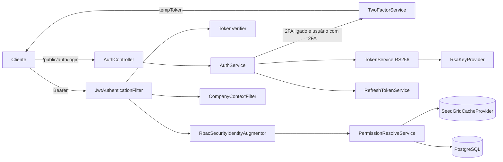

# security — Visão geral (extension Quarkus)

Notas relacionadas: [[SeedGrid/Extensions/security/Enums|Enums do security]] · [[SeedGrid/Extensions/security/Configuracao|Configuração do security]] · [[SeedGrid/Extensions/security/Exemplos|Exemplos do security]] · [[SeedGrid/Extensions/security/Rust|Porte Rust]]

> **Em andamento (não publicado):** mudanças de escopo e acesso (isolamento de RBAC entre tenants, `isolation`, permissões somente leitura, cadastro por `publicId`, `@QUERY`) em [[SeedGrid/Extensions/security/Escopo-e-acesso|Escopo e acesso]].

## Objetivo e funcionalidades

Plano de segurança pronto para aplicações Quarkus da plataforma SeedGrid (Confirmado, `README.md` + código):

- **Autenticação JWT RS256** própria (Nimbus JOSE): emissão em `TokenService`, verificação em `TokenVerifier` + `JwtAuthenticationFilter`; bridge para `mp.jwt.*` para que o `SecurityIdentity` do Quarkus funcione.
- **Refresh tokens opacos** com rotação, família, detecção de reuso (revoga a família) e janela de graça para refresh concorrente.
- **RBAC**: roles → permissões resolvidas por `PermissionResolveService` (cache via lib cache, versão RBAC + nonce de boot na chave) e injetadas como `StringPermission` pelo `RbacSecurityIdentityAugmentor` → habilita `@PermissionsAllowed`. Permissões podem ter **audience** (claim `audience` setado pelo host via `JwtTokenCustomizer`); identidades de API key (`apikey.authType=API_KEY`) são ignoradas pelo augmentor.
- **Multiempresa (T1)**: token escopado por empresa (`companyId`, `companyRoot`, `allowedCompanies`, `allCompanies`), `POST /me/select-company`, `CompanyContextFilter` (claim `companyId`, fallback header `X-Company-Id`), modelo aditivo global + por conta (`UserCompany`), empresa-plataforma identificada pelo CNPJ de `default-company`.
- **2FA**: TOTP, EMAIL e WHATSAPP (estratégias plugáveis `TwoFactorStrategy`), backup codes, QR code com logo opcional.
- **Self-enter**: signup público com OTP de e-mail + aprovação, convites (com ou sem aprovação), job de limpeza agendado. Na aprovação, as roles vêm do convite/aprovação ou, na falta delas, da `default-role` (role global; obrigatória quando o self-enter está ligado, sem padrão). O e-mail de "acesso aprovado" não é enviado (o serviço só registra log).
- **Gestão**: usuários, roles, permissões, empresas, memberships, avatares (storage da lib filemanagement), gestão pela própria conta (`/me/security/*`), perfil (`/me/profile`).
- **Política de senha** (tamanho, categorias, histórico, expiração), troca obrigatória (`PasswordChangeRequiredFilter`), BCrypt.
- **Bootstrap** de empresa default e primeiro admin no startup.
- **E-mails** HTML (templates em `runtime/src/main/resources/templates/security-default/`) via mailer nomeado `security`, com alerta operacional de falha de entrega via notification.
- **Rate-limit** dos endpoints públicos (lib resilience).
- Erros RFC 7807 (`SecurityApiExceptionExtension`, integra o `ApiExceptionHandler` da commons).

## Módulos Maven e coordenadas

| Módulo | groupId | artifactId | versão |
|---|---|---|---|
| parent (agregador) | `br.com.seedgrid` | `seedgrid-security-parent` | `2026.10.14` |
| runtime | `br.com.seedgrid` | `seedgrid-security` | `2026.10.14` |
| deployment | `br.com.seedgrid` | `seedgrid-security-deployment` | `2026.10.14` |

Parent: `br.com.seedgrid:seedgrid-parent:2026.07.02`.

Dependências SeedGrid do runtime (versões do `runtime/pom.xml`):

| Artefato | Versão | Uso |
|---|---|---|
| `seedgrid-commons` | 2026.08.16 | `CurrentUserProvider`, `BaseEntity`, `ProblemDetails`, `ApiExceptionExtension` — [[SeedGrid/Extensions/commons/Visao-geral\|commons]] |
| `seedgrid-privacy` | 2026.07.27 | Mascaramento e criptografia opcional de PII — [[SeedGrid/Extensions/privacy/Visao-geral\|privacy]] |
| `seedgrid-filemanagement` | 2026.07.08 | Storage de avatares — [[SeedGrid/Extensions/filemanagement/Visao-geral\|filemanagement]] |
| `seedgrid-cache-core` | 2026.10.13 | Cache de permissões, sessões 2FA, códigos — [[SeedGrid/Extensions/cache/Visao-geral\|cache]] |
| `seedgrid-resilience-core` | 2026.07.08 | `@SgRateLimit` — [[SeedGrid/Extensions/resilience/Visao-geral\|resilience]] |
| `seedgrid-audit-core` / `seedgrid-audit-postgresql` | 2026.09.25 | Auditoria (o postgresql aparece com `scope test` no runtime) — [[SeedGrid/Extensions/audit/Visao-geral\|audit]] |
| `seedgrid-notification-api` | 2026.10.09 | Evento `platform.email-delivery-failed` — [[SeedGrid/Extensions/notification/Visao-geral\|notification]] |
| `seedgrid-whatsapp-core` (+ `-evolution`, `-whatsapp-cloud` como `optional`) | 2026.07.27 | `WhatsAppApi` para 2FA — [[SeedGrid/Extensions/whatsapp/Visao-geral\|whatsapp]] |

Quarkus: `quarkus-arc`, `quarkus-jdbc-postgresql`, `quarkus-flyway`, `quarkus-rest-jackson`, `quarkus-smallrye-jwt`, `quarkus-smallrye-jwt-build`, `quarkus-mailer`, `quarkus-scheduler`, `quarkus-cache`, `quarkus-hibernate-validator`, `quarkus-smallrye-openapi`. Terceiros: `dev.samstevens.totp:totp:1.7.1`, `com.nimbusds:nimbus-jose-jwt:9.37.3`, `org.mindrot:jbcrypt:0.4`.

## Deployment (`SecurityProcessor`)

`java/seedgrid-quarkus-ext-security/deployment/src/main/java/br/com/seedgrid/security/deployment/SecurityProcessor.java`:
- `FeatureBuildItem("seedgrid-security")`;
- `IndexDependencyBuildItem` para `seedgrid-whatsapp-core`, `seedgrid-whatsapp-evolution`, `seedgrid-whatsapp-whatsapp-cloud`;
- `AdditionalBeanBuildItem` (unremovable) com filtros, controllers, services, repositories, configs, estratégias 2FA e implementações default das SPIs;
- `AddToOpenAPIDefinitionBuildItem(new JwtSecurityOpenApiFilter())`.
Não há configuração de build time.

## Arquitetura e fluxo



Filtros JAX-RS: `SelfEnterDisabledFilter` (`@PreMatching`, 404 quando self-enter desligado), `JwtAuthenticationFilter` (rota pública = path contém `/public/` ou `/q/`), `CompanyContextFilter`, `PasswordChangeRequiredFilter`, `PlatformScopeFilter` (anotação `@SgPlatformScope`).

## APIs públicas e pontos de integração

### Anotações

_Fonte: código de `seedgrid-quarkus-ext-security` (versão local 2026.10.22, não publicada)._

| Anotação | Pacote | Onde se aplica | Atributos (padrão) | Para que serve |
|---|---|---|---|---|
| `@SgMonoCompany` | `br.com.seedgrid.security.annotations` | `METHOD`, `TYPE` | — | Marks a controller or endpoint as exempt from company-context validation. |
| `@SgPermitWithoutPasswordChange` | `br.com.seedgrid.security.annotations` | `METHOD`, `TYPE` | — | Marca um endpoint como permitido mesmo quando o usuário precisa trocar a senha. |
| `@SgPlatformScope` | `br.com.seedgrid.security.annotations` | `TYPE`, `METHOD` | `allowSelf` (`false`) | Endpoint que administra a PLATAFORMA inteira (todas as contas): usuarios, perfis, permissoes e empresas de qualquer conta. |
| `@SgReadOnlyEnforced` | `br.com.seedgrid.security.annotations` | `TYPE` | — | Recurso `SgMonoCompany` que mesmo assim respeita o estado de acesso da empresa CORRENTE do token: em `READ_ONLY`, escrita (`POST`/`PUT`/`PATCH`/`DELETE`) responde 403 `COMPANY_READ_ONLY`, salvo metodo com `SgReadOnlySafe` (caminho de recuperacao) ou caminho da lista `seedgrid.security.company-access.read-only.allowed-paths`. |
| `@SgReadOnlySafe` | `br.com.seedgrid.security.annotations` | `METHOD`, `TYPE` | — | Marca um endpoint que NAO altera dados da empresa mesmo usando um metodo HTTP de escrita (tipicamente um `POST` de consulta que um host nao pode trocar por `GET`/`QUERY`). |

**Detalhes já documentados:**

- `@SgMonoCompany` — endpoint sem contexto de empresa (ignorado pelo `CompanyContextFilter`).
- `@SgPermitWithoutPasswordChange` — liberado mesmo com troca de senha pendente.
- `@SgPlatformScope(allowSelf=false)` + `@SgPlatformScope.Exempt` — restringe a usuários da empresa-plataforma.
- Usa as anotações Quarkus `@Authenticated`, `@RolesAllowed`, `@PermissionsAllowed`, `@PermitAll`.

### SPIs

Detalhes de cada SPI (assinaturas, o que o padrão faz, implementações reais e exemplos): [[SeedGrid/Extensions/security/SPIs|SPIs]].

_Fonte: código de `seedgrid-quarkus-ext-security` (versão local 2026.10.22, não publicada)._

| SPI | Pacote | Implementação padrão (`@DefaultBean`) | Para que serve |
|---|---|---|---|
| `AccountUserActivationMailer` | `br.com.seedgrid.security.spis` | `DefaultAccountUserActivationMailer` | Entrega o convite de ativacao de um usuario criado (ou reenviado) pelo admin de uma CONTA em `/me/security/users`. |
| `AllowedCompaniesResolver` | `br.com.seedgrid.security.spis` | `DefaultAllowedCompaniesResolver` | SPI que resolve quais companies entram no JWT do usuario. |
| `CompanyQuotaValidator` | `br.com.seedgrid.security.spis` | `DefaultCompanyQuotaValidator` | SPI que valida se a conta pode ter mais uma empresa, chamada ANTES de uma empresa ser criada (`POST /companies`) ou reativada (`active` de false para true), no molde do `UserQuotaValidator`. |
| `EmailServiceInterface` | `br.com.seedgrid.security.spis` | `DefaultEmailService` | Interface SPI para customização do envio de e-mails. |
| `JwtTokenCustomizer` | `br.com.seedgrid.security.spis` | `DefaultJwtTokenCustomizer` | SPI (Service Provider Interface) for customizing JWT token generation. |
| `JwtTokenValidator` | `br.com.seedgrid.security.spis` | `DefaultJwtTokenValidator` | SPI (Service Provider Interface) for validating custom JWT token claims. |
| `LoginScopeResolver` | `br.com.seedgrid.security.spis` | `DefaultLoginScopeResolver` | SPI que decide em QUAL company a sessao nasce escopada (T1) a partir de um `requestedScope` OPACO enviado pelo app no login. |
| `RoleUsageChecker` | `br.com.seedgrid.security.spis` | sem padrão | Extensao: outros modulos informam quantos registros deles ainda dependem de uma role (ex.: API keys do ext-apikeys), para o `RoleService` recusar a exclusao com 409 em vez de estourar a FK. |
| `SecurityScopeResolverProvider` | `br.com.seedgrid.security.spis` | `DefaultSecurityScopeResolver` | Define a partição dos dados de permissão (RBAC): o "escopo" em que o cache de permissões é guardado e consultado. |
| `SocialAccountCreator` | `br.com.seedgrid.security.spis` | `DefaultSocialAccountCreator` | SPI que CRIA a conta pessoal (PF) de quem entra pela primeira vez por login social. |
| `SocialIdentityProvider` | `br.com.seedgrid.security.spis` | sem padrão | SPI de um provedor de login social. |
| `SocialProviderCatalog` | `br.com.seedgrid.security.spis` | `DefaultSocialProviderCatalog` | Quais provedores de login social estao HABILITADOS neste host (ex.: `google`, `facebook`), para o front montar os botoes. |
| `TemplateSecurityProvider` | `br.com.seedgrid.security.spis` | `DefaultTemplateSecurityProvider` | SPI para fornecer templates de email do modulo security. |
| `TwoFactorEmailTemplateProvider` | `br.com.seedgrid.security.spis` | `DefaultTwoFactorEmailTemplateProvider` | SPI for customizing 2FA email templates. |
| `TwoFactorStrategy` | `br.com.seedgrid.security.spis` | `EmailTwoFactorStrategy`, `TotpTwoFactorStrategy`, `WhatsappTwoFactorStrategy` | Strategy interface for different 2FA methods (EMAIL, TOTP, SMS, etc.). |
| `UserAdditionalFieldsValidator` | `br.com.seedgrid.security.spis` | `DefaultUserAdditionalFieldsValidator` | Validates application-specific user attributes before they are persisted. |
| `UserQuotaValidator` | `br.com.seedgrid.security.spis` | `DefaultUserQuotaValidator` | SPI que valida se uma company pode receber mais um usuario, chamada ANTES do `User` ser persistido (aprovacao de self-enter, criacao direta via admin). |

**Como substituir:** declare um bean CDI (`@ApplicationScoped`) que implemente a interface, **sem** `@Alternative` nem `@Priority`; a implementação padrão (`@DefaultBean`) cede. SPI "sem padrão" precisa de uma implementação do host (ou de outro módulo) para o recurso funcionar.

```java
@ApplicationScoped
public class MeuAccountUserActivationMailer implements AccountUserActivationMailer {
    // implemente os métodos da interface
}
```

### Endpoints REST (paths de `controllers/RestControllerPath`)

| Grupo | Método e path |
|---|---|
| Auth (público) | `POST /public/auth/login`, `POST /public/auth/refresh`, `GET /public/auth/confirm-email`, `POST /public/auth/forgot-password`, `GET /public/auth/reset-password` |
| Me | `GET /me/permissions`, `GET /me/companies`, `POST /me/select-company` |
| Perfil | `GET /me/profile`, `PUT /me/profile`, `PUT /me/profile/password`, `POST /me/profile/avatar`, `DELETE /me/profile/avatar` |
| Gestão pela conta | `GET/POST /me/security/users`, `GET/PUT/DELETE /me/security/users/{id}`, `POST /me/security/users/{id}/resend-activation`; `GET/POST /me/security/roles`, `GET /me/security/roles/permissions`, `GET/PUT/DELETE /me/security/roles/{id}` |
| Usuários | `GET/POST /users`, `GET/PATCH/DELETE /users/{publicId}`, `PUT/DELETE /users/{publicId}/memberships/{companyPublicId}`, `POST/GET/DELETE /users/{publicId}/avatar`, `POST /users/avatars/defaults`, `PUT /users/change-password` |
| Escrita de usuário (app) | `POST /app/security/users`, `PATCH /app/security/users/{publicId}` |
| Roles | `GET/POST /roles`, `GET /roles/integration`, `GET/PATCH/DELETE /roles/{publicId}` |
| Permissões | `GET /permissions`, `GET /permissions/{publicId}` |
| Empresas | `GET/POST /companies`, `GET/PATCH/DELETE /companies/{publicId}`, `GET /public/companies` |
| Plataforma | `GET /admin/platform-access`, `POST /admin/platform-access` |
| 2FA | `GET /2f/status`, `POST /2f/enable`, `POST /2f/setup/confirm`, `POST /2f/totp/confirm`, `POST /2f/disable`; públicos `POST /public/2f/verify`, `POST /public/2f/resend` |
| Self-enter (admin) | `GET /self-enter/requests/to-approve`, `GET /self-enter/public-link`, `POST/GET /self-enter/invitations`, `POST /self-enter/invitations/{id}/resend`, `POST /self-enter/requests/{id}/approve`, `POST /self-enter/requests/{id}/reject` |
| Self-enter (público) | `POST /public/self-enter/requests`, `POST /public/self-enter/requests/{id}/confirm-email`, `POST /public/self-enter/requests/{id}/resend-email`, `GET /public/self-enter/invitations/{token}`, `POST /public/self-enter/invitations/{token}/complete` |

### Beans CDI úteis ao host
`TokenService`, `RefreshTokenService`, `PermissionResolveService`, `RbacVersionService`, `UserService`, `RoleService`, `PasswordService`, `SecretEncryptionService`, `PlatformCompanyService`, `SecurityLinkBuilder`.

### Eventos
- Notification: `platform.email-delivery-failed` (payload `recipient` mascarado, `subject`, `cause`, `accumulated`) — `services/EmailDeliveryAlertService`.
- `StartupEvent` observado por `FirstAdminBootstrapService`.
- Job `@Scheduled` `EntryRequestCleanupJob` (multi-tenant).

## Migrations

`runtime/src/main/resources/db/migration/security`, **V200 a V235** (o README fala em V200–V234; V235 `entry_request_company_cascade` existe). Tabelas principais: `sg_users`, `sg_roles`, `sg_permissions`, `sg_role_permissions`, `sg_user_roles`, `sg_password_history`, `sg_entry_requests`, `sg_entry_request_validation_tokens`, `sg_backup_codes`, `sg_refresh_tokens`, `sg_companies`, `sg_user_companies`, `sg_user_company_roles`, `sg_default_user_avatars`. V204 semeia a role `ADMIN` (exigida pelo bootstrap).

## Testes

`runtime/src/test/java/br/com/seedgrid/security/` — ~50 classes: `@QuarkusTest` com Postgres via Testcontainers (`PostgreSqlTestResourceLifecycleManager`) cobrindo auth, refresh com janela de graça, 2FA, self-enter (vários profiles: desligado, só público, só convite, auto-aprovação, sem default-role, TTL curto), bootstrap (ligado/desligado), política de senha, audience de permissões, escopo de plataforma, memberships, atributos adicionais, PII cifrada; unitários de `JsonAttributeLimits/Merger`, `EmailDeliveryAlertService`, `DefaultEmailService`, resolvers. O exemplo `platform-examples/examples/seedgrid-security-example` tem `CompanyScopedTokenT1Test` e `SecuritySchemaBootstrapTest`. **Não executados.**

## Limitações

- Sem endpoint de logout; sessão encerrada por expiração/rotação.
- Rota só é pública se o path contém `/public/` (ou `/q/`).
- E-mail de aprovação do self-enter não é enviado (`SelfEnterService#sendApprovalEmail` só loga); `TemplateSecurityProvider#entryRequestApproved` não é chamado.
- Defaults efetivos que diferem do `@WithDefault` (2FA ligado, senha permissiva): ver [[SeedGrid/Extensions/security/Configuracao|Configuração]] §5.
