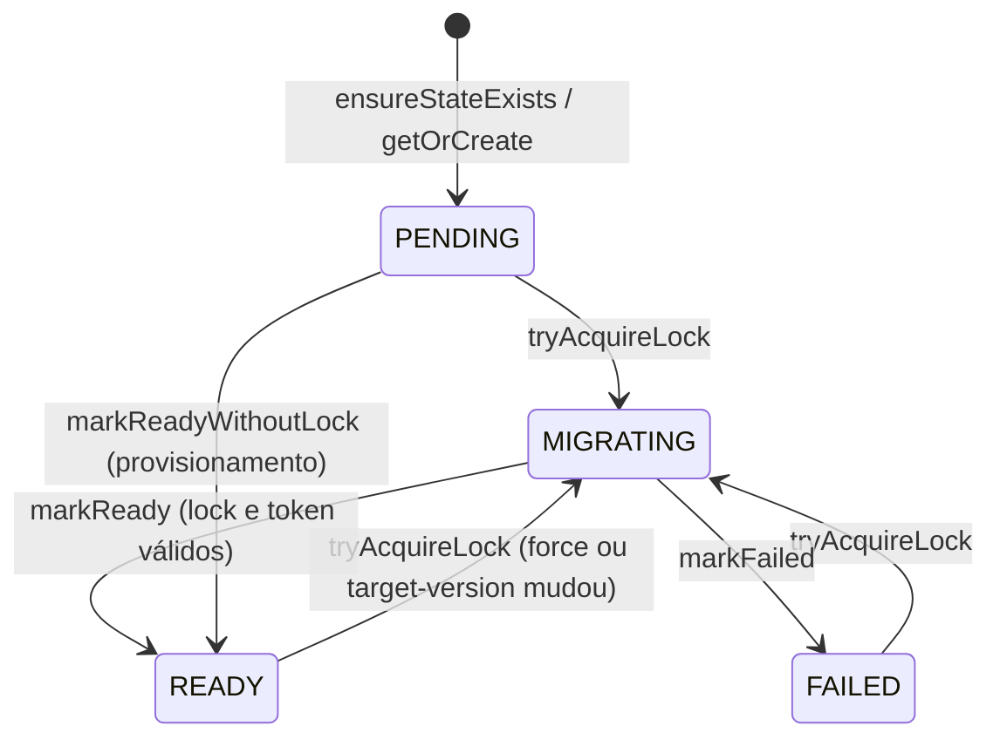

# subdomain-tenancy — Enums (Quarkus)

Visão geral: [[SeedGrid/Extensions/subdomain-tenancy/Visao-geral|Visão geral do subdomain-tenancy]] · Config: [[SeedGrid/Extensions/subdomain-tenancy/Configuracao|Configuração]] · [[SeedGrid/Extensions/subdomain-tenancy/Rust|Porte Rust]]

Nenhuma propriedade de configuração desta extension é tipada por enum (todas são `String`, `boolean`, números, `Duration`, `List`), portanto a `Configuracao.md` não tem links para esta nota.

## Índice

| Enum | Pacote/arquivo | Usado em | Público? |
|---|---|---|---|
| [[#TenantMigrationStatus]] | `migration/TenantMigrationStatus.java` | coluna `sg_tenant_migration_state.status`; JSON de `/internal/migrations`, `/internal/health`; resposta 503 do gate de login | Sim |
| [[#TenantMigrationDecision]] | `migration/TenantMigrationDecision.java` | retorno de `TenantMigrationCoordinator`; JSON de `POST /internal/migrations/tenants/{id}/trigger` | Sim |
| [[#TenantHealthStatus]] | `health/TenantHealthStatus.java` | JSON de `GET /internal/health/tenants/{id}` | Sim |
| [[#TenantHealthCode]] | `health/TenantHealthCode.java` | idem | Sim |
| [[#SignupOutcome]] | `services/TenantService.java` (aninhado) | JSON de `POST /public/tenants` | Sim |

Caminhos relativos a `java/seedgrid-quarkus-ext-subdomain-tenancy/runtime/src/main/java/br/com/seedgrid/subdomaintenancy/`.

## TenantMigrationStatus

`br.com.seedgrid.subdomaintenancy.migration.TenantMigrationStatus`. Estado de migração de um tenant (**Confirmado**).

| Valor | Significado | Efeito / onde é tratado | Observações |
|---|---|---|---|
| `PENDING` | Estado inicial; ainda não migrado para a `target-version` | Gravado por `TenantMigrationStateStore#ensureStateExists`/`getOrCreate`; `TenantHealthService` devolve `MIGRATION_PENDING`; é o valor devolvido por `parseStatus` quando a coluna é nula, vazia ou inválida | `markPending(...)` existe no store, mas nenhum código o chama |
| `READY` | Tenant migrado | `TenantMigrationCoordinator#isAlreadyReady` exige `READY` **e** `target_version == current_version == migration.target-version`; gravado por `markReady` e `markReadyWithoutLock` (pós-provisionamento) | O master é representado em memória com `READY` (`buildMasterState`), sem linha na tabela |
| `MIGRATING` | Migração em andamento com lock | Gravado por `tryAcquireLock`; se outra instância tem lock ativo, o gate de login devolve 503 `tenant_migration_in_progress`; `TenantHealthService` → `MIGRATION_RUNNING` | — |
| `FAILED` | Última tentativa falhou | Gravado por `markFailed` (com `last_error`); gate devolve 503 `tenant_migration_failed`; health → `MIGRATION_FAILED` | Nova tentativa é permitida (login ou `trigger`) |

- **Persistência:** coluna `sg_tenant_migration_state.status VARCHAR(20) NOT NULL DEFAULT 'PENDING'` (migration `V100`), gravada como `name()` por SQL direto (`TenantMigrationStateStore`, sem JPA). **Não há CHECK constraint**; a leitura é tolerante: `valueOf(status.trim().toUpperCase())`, qualquer valor desconhecido vira `PENDING`.
- **JSON:** `name()` em `status` (migrações, gate 503 — `UNKNOWN` quando não há estado) e `migrationStatus` (health, `null` se não há linha).
- **Transições** (confirmadas nas chamadas do coordinator/store):

  Que `tryAcquireLock` aceita partir de `READY`/`FAILED`/lock expirado é **Inferência** do uso (`force=true`, mudança de `target-version`, tentativa após falha); as condições SQL exatas não foram detalhadas aqui.
- **Usado em:** [[SeedGrid/Extensions/subdomain-tenancy/Configuracao|`migration.*`]]; endpoints `GET /internal/migrations/tenants/{id}/status`, `POST …/trigger`, `GET /internal/health/tenants/{id}`.

## TenantMigrationDecision

`br.com.seedgrid.subdomaintenancy.migration.TenantMigrationDecision` — resultado de uma tentativa/consulta de migração (**Confirmado**). Criado pelas fábricas `TenantMigrationOutcome.ready/inProgress/failed`.

| Valor | Significado | Efeito / onde é tratado | Observações |
|---|---|---|---|
| `READY` | Tenant pronto (já estava, migrou agora, migração desligada ou é o master) | `TenantMigrationGateFilter` deixa o login passar; `TenantMigrationController` responde 200 | `migratedNow` indica se migrou nesta chamada |
| `IN_PROGRESS` | Migração enfileirada/rodando (capacidade esgotada, lock de outra instância, enfileirada em background) | Gate bloqueia com 503 + `Retry-After: 15`; controller responde 503 | — |
| `FAILED` | A migração falhou nesta tentativa | Marca o span OTel com erro; gate bloqueia com 503 (código `tenant_migration_failed` quando o status gravado é `FAILED`); controller responde 503 | — |

- **Serialização:** `name()` no campo `decision` do corpo de `POST /internal/migrations/tenants/{id}/trigger` e atributo de span `tenant_migration.decision`. Não é persistido.

## TenantHealthStatus

`br.com.seedgrid.subdomaintenancy.health.TenantHealthStatus` (**Confirmado**).

| Valor | Significado | Efeito / onde é tratado | Observações |
|---|---|---|---|
| `UP` | Saudável | `TenantHealthReport#isUp` → HTTP 200 | Só com `code=OK` |
| `DOWN` | Indisponível ou inexistente | Usado para `INVALID_TENANT`, `TENANT_NOT_FOUND`, `DATABASE_UNREACHABLE` | HTTP 400/404/503 conforme o code |
| `OUT_OF_SERVICE` | Existe, mas não atende | Usado para `TENANT_INACTIVE`, `MIGRATION_FAILED`, `MIGRATION_PENDING`, `MIGRATION_RUNNING` | HTTP 503 |

- **JSON:** `name()` em `status`. Não persistido. O HTTP é decidido por `TenantHealthController#resolveHttpStatus` (up → 200; `INVALID_TENANT` → 400; `TENANT_NOT_FOUND` → 404; demais → 503).

## TenantHealthCode

`br.com.seedgrid.subdomaintenancy.health.TenantHealthCode` (**Confirmado**). Ordem de avaliação em `TenantHealthService#checkTenant`: id inválido → tenant inexistente → inativo → banco inacessível → migração.

| Valor | Significado | Efeito / onde é tratado | Observações |
|---|---|---|---|
| `OK` | Tudo certo | `status=UP`, HTTP 200 | Fábrica `TenantHealthReport.up` |
| `INVALID_TENANT` | Id do tenant vazio/inválido | `status=DOWN`, HTTP 400 | — |
| `TENANT_NOT_FOUND` | Não existe em `sg_tenants` | `status=DOWN`, HTTP 404 | — |
| `TENANT_INACTIVE` | Existe, mas `active=false` | `status=OUT_OF_SERVICE`, HTTP 503 | — |
| `DATABASE_UNREACHABLE` | `SELECT 1` no banco do tenant falhou | `status=DOWN`, HTTP 503 | Usa `TenantConnectionResolverImpl` (circuit breaker pode causar isto) |
| `MIGRATION_PENDING` | Estado de migração `PENDING` | `status=OUT_OF_SERVICE`, HTTP 503 | Não é emitido quando não há linha de estado (`migrationStatus=null` → `OK`) |
| `MIGRATION_RUNNING` | Estado `MIGRATING` | `status=OUT_OF_SERVICE`, HTTP 503 | — |
| `MIGRATION_FAILED` | Estado `FAILED` | `status=OUT_OF_SERVICE`, HTTP 503 | Inclui `migrationError` no JSON |

- **JSON:** `name()` em `code`. Não persistido.
- Estado `READY` gravado com `target_version` diferente do configurado **não** gera código próprio no health (retorna `OK`) — **Inferência** a partir de `checkTenant`, que só compara o status.

## SignupOutcome

`br.com.seedgrid.subdomaintenancy.services.TenantService.SignupOutcome` (enum aninhado público; **Confirmado**).

| Valor | Significado | Efeito / onde é tratado | Observações |
|---|---|---|---|
| `CREATED` | Cadastro pendente novo | `TenantSignupController`: HTTP **201** | — |
| `UPDATED_PENDING` | Já existia cadastro pendente (e-mail não validado) com o mesmo `subdomain`; foi atualizado e o OTP reenviado | HTTP **200** | — |

- **JSON:** `name()` em `status` do corpo de `POST /public/tenants` (com `emailDelivered` e `result`). Não persistido.

## Enums de outras bibliotecas expostos pela extension

| Enum | Origem | Onde aparece |
|---|---|---|
| `StateEnum` | `br.com.seedgrid.cities.enums.StateEnum` (módulo `cities`; antes na lib commons) | `state` do endereço no body de `POST /public/tenants` (`TenantSignupRequest.AddressDTO`); no bootstrap/provisionamento é gravado por `name()` (`RawCompanies`) e lido com `StateEnum.valueOf(s.toUpperCase())` (`AdminUserBootstrapService`). Valores: ver a nota da lib commons |

## Internos

Nenhum enum interno nos módulos `runtime` e `deployment` (todos os enums declarados estão listados acima).
