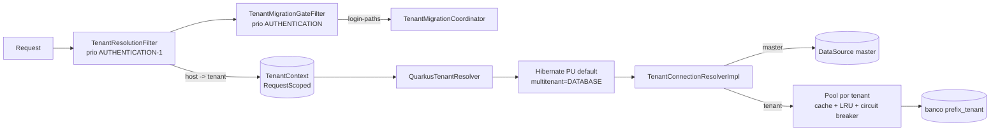

# subdomain-tenancy — Visão geral (Quarkus)

Configuração: [[SeedGrid/Extensions/subdomain-tenancy/Configuracao|Configuração do subdomain-tenancy]] · Enums: [[SeedGrid/Extensions/subdomain-tenancy/Enums|Enums do subdomain-tenancy]] · Exemplos: [[SeedGrid/Extensions/subdomain-tenancy/Exemplos|Exemplos do subdomain-tenancy]] · [[SeedGrid/Extensions/subdomain-tenancy/Rust|Porte Rust]]

> [!note] Fontes
> Lido no código do commit `fe62530a29`. O `README.md` e os `docs/` da extension foram revisados contra o código em 2026-10-14. Os relatórios `AJUSTES_REALIZADOS.md`, `AUDITORIA_FINAL_CONFORMIDADE.md`, `CORRECOES_FINALIZADAS.md`, `IMPLEMENTATION_SUMMARY.md`, `RELATORIO_CONFORMIDADE.md`, `REVISAO_FINAL_CONFORMIDADE.md` e `SETUP_ENVIRONMENT.md` (raiz do repo) são históricos.

## Objetivo

Multi-tenancy **um banco PostgreSQL por tenant**, com o tenant identificado pelo **subdomínio** do host (`cliente1.crm.example.com` → tenant `cliente1`). Inclui:

- Resolução de tenant por request (`X-Forwarded-Host`/`Host`) e `TenantResolver`/`TenantConnectionResolver` do Hibernate ORM em modo `DATABASE`.
- Banco **master** (persistence unit `master`) com o catálogo `tenants`, security, billing, apikeys e afins.
- **Signup self-service** com validação por OTP de 6 dígitos por e-mail e **provisionamento** automático (CREATE DATABASE + migrations + usuário root).
- Cache de pools JDBC por tenant com limite, evicção por TTL/LRU e **circuit breaker** por tenant.
- **Orquestração de migrations por tenant** (sob demanda no login, manual, ou todas no boot) com lock distribuído e heartbeat.
- Health por tenant, OpenAPI filtrado por contexto (master × tenant), métricas Micrometer e spans OpenTelemetry.
- Bootstrap do admin global no master, limpeza de cadastros não validados, integração com billing (conta + trial), audit, backup e security.

## Módulos e coordenadas Maven

| Módulo | Coordenada | Observação |
|---|---|---|
| parent | `br.com.seedgrid:seedgrid-subdomain-tenancy-parent:2026.10.14-1` (pom) | Parent: `br.com.seedgrid:seedgrid-parent:2026.07.02` (Quarkus 3.30.8). Centraliza as versões da foundation em `<properties>` e `dependencyManagement` |
| runtime | `br.com.seedgrid:seedgrid-subdomain-tenancy:2026.10.14-1` | O que o host declara |
| deployment | `br.com.seedgrid:seedgrid-subdomain-tenancy-deployment:2026.10.14-1` | `SubdomainTenancyProcessor` |

**Confirmado** em `pom.xml`, `runtime/pom.xml`, `deployment/pom.xml`.

### Dependências SeedGrid (versões do parent)

| Artefato | Versão | Uso aqui |
|---|---|---|
| `seedgrid-commons` | 2026.10.08 | `BaseEntity`, `commons.spi.TenantProvider`, `SchemaUtils`, `ApiExceptionExtension` |
| `seedgrid-security` | 2026.10.14 | Usuários/papéis, JWT, `PasswordService`, SPIs `JwtTokenCustomizer`, `JwtTokenValidator`, `SecurityScopeResolverProvider`, `SecurityLinkBuilder` |
| `seedgrid-privacy` | 2026.07.27 | Mascaramento/criptografia de PII do `Tenant` |
| `seedgrid-audit-core` | 2026.09.25 | `AuditMetadataContributor`, `AuditReadScopeProvider` (`seedgrid-audit-postgresql` só em teste) |
| `seedgrid-backup` | 2026.10.09 | `backup.spi.TenantProvider` |
| `seedgrid-billing-core` | 2026.10.14-1 | Conta/trial por tenant, SPIs `CurrentAccountResolver`, `AccountMembersGateway` (`seedgrid-billing-stripe` só em `dependencyManagement`) |
| `seedgrid-apikeys` | 2026.10.14 | Schema de API keys no master e nos tenants |
| `seedgrid-notification` (+ `-deployment`) | 2026.10.15 | Catálogo de eventos, regras, outbox e envio por e-mail/WhatsApp; vem transitivamente, o host não precisa declará-la — ver [[SeedGrid/Extensions/notification/Visao-geral\|notification]] |
| `seedgrid-resilience-core` | 2026.10.13 | `@SeedGridRateLimit` nos endpoints públicos |

Quarkus no runtime: `arc`, `hibernate-orm(-panache)`, `jdbc-postgresql`, `agroal`, `flyway`, `rest-jackson`, `hibernate-validator`, `smallrye-openapi`, `opentelemetry`, `micrometer(-registry-prometheus)`, `smallrye-fault-tolerance`, `mailer`, `qute`, `quarkus-mongodb-client` (**optional**), além de `jbcrypt`. O deployment acrescenta `quarkus-scheduler-deployment`, `quarkus-virtual-threads-deployment` e `quarkus-grpc-common-deployment`.

Extensions relacionadas: [[SeedGrid/Extensions/security/Visao-geral|security]], [[SeedGrid/Extensions/billing/Visao-geral|billing]], [[SeedGrid/Extensions/audit/Visao-geral|audit]], [[SeedGrid/Extensions/backup/Visao-geral|backup]], [[SeedGrid/Extensions/apikeys/Visao-geral|apikeys]], [[SeedGrid/Extensions/resilience/Visao-geral|resilience]], [[SeedGrid/Extensions/privacy/Visao-geral|privacy]], [[SeedGrid/Extensions/commons/Visao-geral|commons]]. Alternativa com banco compartilhado/login: [[SeedGrid/Extensions/login-tenancy/Visao-geral|login-tenancy]].

## Arquitetura e fluxo

- **Resolução** (Confirmado): `TenantResolutionFilter` lê `X-Forwarded-Host` (prioritário) ou `Host`, extrai o tenant com `TenantHostExtractor` e grava no `TenantContext` e no MDC (`tenantId`); sem tenant → `master`. O Javadoc do filtro deixa explícito que o default para `master` **não** é fronteira de segurança: o isolamento vem do JWT/API key serem resolvidos no banco do próprio tenant.
- **JWT**: `SubdomainTenancyJwtTokenCustomizer` adiciona as claims `subdomain` e `audience` (`platform`/`client`); `SubdomainTenancyJwtTokenValidator` rejeita token cujo `subdomain` difere do host.
- **Conexões**: `TenantConnectionResolverImpl` verifica no master se o tenant existe e está ativo (`TenantNotFoundException` caso contrário), cria `SimpleDriverDataSource` por tenant, aplica limite/evicção e circuit breaker. Detalhes dos parâmetros em [[SeedGrid/Extensions/subdomain-tenancy/Configuracao|Configuração]].
- **Startup** (`MigrationService#onStart`, `@Priority(APPLICATION)`): no master roda, em ordem, security → audit (se `jpa`) → backup → billing → apikeys → ai-pricing → exchange → business-days (módulos de produto, `modules.<x>.enabled`, default `true`) → subdomain-tenancy → `db/migration/master` (+ additional), depois `AdminUserBootstrapService#seedAdminUserIfNeeded`. Tenants não migram no boot por padrão.
- **Signup → provisionamento**: `POST /public/tenants` grava o tenant pendente e envia OTP; `POST /public/tenants/validate-email` valida o código e chama `TenantProvisioningService#createTenantWithAdmin` (lock local + `pg_try_advisory_lock`, `CREATE DATABASE` idempotente, migrations security → tenant → audit → backup → apikeys → business-days, usuário root; rollback com `DROP DATABASE` se o banco foi criado no fluxo), depois `SubdomainBillingAccounts#ensureFor` (conta + trial no billing) e ativa o tenant.
- **Migração por tenant**: `TenantMigrationCoordinator` com estado em `tenant_migration_state` (`PENDING`/`MIGRATING`/`READY`/`FAILED`), lock com fencing token e heartbeat. Gatilhos: login (gate devolve `503` + `Retry-After: 15`), endpoint manual, ou boot.
- **Limpeza**: `TenantCleanupScheduler` remove do master os cadastros não validados mais velhos que o TTL (não remove o banco — ver Limitações).

## APIs públicas e pontos de integração

### Endpoints REST

| Método e path | Classe | Acesso | Observação |
|---|---|---|---|
| `POST /public/tenants` | `TenantSignupController#signupTenant` | público, rate limit `tenant-signup` (100/min) | `201` CREATED ou `200` UPDATED_PENDING; corpo traz `emailDelivered` |
| `POST /public/tenants/validate-email` | `#validateEmail` | público, `tenant-validate-email` (10/min) | Body `{subdomain, code}`; dispara o provisionamento |
| `POST /public/tenants/resend-email?subdomain=` | `#resendEmail` | público, `tenant-resend-email` (5/h) | `400` sem `subdomain` |
| `GET /public/tenant-openapi` | `TenantOpenApiController#getFilteredOpenApi` | `@PermitAll` + permissão HTTP `permit` no `MPC` | Remove tag `tenant-only` no master; `master-only` + `master-only-paths` nos tenants |
| `POST /internal/migrations/tenants/{tenantId}/trigger?force=` | `TenantMigrationController#triggerMigration` | só contexto master (`403 master_scope_required`) | Não há `@RolesAllowed` na classe; a autenticação depende da política global do security (**Não confirmado**) |
| `GET /internal/migrations/tenants/{tenantId}/status` | `#migrationStatus` | idem | — |
| `GET /internal/health/tenants/{tenantId}` | `TenantHealthController#tenantHealth` | idem | Códigos `OK`, `INVALID_TENANT`, `TENANT_NOT_FOUND`, `TENANT_INACTIVE`, `DATABASE_UNREACHABLE`, `MIGRATION_PENDING/RUNNING/FAILED` |

Paths centralizados em `RestControllerPath`. Exceções mapeadas por `SubdomainTenancyExceptionExtension` (`ApiExceptionExtension` do commons): `TenantNotFoundException` → 404, `SubdomainAlreadyExistsException`/`CnpjAlreadyExistsException` → 409, `TenantAlreadyActiveException`/`ValidationCodeExpiredException` → 400.

### Anotações
- `@MasterOnly` / `@TenantOnly` (`annotations/`): meta-anotações com `@Tag("master-only")`/`@Tag("tenant-only")` — **só documentação/OpenAPI**, não controlam acesso.

### SPIs para o host

| Interface | Default fornecido | Uso |
|---|---|---|
| `spi.SubdomainTenancyNotificationService#sendValidationNotification(TenantValidationNotification)` | `MailerNotificationService` (`@DefaultBean`, mailer `subdomaintenancy`) | Entrega do OTP |
| `spi.TemplateSubdomainTenancyProvider#buildValidationEmail(...)` | `DefaultTemplateSubdomainTenancyProvider` (`@DefaultBean`, Qute: procura `templates/subdomain-tenancy/confirmation.html` ou `subdomain-tenancy/html/confirmation.html` do host e cai em `subdomaintenancy-default/html/confirmation.html` da extension) | HTML do OTP quando não há `EmailTemplateProvider` |
| `spi.EmailTemplateProvider#buildConfirmationEmailHtml(...)`, `#getConfirmationEmailSubject(...)` | nenhum | Opcional; se resolvível, define assunto/HTML |
| `spi.PasswordEncoder#encode(String)` | `BCryptPasswordEncoder` (`@DefaultBean`) | Injetado como `Instance<PasswordEncoder>` em `TenantService`/`TenantProvisioningService` |

Com os defaults `@DefaultBean`, o envio do OTP funciona só com o SMTP configurado (**Confirmado**).

### Beans CDI úteis ao host
- `TenantContext` (`@RequestScoped`): `getCurrentTenant()`, `setCurrentTenant(String)`, `clear()`.
- `TenantScopedExecutor#call(Supplier<T>)`: executa em nova transação (`REQUIRES_NEW`).
- `TenantHostExtractor#extractTenantFromHost(String)`.
- `TenantAwareMongoProducer` (`@Produces @DefaultBean MongoDatabase`, banco `<prefix>_<tenant>_audit_db`) e `MongoTenantResolverProducer` → `MongoTenantResolver` quando há `MongoClient`.
- Implementações de SPIs de outras extensions: `MultiTenantProvider` (commons), `MultiTenantBackupProvider` (backup), `TenantAuditScopeProvider` (audit), `SubdomainCurrentAccountResolver`/`SubdomainAccountMembersGateway` (billing), `SubdomainTenancySecurityScopeResolver`, `TenantSecurityLinks` (`@Alternative @Priority(1)`, reescreve links de e-mail do security para `<tenant>.<host>`).

### Métricas (Micrometer)
`seedgrid.subdomain-tenancy.tenant.datasource.provisioning.failures`, `…connection.failures`, `…connection.circuit.open`, `…active.pools`, `…active.connections.total`, `…connections.active{tenant}`, `…evictions{reason=ttl|lru}`, `seedgrid.subdomain-tenancy.migration.failures`.

## Migrations

| Location | Versões | History | Onde roda |
|---|---|---|---|
| `db/migration/subdomain-tenancy` | `V100`–`V110` (tenants, root user, campos de trial legados, snapshots, `tenant_migration_state`, fencing token, índices, `tenant_validation_tokens`, hashes de busca de privacy, conta de billing) | `flyway_schema_history_subdomain_tenancy` | master |
| `db/migration/tenancy` | `V706__timestamps_com_fuso.sql` | — | **Não aplicada** pela extension (nenhuma location aponta para ela). `java/MIGRATION_RANGES.md` documenta a faixa 100–199 e trata a V706 como exceção legada |
| `db/migration/master` / `db/migration/tenant` (do host) | livres | `flyway_schema_history_master` / `_tenant` | master no boot / tenant no provisionamento e migração |

## Testes

`runtime/src/test/java/br/com/seedgrid/subdomaintenancy/` — 17 classes, ~76 métodos `@Test`. **Não executados** nesta análise.

- Unitários (Mockito): `TenantHostExtractorTest` (10), `TenantsRepositoryTest` (7), `TenantHealthServiceTest`, `TenantProvisioningServiceTest`, `TenantServiceTest`, `TenantMigrationCoordinatorTest`, `TenantMigrationStateStoreTest`, `TenantResolutionFilterTest`, `TenantHealthControllerTest`, `TenantOpenApiControllerFilterTest`, `TenantAuditScopeProviderTest`, `TenantSecurityLinksTest`, `TenantToStringMaskingTest`.
- `@QuarkusTest` com Postgres via Testcontainers (`SubdomainTenancyPostgresTestResource`): `TenantRegisterResourceIntegrationTest` (9), `TenantsRepositoryIntegrationTest` (6), `TenantBillingIntegrationTest`, `TenantEncryptedFieldsTest` (perfil com criptografia de privacy).
- Há também `perf/jmeter/login-concurrency.jmx` (carga de login concorrente).

## Limitações

- **Somente PostgreSQL** (`CREATE DATABASE`, `pg_try_advisory_lock`, `pg_terminate_backend`); o usuário de tenant precisa de `CREATE DATABASE`.
- **Subdomínios com `_`**: o signup aceita `^[a-z0-9_]{5,50}$`, mas o extractor só aceita `^[a-z0-9-]+$` → esses tenants caem em `master` pelo host (**Confirmado**; ver Dúvidas na Configuração).
- Teto de `max-active-datasources` sem pool ocioso → `TenantProvisioningException` na resolução.
- `TenantCleanupScheduler` remove só o registro em `tenants`, não o banco físico (contradiz o Javadoc). Se houver banco criado para cadastro não validado, ele fica órfão (o provisionamento só ocorre após validação, então na prática isso só acontece em cenários de falha — **Inferência**).
- Vários literais `"master"` fixos: `default-tenant` diferente de `master` não é consistente.
