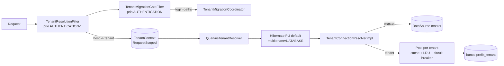

# subdomain-tenancy — Visão geral (Quarkus)

Configuração: [[SeedGrid/Extensions/subdomain-tenancy/Configuracao|Configuração do subdomain-tenancy]] · Enums: [[SeedGrid/Extensions/subdomain-tenancy/Enums|Enums do subdomain-tenancy]] · Exemplos: [[SeedGrid/Extensions/subdomain-tenancy/Exemplos|Exemplos do subdomain-tenancy]] · [[SeedGrid/Extensions/subdomain-tenancy/Rust|Porte Rust]]

> [!note] Fontes
> Lido no código do commit `fe62530a29`. O `README.md` e os `docs/` da extension foram revisados contra o código em 2026-10-14. Os relatórios `AJUSTES_REALIZADOS.md`, `AUDITORIA_FINAL_CONFORMIDADE.md`, `CORRECOES_FINALIZADAS.md`, `IMPLEMENTATION_SUMMARY.md`, `RELATORIO_CONFORMIDADE.md`, `REVISAO_FINAL_CONFORMIDADE.md` e `SETUP_ENVIRONMENT.md` (raiz do repo) são históricos.

> **Publicado na 2026.10.22:** mudanças de escopo e acesso (isolamento de RBAC entre tenants, `isolation`, permissões somente leitura, cadastro por `publicId`, `@QUERY`) em [[SeedGrid/Extensions/security/Escopo-e-acesso|Escopo e acesso]].

> **Todo tenant sempre tem um ADMIN.** A extension `security` não deixa remover nem rebaixar o último ADMIN ativo (invariante "mínimo 1 ADMIN ativo"): a resposta é HTTP 409 `LAST_ADMIN_PROTECTED` (escopo `seedgrid.security.admin-guard.scope`: `company` em `shared-database`, `database` em `dedicated-database`). O host não precisa reimplementar essa regra. Detalhes em [[SeedGrid/Extensions/security/Escopo-e-acesso|Escopo e acesso]].
>
> **Atenção com API keys:** a chave pertence a quem a emitiu. O guarda só impede remover o ÚLTIMO admin; remover qualquer outro admin (ou tirá-lo da empresa) derruba as chaves dele: o dono fora da empresa da chave dá falha de autenticação (fail closed), e apagar o usuário apaga as chaves (`ON DELETE CASCADE`). Prática recomendada (decisão do dono): a chave é emitida por um admin do tenant; antes de remover um admin que emitiu chaves, avisar quem administra e reemitir as chaves por outro admin. Veja [[SeedGrid/Extensions/apikeys/Visao-geral|apikeys]].

## Objetivo

Multi-tenancy **um banco PostgreSQL por tenant**, com o tenant identificado pelo **subdomínio** do host (`cliente1.crm.example.com` → tenant `cliente1`). Inclui:

- Resolução de tenant por request (`X-Forwarded-Host`/`Host`) e `TenantResolver`/`TenantConnectionResolver` do Hibernate ORM em modo `DATABASE`.
- Banco **master** (persistence unit `master`) com o catálogo `sg_tenants`, security, billing, apikeys e afins.
- **Signup self-service** com validação por OTP de 6 dígitos por e-mail e **provisionamento** automático (CREATE DATABASE + migrations + usuário root).
- Cache de pools JDBC por tenant com limite, evicção por TTL/LRU e **circuit breaker** por tenant.
- **Orquestração de migrations por tenant** (sob demanda no login, manual, ou todas no boot) com lock distribuído e heartbeat.
- Health por tenant, OpenAPI filtrado por contexto (master × tenant), métricas Micrometer e spans OpenTelemetry.
- Bootstrap do admin global no master, limpeza de cadastros não validados, integração com billing (conta + trial), audit, backup e security.

## Módulos e coordenadas Maven

| Módulo | Coordenada | Observação |
|---|---|---|
| parent | `br.com.seedgrid:seedgrid-subdomain-tenancy-parent:2026.11.02` (pom) | Parent: `br.com.seedgrid:seedgrid-parent:2026.07.02` (Quarkus 3.30.8). Centraliza as versões da foundation em `<properties>` e `dependencyManagement` |
| runtime | `br.com.seedgrid:seedgrid-subdomain-tenancy:2026.11.02` | O que o host declara |
| deployment | `br.com.seedgrid:seedgrid-subdomain-tenancy-deployment:2026.11.02` | `SubdomainTenancyProcessor` |

**Confirmado** em `pom.xml`, `runtime/pom.xml`, `deployment/pom.xml`.

### Dependências SeedGrid (versões do parent)

| Artefato | Versão | Uso aqui |
|---|---|---|
| `seedgrid-commons` | 2026.10.08 | `BaseEntity`, `commons.spis.TenantProvider`, `SchemaUtils`, `BusinessException`/`SystemSeedGridException` (base `SeedGridException`) |
| `seedgrid-security` | 2026.10.14 | Usuários/papéis, JWT, `PasswordService`, SPIs `JwtTokenCustomizer`, `JwtTokenValidator`, `SecurityScopeResolverProvider`, `SecurityLinkBuilder` |
| `seedgrid-privacy` | 2026.07.27 | Mascaramento/criptografia de PII do `Tenant` |
| `seedgrid-audit-core` | 2026.09.25 | `AuditMetadataContributor`, `AuditReadScopeProvider` (`seedgrid-audit-postgresql` só em teste) |
| `seedgrid-backup` | 2026.10.09 | `backup.spis.TenantProvider` |
| `seedgrid-billing-core` | 2026.10.14-1 | Conta/trial por tenant, SPIs `CurrentAccountResolver`, `AccountMembersGateway` (`seedgrid-billing-stripe` só em `dependencyManagement`) |
| `seedgrid-apikeys` | 2026.10.14 | Schema de API keys no master e nos tenants |
| `seedgrid-notification` (+ `-deployment`) | 2026.10.15 | Catálogo de eventos, regras, outbox e envio por e-mail/WhatsApp; vem transitivamente, o host não precisa declará-la — ver [[SeedGrid/Extensions/notification/Visao-geral\|notification]] |
| `seedgrid-resilience-core` | 2026.10.13 | `@SgRateLimit` nos endpoints públicos |

Quarkus no runtime: `arc`, `hibernate-orm(-panache)`, `jdbc-postgresql`, `agroal`, `flyway`, `rest-jackson`, `hibernate-validator`, `smallrye-openapi`, `opentelemetry`, `micrometer(-registry-prometheus)`, `smallrye-fault-tolerance`, `mailer`, `qute`, `quarkus-mongodb-client` (**optional**), além de `jbcrypt`. O deployment acrescenta `quarkus-scheduler-deployment`, `quarkus-virtual-threads-deployment` e `quarkus-grpc-common-deployment`.

Extensions relacionadas: [[SeedGrid/Extensions/security/Visao-geral|security]], [[SeedGrid/Extensions/billing/Visao-geral|billing]], [[SeedGrid/Extensions/audit/Visao-geral|audit]], [[SeedGrid/Extensions/backup/Visao-geral|backup]], [[SeedGrid/Extensions/apikeys/Visao-geral|apikeys]], [[SeedGrid/Extensions/resilience/Visao-geral|resilience]], [[SeedGrid/Extensions/privacy/Visao-geral|privacy]], [[SeedGrid/Extensions/commons/Visao-geral|commons]]. Alternativa com banco compartilhado/login: [[SeedGrid/Extensions/login-tenancy/Visao-geral|login-tenancy]].

## Arquitetura e fluxo



- **Resolução** (Confirmado): `TenantResolutionFilter` lê `X-Forwarded-Host` (prioritário) ou `Host`, extrai o tenant com `TenantHostExtractor` e grava no `TenantContext` e no MDC (`tenantId`); sem tenant → `master`. O Javadoc do filtro deixa explícito que o default para `master` **não** é fronteira de segurança: o isolamento vem do JWT/API key serem resolvidos no banco do próprio tenant.
- **JWT**: `SubdomainTenancyJwtTokenCustomizer` adiciona as claims `subdomain` e `audience` (`platform`/`client`); `SubdomainTenancyJwtTokenValidator` rejeita token cujo `subdomain` difere do host.
- **Conexões**: `TenantConnectionResolverImpl` verifica no master se o tenant existe e está ativo (`TenantNotFoundException` caso contrário), cria `SimpleDriverDataSource` por tenant, aplica limite/evicção e circuit breaker. Detalhes dos parâmetros em [[SeedGrid/Extensions/subdomain-tenancy/Configuracao|Configuração]].
- **Startup** (`MigrationService#onStart`, `@Priority(APPLICATION)`): no master roda, em ordem, security → audit (se `jpa`) → backup → billing → apikeys → ai-pricing → exchange → business-days (módulos de produto, `modules.<x>.enabled`, default `true`) → subdomain-tenancy → `db/migration/master` (+ additional), depois `AdminUserBootstrapService#seedAdminUserIfNeeded`. Tenants não migram no boot por padrão. **Por tenant** (`TenantProvisioningService` e `TenantMigrationCoordinator`): security (+ cities), tenant, audit, backup, apikeys e business-days, mais o `filemanagement` quando `seedgrid.filemanagement.registry-table.enabled=true` (a partir da 2026.11.01). O `filemanagement` não tem `modules.filemanagement.enabled`: quem decide é `seedgrid.filemanagement.registry-table.enabled`. Ligado (a partir da 2026.11.01), a `V1300` (`sg_attachments`) entra no histórico do tenant e o master não ganha a tabela; desligado (padrão), nada é criado. Versões anteriores, tenant existente e o caso do host que reescreve `quarkus.hibernate-orm.packages`: veja [[SeedGrid/Extensions/filemanagement/Configuracao|Configuração do filemanagement]].
- **Signup → provisionamento**: `POST /public/tenants` grava o tenant pendente e envia OTP; `POST /public/tenants/validate-email` valida o código e chama `TenantProvisioningService#createTenantWithAdmin` (lock local + `pg_try_advisory_lock`, `CREATE DATABASE` idempotente, migrations security → tenant → audit → backup → apikeys → business-days, usuário root; rollback com `DROP DATABASE` se o banco foi criado no fluxo), depois `SubdomainBillingAccounts#ensureFor` (conta + trial no billing) e ativa o tenant.
- **Migração por tenant**: `TenantMigrationCoordinator` com estado em `sg_tenant_migration_state` (`PENDING`/`MIGRATING`/`READY`/`FAILED`), lock com fencing token e heartbeat. Gatilhos: login (gate devolve `503` + `Retry-After: 15`), endpoint manual, ou boot.
- **Admin do master (`seedgrid.subdomain-tenancy.admin-user.*`, Confirmado em `AdminUserBootstrapService`, PasswordChangeRequiredFilter e UserService#changePassword; P2.F0.DEM10 do display):** no primeiro boot, com a tabela `sg_users` do master vazia, o bootstrap cria o usuário root com a role `ADMIN`, ligado à empresa-plataforma (default company). Ele **nasce com `change_password_required = true`** (mesmo com `initial-password` configurada) e **sem e-mail confirmado** (grava `email_confirmation_token` e envia o e-mail de boas-vindas com a senha e o token). Com a flag ligada, o `PasswordChangeRequiredFilter` responde **401** com o corpo `{"code":"PASSWORD_CHANGE_REQUIRED","message":"..."}` em **toda** rota autenticada (não só `/admin`), exceto as marcadas `@SgPermitWithoutPasswordChange`. O login em si funciona e devolve o token, com `changePasswordRequired: true` na resposta. Para liberar: `PUT /users/change-password` (corpo `{"currentPassword","newPassword"}`; permissão `USER_CHANGE_PASSWORD`, que a role `ADMIN` já tem) ou `PUT /me/profile/password` (mesmo corpo); ambos limpam a flag, gravam o histórico de senhas e **revogam os refresh tokens e a sessão do usuário**, então o front deve fazer login de novo com a senha nova. A nova senha segue a política de senha (`@ValidPassword`) e não pode repetir senha recente; senha atual errada devolve erro de negócio. Se a senha foi gerada (sem `initial-password`) e o e-mail não saiu, o admin fica sem acesso até a recuperação de senha (o log avisa). Teste automatizado que não quer percorrer o fluxo pode baixar a flag direto no master (`UPDATE sg_users SET change_password_required = FALSE WHERE email = ...`), só em ambiente de teste. Não conferi se o login exige o e-mail confirmado.
- **Limpeza**: `TenantCleanupScheduler` remove do master os cadastros não validados mais velhos que o TTL (não remove o banco — ver Limitações).

## APIs públicas e pontos de integração

### Endpoints REST

| Método e path | Classe | Acesso | Observação |
|---|---|---|---|
| `POST /public/tenants` | `TenantSignupController#signupTenant` | público, rate limit `tenant-signup` (100/min) | `201` CREATED ou `200` UPDATED_PENDING; corpo traz `emailDelivered` |
| `POST /public/tenants/validate-email` | `#validateEmail` | público, `tenant-validate-email` (10/min) | Body `{subdomain, code}`; dispara o provisionamento |
| `POST /public/tenants/resend-email?subdomain=` | `#resendEmail` | público, `tenant-resend-email` (5/h) | `400` sem `subdomain` |
| `GET /public/tenant-openapi` | `TenantOpenApiController#getFilteredOpenApi` | `@PermitAll` + permissão HTTP `permit` no `MPC` | Remove tag `tenant-only` no master; `master-only` + `master-only-paths` nos tenants |
| `POST /internal/migrations/tenants/{tenantId}/trigger?force=` | `TenantMigrationController#triggerMigration` | só contexto master (`403 master_scope_required`) | Não há `@RolesAllowed` na classe; a autenticação depende da política global do security (**Não confirmado**) |
| `GET /internal/migrations/tenants/{tenantId}/status` | `#migrationStatus` | idem | — |
| `GET /internal/health/tenants/{tenantId}` | `TenantHealthController#tenantHealth` | idem | Códigos `OK`, `INVALID_TENANT`, `TENANT_NOT_FOUND`, `TENANT_INACTIVE`, `DATABASE_UNREACHABLE`, `MIGRATION_PENDING/RUNNING/FAILED` |

Paths centralizados em `RestControllerPath`. As exceptions herdam `BusinessException`/`SystemSeedGridException` e levam o status: `TenantNotFoundException` → 404, `SubdomainAlreadyExistsException`/`CnpjAlreadyExistsException`/`TenantAlreadyActiveException` → 409 (**o `TenantAlreadyActive` mudou de 400 para 409 em 2026-10-28, paridade com o Rust**), `ValidationCodeExpiredException` → 400, `TenantProvisioningException` → 500 (`SystemSeedGridException`, `detail` genérico). A `SubdomainTenancyExceptionExtension` foi removida; guardião BE-42.

### Anotações

_Fonte: código de `seedgrid-quarkus-ext-subdomain-tenancy` (versão 2026.10.22, publicada no Maven Central)._

| Anotação | Pacote | Onde se aplica | Atributos (padrão) | Para que serve |
|---|---|---|---|---|
| `@SgMasterOnly` | `br.com.seedgrid.subdomaintenancy.annotations` | `TYPE`, `METHOD` | — | Marca um endpoint ou resource class como disponível apenas no domínio master. |
| `@SgTenantOnly` | `br.com.seedgrid.subdomaintenancy.annotations` | `TYPE`, `METHOD` | — | Marca um endpoint ou resource class como disponível apenas para tenants. |

**Detalhes já documentados:**

- `@SgMasterOnly` / `@SgTenantOnly` (`annotations/`): meta-anotações com `@Tag("master-only")`/`@Tag("tenant-only")` — **só documentação/OpenAPI**, não controlam acesso.

### SPIs

Detalhes de cada SPI (assinaturas, o que o padrão faz, implementações reais e exemplos): [[SeedGrid/Extensions/subdomain-tenancy/SPIs|SPIs]].

_Fonte: código de `seedgrid-quarkus-ext-subdomain-tenancy` (versão 2026.10.22, publicada no Maven Central)._

| SPI | Pacote | Implementação padrão (`@DefaultBean`) | Para que serve |
|---|---|---|---|
| `EmailTemplateProvider` | `br.com.seedgrid.subdomaintenancy.spis` | sem padrão | Service Provider Interface for rendering email templates. |
| `PasswordEncoder` | `br.com.seedgrid.subdomaintenancy.spis` | `BCryptPasswordEncoder` | Service Provider Interface for password encoding. |
| `SubdomainTenancyNotificationService` | `br.com.seedgrid.subdomaintenancy.spis` | `MailerNotificationService` | Service Provider Interface for sending tenant notifications (email, SMS, WhatsApp, etc). |
| `TemplateSubdomainTenancyProvider` | `br.com.seedgrid.subdomaintenancy.spis` | `DefaultTemplateSubdomainTenancyProvider` | SPI para renderizar templates de e-mail do módulo subdomain-tenancy. |

**Como substituir:** declare um bean CDI (`@ApplicationScoped`) que implemente a interface, **sem** `@Alternative` nem `@Priority`; a implementação padrão (`@DefaultBean`) cede. SPI "sem padrão" precisa de uma implementação do host (ou de outro módulo) para o recurso funcionar.

```java
@ApplicationScoped
public class MeuEmailTemplateProvider implements EmailTemplateProvider {
    // implemente os métodos da interface
}
```

**Detalhes já documentados:**

| Interface | Default fornecido | Uso |
|---|---|---|
| `spi.SubdomainTenancyNotificationService#sendValidationNotification(TenantValidationNotification)` | `MailerNotificationService` (`@DefaultBean`, mailer `subdomaintenancy`) | Entrega do OTP |
| `spi.TemplateSubdomainTenancyProvider#buildValidationEmail(...)` | `DefaultTemplateSubdomainTenancyProvider` (`@DefaultBean`, Qute: procura `templates/subdomain-tenancy/confirmation.html` ou `subdomain-tenancy/html/confirmation.html` do host e cai em `subdomaintenancy-default/html/confirmation.html` da extension) | HTML do OTP quando não há `EmailTemplateProvider` |
| `spi.EmailTemplateProvider#buildConfirmationEmailHtml(...)`, `#getConfirmationEmailSubject(...)` | nenhum | Opcional; se resolvível, define assunto/HTML |
| `spi.PasswordEncoder#encode(String)` | `BCryptPasswordEncoder` (`@DefaultBean`) | Injetado como `Instance<PasswordEncoder>` em `TenantService`/`TenantProvisioningService` |

Com os defaults `@DefaultBean`, o envio do OTP funciona só com o SMTP configurado (**Confirmado**).

### Beans CDI úteis ao host
- `TenantContext` (`@RequestScoped`): `getCurrentTenant()`, `setCurrentTenant(String)`, `clear()`.
- `TenantScopedExecutor#call(Supplier<T>)`: executa em nova transação (`REQUIRES_NEW`).
- `TenantHostExtractor#extractTenantFromHost(String)`.
- `TenantAwareMongoProducer` (`@Produces @DefaultBean MongoDatabase`, banco `<prefix>_<tenant>_audit_db`) e `MongoTenantResolverProducer` → `MongoTenantResolver` quando há `MongoClient`.
- Implementações de SPIs de outras extensions: `MultiTenantProvider` (commons), `MultiTenantBackupProvider` (backup), `TenantAuditScopeProvider` (audit), `SubdomainCurrentAccountResolver`/`SubdomainAccountMembersGateway` (billing), `SubdomainTenancySecurityScopeResolver`, `TenantSecurityLinks` (`@Alternative @Priority(1)`, reescreve links de e-mail do security para `<tenant>.<host>`).

### Métricas (Micrometer)
`seedgrid.subdomain-tenancy.tenant.datasource.provisioning.failures`, `…connection.failures`, `…connection.circuit.open`, `…active.pools`, `…active.connections.total`, `…connections.active{tenant}`, `…evictions{reason=ttl|lru}`, `seedgrid.subdomain-tenancy.migration.failures`.

## Migrations

| Location | Arquivos | History | Onde roda |
|---|---|---|---|
| `db/migration/subdomain-tenancy` | `V100__subdomain-tenancy_ddl.sql` (3 tabelas: `sg_tenants`, `sg_tenant_validation_tokens`, `sg_tenant_migration_state`; datas em `timestamptz`, inclusive o lock de migração entre instâncias) | `sg_flyway_schema_history_subdomain_tenancy` | master |
| `db/migration/master` / `db/migration/tenant` (do host) | livres | `sg_flyway_schema_history_master` / `_tenant` | master no boot / tenant no provisionamento e migração |

**Compressão das migrations (2026-10-27):** o histórico anterior (V100 a V111 e a `V706` de timestamps, que ficava órfã em `db/migration/tenancy` e foi removida) virou **uma migration de DDL** e, onde há dados iniciais, **um seed repetível** (`R__*.sql`, idempotente). **Sem retrocompatibilidade: banco criado com a versão anterior deve ser recriado** (os checksums mudaram). Estrutura nova depois disso = a próxima `V` da faixa; permissão ou dado inicial novo = uma linha no `R__`.

## Testes

`runtime/src/test/java/br/com/seedgrid/subdomaintenancy/` — 17 classes, ~76 métodos `@Test`. **Não executados** nesta análise.

- Unitários (Mockito): `TenantHostExtractorTest` (10), `TenantsRepositoryTest` (7), `TenantHealthServiceTest`, `TenantProvisioningServiceTest`, `TenantServiceTest`, `TenantMigrationCoordinatorTest`, `TenantMigrationStateStoreTest`, `TenantResolutionFilterTest`, `TenantHealthControllerTest`, `TenantOpenApiControllerFilterTest`, `TenantAuditScopeProviderTest`, `TenantSecurityLinksTest`, `TenantToStringMaskingTest`.
- `@QuarkusTest` com Postgres via Testcontainers (`SubdomainTenancyPostgresTestResource`): `TenantRegisterResourceIntegrationTest` (9), `TenantsRepositoryIntegrationTest` (6), `TenantBillingIntegrationTest`, `TenantEncryptedFieldsTest` (perfil com criptografia de privacy).
- Há também `perf/jmeter/login-concurrency.jmx` (carga de login concorrente).

## Limitações

- **Somente PostgreSQL** (`CREATE DATABASE`, `pg_try_advisory_lock`, `pg_terminate_backend`); o usuário de tenant precisa de `CREATE DATABASE`.
- **Subdomínio com `_` (até a 2026.10.22):** o signup aceitava `^[a-z0-9_]{5,50}$`, mas o extractor só aceitava `^[a-z0-9-]+$`, e o tenant era provisionado mas caía em `master` pelo host. **Corrigido na 2026.11.02** (ver o próximo item); quem está na 2026.10.22 ou antes deve recusar `_` no próprio front.
- **Um padrão só de subdomínio (2026.11.02, Confirmado em `SubdomainRules`, commit `b2abc1e`):** cadastro, extractor do host e links de segurança usam a mesma regra, a de um label de hostname (RFC 1123): minúsculas, dígitos e hífen; sem hífen no começo nem no fim; sem `--` nas posições 3 e 4 (`xn--` é de IDN); no máximo 50 caracteres, e o cadastro exige 5 a 50 (`^(?!-)(?![a-z0-9-]{2}--)[a-z0-9-]{5,50}(?<!-)$`). **`_` não é aceito.** O cadastro normaliza para minúsculas e tira espaços. Para resolver o host aceita-se 1 a 50 (`isValidFormat`). **Nomes reservados** recusados no cadastro com 400 (`ReservedSubdomainException`): `master`, `www`, `api`, `admin`, `app`, `mail`, `smtp`, `ftp`, `root`, `static`, `assets`, `cdn`, `auth`, `login`, `billing`, `support`, `status`, `docs`, `blog`. O `master` deixou de ser cadastrável. O host que quiser outros reservados precisa checar por conta própria (a lista não é configurável).
- Teto de `max-active-datasources` sem pool ocioso → `TenantProvisioningException` na resolução.
- `TenantCleanupScheduler` remove só o registro em `sg_tenants`, não o banco físico (contradiz o Javadoc). Se houver banco criado para cadastro não validado, ele fica órfão (o provisionamento só ocorre após validação, então na prática isso só acontece em cenários de falha — **Inferência**).
- Vários literais `"master"` fixos: `default-tenant` diferente de `master` não é consistente.
