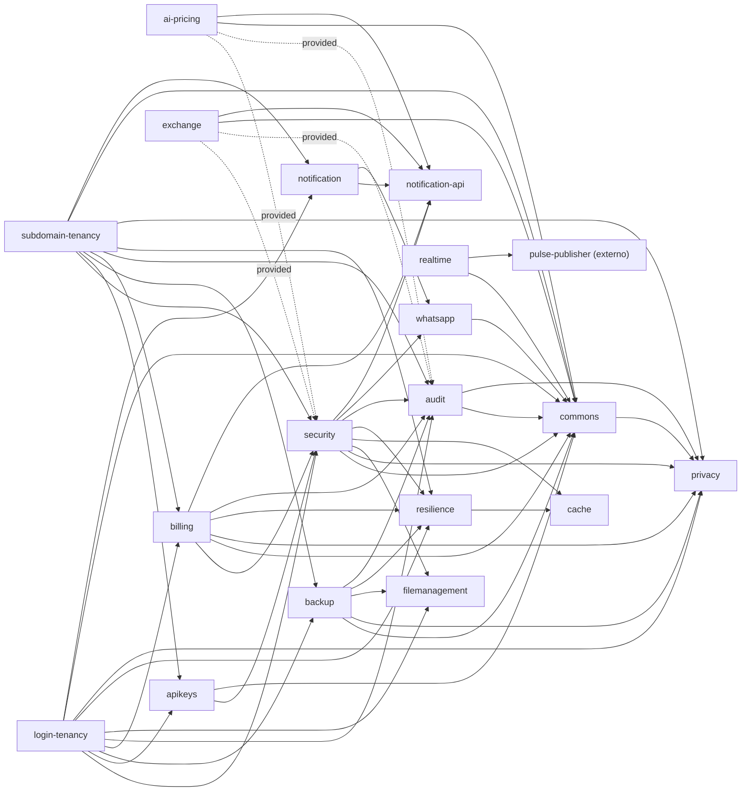
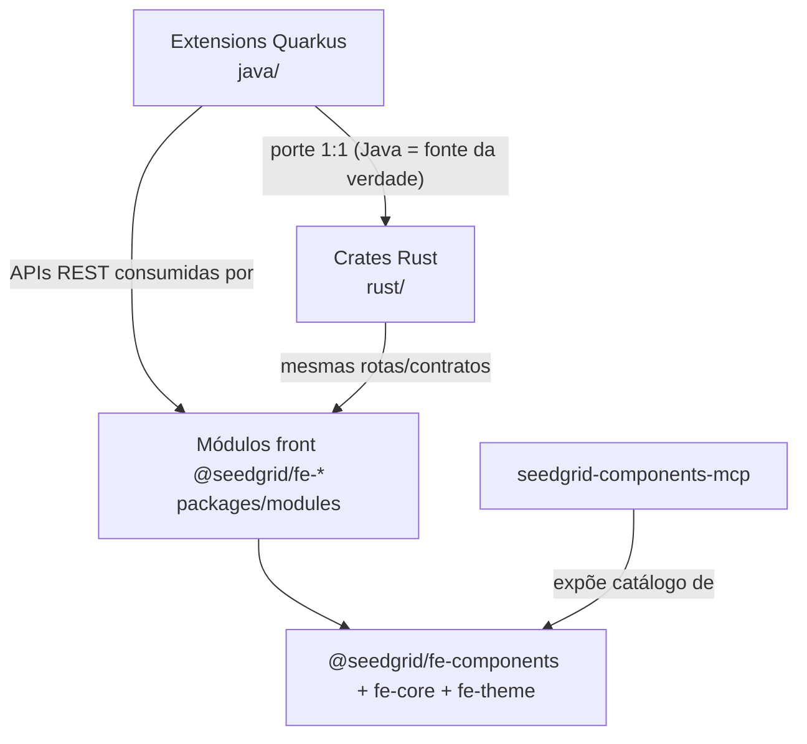

# Mapa dos repositórios

Raiz analisada: `seedgrid-platform`. A pasta raiz **não** é um repositório Git: cada módulo Java é um repositório próprio; `rust/` e `front/seedgrid-fe-components/` são repositórios únicos (monorepos).

> **Atualização de 2026-10-28:** o `seedgrid-cli` foi abandonado pelo dono e saiu deste mapa; o AIDLC (fluxo de produto novo do `seedgrid-ai`) cobre o que ele fazia.

Estado na análise (2026-10-14): todos na branch `main` e **sem alterações locais não commitadas** (`git status --short` vazio em todos).

## Repositórios e commits analisados

### Java / Quarkus (`java/`) — groupId `br.com.seedgrid`, Quarkus `3.30.8` (via `seedgrid-parent`)

| Repositório | Tipo | Versão (pom) | Commit | Data do commit | Nota |
|---|---|---|---|---|---|
| `seedgrid-parent` | POM pai (versões/BOM) | 2026.07.02 | `cc5eeb4bc1` | 2026-09-10 | — |
| `seedgrid-quarkus-ext-security` | Extension | 2026.10.13 | `450735386e` | 2026-10-13 | [[SeedGrid/Extensions/security/Visao-geral\|security]] |
| `seedgrid-quarkus-ext-apikeys` | Extension | 2026.10.09 | `bfc9c25877` | 2026-10-10 | [[SeedGrid/Extensions/apikeys/Visao-geral\|apikeys]] |
| `seedgrid-quarkus-ext-login-tenancy` | Extension | 2026.10.14 | `c67581bda9` | 2026-10-14 | [[SeedGrid/Extensions/login-tenancy/Visao-geral\|login-tenancy]] |
| `seedgrid-quarkus-ext-subdomain-tenancy` | Extension | 2026.10.14 | `fe62530a29` | 2026-10-14 | [[SeedGrid/Extensions/subdomain-tenancy/Visao-geral\|subdomain-tenancy]] |
| `seedgrid-quarkus-ext-billing` | Extension (core + stripe) | 2026.10.14 | `ba38efc347` | 2026-10-14 | [[SeedGrid/Extensions/billing/Visao-geral\|billing]] |
| `seedgrid-quarkus-ext-ai-pricing` | Extension | 2026.10.13 | `0608ca66b5` | 2026-10-13 | [[SeedGrid/Extensions/ai-pricing/Visao-geral\|ai-pricing]] |
| `seedgrid-quarkus-ext-exchange` | Extension | 2026.10.13 | `30f1fd6005` | 2026-10-13 | [[SeedGrid/Extensions/exchange/Visao-geral\|exchange]] |
| `seedgrid-quarkus-ext-business-days` | Extension (repositório ainda não criado) | 2026.10.15 | — | 2026-10-16 | [[SeedGrid/Extensions/business-days/Visao-geral|business-days]] |
| `seedgrid-quarkus-ext-cities` | Extension | 2026.10.22 | `bad4c48` | 2026-10-27 | [[SeedGrid/Extensions/cities/Visao-geral\|cities]] |
| `seedgrid-quarkus-ext-audit` | Extension (core + postgresql + mongodb) | 2026.09.25 | `d5bf32e509` | 2026-09-25 | [[SeedGrid/Extensions/audit/Visao-geral\|audit]] |
| `seedgrid-quarkus-ext-backup` | Extension | 2026.10.09 | `3bed4075ea` | 2026-10-10 | [[SeedGrid/Extensions/backup/Visao-geral\|backup]] |
| `seedgrid-quarkus-ext-notification` | Extension (+ `api`) | 2026.10.15 | `3d00bee` | 2026-10-15 | [[SeedGrid/Extensions/notification/Visao-geral\|notification]] |
| `seedgrid-quarkus-ext-realtime` | Extension | 2026.10.08 | `8f13639b3c` | 2026-10-08 | [[SeedGrid/Extensions/realtime/Visao-geral\|realtime]] |
| `seedgrid-quarkus-ext-resilience` | Extension | 2026.10.13 | `eff41304f8` | 2026-10-13 | [[SeedGrid/Extensions/resilience/Visao-geral\|resilience]] |
| `seedgrid-quarkus-ext-whatsapp` | Extension (core + evolution + cloud) | 2026.08.16 | `d8454f6313` | 2026-08-16 | [[SeedGrid/Extensions/whatsapp/Visao-geral\|whatsapp]] |
| `seedgrid-quarkus-lib-cache` | Library (core + redis/valkey/dragonfly) | 2026.10.13 | `14bd916a09` | 2026-10-13 | [[SeedGrid/Extensions/cache/Visao-geral\|cache]] |
| `seedgrid-quarkus-lib-commons` | Library | 2026.10.08 | `fa49c344db` | 2026-10-08 | [[SeedGrid/Extensions/commons/Visao-geral\|commons]] |
| `seedgrid-quarkus-lib-filemanagement` | Library | 2026.07.08 | `35c89c7cf7` | 2026-07-20 | [[SeedGrid/Extensions/filemanagement/Visao-geral\|filemanagement]] |
| `seedgrid-quarkus-lib-privacy` | Library | 2026.07.27 | `79f8b03eeb` | 2026-09-25 | [[SeedGrid/Extensions/privacy/Visao-geral\|privacy]] |
| `seedgrid-components-mcp` | Servidor MCP (TypeScript) que expõe o catálogo de componentes React e Flutter (`/mcp/react`, `/mcp/flutter`, `/mcp/all` no modo misto): ver a referência `.ai/references/mcp-de-componentes-react-e-flutter.md` do toolkit instalado (qual endereço registrar e o custo) | — | `69fe6a1cf8` | 2026-09-17 | não documentado em detalhe |
| `seedgrid-platform-examples` (repositório próprio, `examples/*`, 12 apps) | Apps de exemplo públicos, um por extension, com `infra/compose.yml` | — | https://github.com/SeedGrid/platform-examples.git | — | única pasta de exemplos; fonte dos exemplos da KB |

### Rust (`rust/`) — workspace único

| Item | Valor |
|---|---|
| Commit | `be738a2d1e` (2026-10-08) |
| Versão do workspace | `2026.7.27` (`[workspace.package]` em `rust/Cargo.toml`; o README cita `2026.7.22` — divergência de documentação) |
| Membros | 13 crates `seedgrid-rust-crate-*`, `seedgrid-macros`, `seedgrid-runtime` e 5 crates do broker |
| Exemplos | `rust/examples/*` (fora do workspace) |

Cada crate é o **porte** da extension/lib Java de mesmo nome; a paridade é registrada em `rust/DIVERGENCES-SUMMARY.md` (decisão: Java é a fonte da verdade). As notas `Rust.md` / `Configuracao-Rust.md` ficam na mesma pasta da extension correspondente.

### Front-end (`front/seedgrid-fe-components/`) — monorepo pnpm + Turborepo

| Item | Valor |
|---|---|
| Commit | `ad30fc11de` (2026-10-08) |
| Pacotes | `@seedgrid/fe-components` (2026.7.1), `@seedgrid/fe-core` (2026.7.1), `@seedgrid/fe-theme` (0.3.0), `@seedgrid/fe-commons` (0.2.0), `@seedgrid/fe-playground` (0.1.0), módulos `@seedgrid/fe-*` em `packages/modules/` |
| App | `apps/showcase` (vitrine dos componentes) |
| Stack | React 19, TypeScript 5, react-hook-form 7, lucide-react, TipTap 2 (editor) |

Documentação: [[SeedGrid/SeedGrid-components/Indice|Índice dos componentes]].

`front/next-projects/` contém apenas documentação de padrões/decisões (sem código) e não foi analisado.

### Produtos (`seedgrid-products/`)

Fora de `seedgrid-platform`; consomem as crates/extensions acima.

| Repositório | Tipo | Versão | Commit | Consome | Nota |
|---|---|---|---|---|---|
| `seedgrid-pulse` | Produto (servidor Rust + UI Next.js + SDKs) | 0.3.0 (servidor e UI) | `9dcbdad` | crates `security`, `login-tenancy`, `audit`, `apikeys`, `broker-*` (por path dependency) | [[SeedGrid/Produtos/Pulse/Visao-geral\|Pulse]] |

### Boilerplates (repositório `boilerplate`)

Modelos de produto que o `sg-new-product` copia para o produto novo (cópia embutida em `.ai/boilerplates/`). Fora de `seedgrid-platform`; consomem as extensions Java acima. Estado verificado em 2026-10-23: branch `feature/escopo-acesso-2026-10`, commit `0295f52` (ainda não está no `main`).

| Pasta | Público | Extensions de base | Observação |
|---|---|---|---|
| `login-tenancy-b2b` (antigo `login-tenancy`) | empresas, cadastro por CNPJ, equipe e convites | `login-tenancy` com `security`, `audit`, `backup`, `billing`, `apikeys`, `notification`, `filemanagement`, `privacy`, `resilience` | seletor de empresa, perfis, assinatura; sem login social |
| `login-tenancy-b2c` | pessoa física, `POST /public/signup/personal` (CPF opcional) | as mesmas do b2b (a extension `login-tenancy` é a mesma), configurada com `customer-type=B2C` | uma conta é uma pessoa; login social por configuração (`seedgrid-security-social`); sem telas de usuários, convites e perfis |
| `subdomain-tenancy` | empresas, um tenant por subdomínio | `subdomain-tenancy` com `security`, `audit`, `backup`, `billing`, `apikeys`, `notification`, `privacy`, `resilience` | nunca terá versão pessoa física (regra do dono) |
| `modular` (antigo `outro`) | sem tenancy | `security` e `audit` (PostgreSQL); opcionais conforme a escolha | sem billing e sem admin web; criado pelo seedgrid-ai |

A extension `login-tenancy` é uma só, compartilhada por B2B e B2C: a diferença está na configuração e nas telas. A escolha do modelo e os opcionais de cada um são conduzidos pela skill `sg-new-product` (`data/catalogo.json` e `data/matriz-produto.json`); o b2c segue indisponível na matriz até provar a subida.

## Dependências entre módulos Java

Extraído dos `pom.xml` (excluindo `deployment` e `integration-tests`). Escopo `compile` salvo indicação.

Observações:
- `security` usa `seedgrid-whatsapp-evolution` e `seedgrid-whatsapp-whatsapp-cloud` como dependências **opcionais**.
- `audit-postgresql` aparece com escopo `test` em security, backup, login-tenancy e subdomain-tenancy.
- `seedgrid-pulse-publisher` (dependência de `realtime/runtime/pom.xml`) **não está** neste conjunto de repositórios — origem não confirmada.
- Faixas de versão das migrations SQL: `java/MIGRATION_RANGES.md`.

## Relação entre as três frentes

