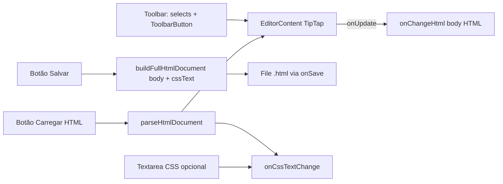

# SgTextEditor

O `SgTextEditor` é o editor de texto rico (HTML) do pacote `@seedgrid/fe-components` (v`2026.7.1`), construído sobre o **TipTap 2**. Referência: [[SeedGrid/SeedGrid-components/editor/API|API do SgTextEditor]]. Código: [[SeedGrid/SeedGrid-components/editor/Exemplos|Exemplos do SgTextEditor]].

## Objetivo

O editor produz e edita **documentos HTML com CSS embutido**. As funções principais, todas **Confirmado**:
- toolbar de formatação (títulos, fontes, tamanhos, cores, listas, alinhamento, link, imagem por URL);
- editor opcional de CSS;
- botões para **salvar** o documento como `File` `.html` e **carregar** um `.html` do disco.

Usos indicados: modelos de e-mail, termos e contratos, conteúdo de páginas e notas ricas. Para texto simples, use [[SeedGrid/SeedGrid-components/inputs-texto/Visao-geral|SgInputTextArea]]. Essa recomendação está em `aiHints.avoidUseCases` de `SgInputText.meta.ts`. **Confirmado**.

## Dependências (peers TipTap)

`peerDependencies` do pacote (também em `devDependencies`), todas na faixa `^2.9.1`:

| Pacote | Uso |
|---|---|
| `@tiptap/react` | `useEditor`, `EditorContent` |
| `@tiptap/core` | Tipos/base |
| `@tiptap/pm` | ProseMirror |
| `@tiptap/starter-kit` | Parágrafos, títulos, listas, negrito/itálico/tachado, bloco de código |
| `@tiptap/extension-underline` | Sublinhado |
| `@tiptap/extension-link` | Links |
| `@tiptap/extension-image` | Imagens |
| `@tiptap/extension-text-align` | Alinhamento |
| `@tiptap/extension-text-style` | Base de estilo (estendida com `fontSize`) |
| `@tiptap/extension-color` | Cor do texto |
| `@tiptap/extension-highlight` | Realce |
| `@tiptap/extension-subscript` / `@tiptap/extension-superscript` | Sub/sobrescrito |
| `@tiptap/extension-font-family` | Família da fonte |

Além disso: `react`, `react-hook-form` (`Controller`) e `lucide-react` (ícones da toolbar). **Confirmado** pelos imports de `SgTextEditor.tsx` e pelo `package.json`.

**Importante:** o `src/index.ts` reexporta o `SgTextEditor` estaticamente, e o arquivo importa o TipTap no topo. Por isso, **qualquer** importação de `@seedgrid/fe-components` faz o bundler resolver os pacotes `@tiptap/*`, mesmo em aplicações que não usam o editor. Na prática, os peers TipTap são necessários para todo consumidor do pacote. Isso é **Inferência**, pela estrutura dos imports ESM e pelo campo `sideEffects: true`; não foi testado em uma aplicação consumidora.

## Composição

- O corpo editado (`valueHtml`) e o CSS (`cssText`) ficam **separados**. Eles só se juntam no documento salvo.
- O CSS **não** é aplicado ao conteúdo dentro do editor. Ele vai apenas para o `<style>` do arquivo gerado.

**Confirmado**: o `cssText` só é usado em `buildFullHtmlDocument` e na textarea.

## Tema e estilos

- **Área de edição:** classes `prose max-w-none`. As classes `prose` vêm do plugin de tipografia do Tailwind. Se esse plugin está incluído no CSS compilado do pacote **não foi verificado**.
- **Moldura:** a toolbar e a área usam bordas e `bg-background`.
- **Customização:** `className`, `style`, `borderRadius`, `height` (padrão 320 px).
- **Desabilitado:** `disabled` deixa o conteúdo não editável, com opacidade 60%.

**Confirmado**, salvo o ponto do `prose`.

## Internacionalização

Todos os rótulos da toolbar, os prompts e o placeholder vêm de `components.textEditor.*`. Ver [[SeedGrid/SeedGrid-components/editor/API#Internacionalização|API]].

## Testes

Só há o teste de contrato por regex (`tests/rhf-components-contract.test.mjs`), que confere o caminho `control`. Não há teste DOM do editor. **Confirmado**.

## Limitações e pontos de atenção

- **Prompts nativos:** link e imagem usam `window.prompt`, sem diálogo próprio e sem upload de arquivo de imagem. **Confirmado**.
- **Instância TipTap:** não há ref nem acesso a ela, então não dá para registrar extensões adicionais. **Confirmado**.
- **RHF:** integração só via `control`. Nesse modo, o `onChangeHtml` do usuário é substituído e deixa de ser chamado. **Confirmado**.
- **Segurança:** o HTML carregado de arquivo vai para o editor sem sanitização explícita. O TipTap descarta o que não corresponde ao schema das extensões, mas o `cssText` extraído é repassado como veio. **Inferência**.
- **Seletor de tamanho de fonte:** é um `<select>` com `defaultValue="16px"`, não controlado, e não reflete o tamanho da seleção atual. **Confirmado**.
