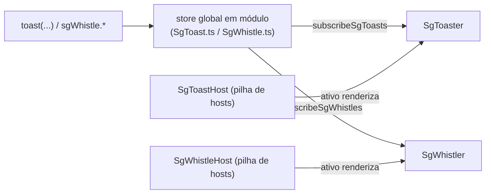

# Feedback e exibição (`src/commons`)

Componentes de exibição (avatar, badge, skeleton) e de feedback (toasts e whistles) do `@seedgrid/fe-components`. A pasta de origem é `src/commons`; aqui recebe o nome `feedback-e-exibicao`.

- API completa: [[SeedGrid/SeedGrid-components/feedback-e-exibicao/API|API de feedback e exibição]]
- Exemplos: [[SeedGrid/SeedGrid-components/feedback-e-exibicao/Exemplos|Exemplos de feedback e exibição]]
- Fundamentos (instalação, CSS, i18n): [[SeedGrid/SeedGrid-components/fundamentos/Visao-geral|Fundamentos]]

## Componentes

| Componente | Exportado | Para que serve | Showcase |
|---|---|---|---|
| `SgAvatar` | sim | Avatar com imagem, ícone, iniciais ou fallback; severidade, formato e tamanhos | `/components/sg-avatar` |
| `SgAvatarGroup` | sim | Avatares sobrepostos com contador `+N` | `/components/sg-avatar` |
| `SgBadge` | sim | Etiqueta/contador com severidade, variantes, ponto pulsante, ícones e remoção | `/components/sg-badge` |
| `SgBadgeOverlay` | sim | Posiciona um badge sobre outro elemento | `/components/sg-badge-overlay` |
| `SgSkeleton` | sim | Placeholder de carregamento (formas e animações `wave`/`pulse`) | `/components/sg-skeleton` |
| `SgToaster` | sim | Pilha fixa de toasts disparados por `toast(...)` | `/components/sg-toaster` |
| `SgToastHost` | sim | Define onde os toasts aparecem; vários hosts → o último montado vence | `/components/sg-toast-host` |
| `SgWhistler` | sim | Lista de avisos no fluxo do layout, disparados por `sgWhistle.*` | `/components/sg-whistler` |
| `SgWhistleHost` | sim | Define onde os whistles aparecem (mesma regra de prioridade) | `/components/sg-whistle-host` |
| `SgToasterHostContext` | não (interno) | Contexto booleano que faz o `SgToaster` interno do host pular a checagem de host | — |
| `SgWhistlerHostContext` | não (interno) | Idem para whistles | — |

## Funções e tipos exportados relacionados

- Toasts (`src/commons/SgToast.ts`): `toast` (com `.message/.success/.info/.warning/.error/.loading/.custom/.dismiss/.promise`), `dismissSgToast`, `subscribeSgToasts`; tipos `SgToastFn`, `SgToastId`, `SgToastType`, `SgToastAction`, `SgToastOptions`, `SgToastRecord`, `SgToastPromiseMessages`.
- Whistles (`src/commons/SgWhistle.ts`): `sgWhistle` (com `.show/.success/.info/.warning/.error/.loading/.dismiss/.update/.custom/.promise`), `dismissSgWhistle`, `subscribeSgWhistles`; tipos `SgWhistleId`, `SgWhistleSeverity`, `SgWhistleBorderStyle`, `SgWhistleAction`, `SgWhistleOptions`, `SgWhistleCustomOptions`, `SgWhistleRecord`, `SgWhistlePromiseStates`.
- Registro de hosts de toast (`src/commons/sgToastHostRegistry.ts`, exportado): `registerHost`, `unregisterHost`, `getActiveHostId`, `hasAnyHost`, `subscribeHostRegistry`, `nextHostId`. O registro equivalente de whistles (`sgWhistleHostRegistry.ts`) **não** é exportado.
- Tipos de props: `SgAvatarProps`, `SgAvatarGroupProps`, `SgAvatarSeverity`, `SgAvatarShape`, `SgAvatarSize`, `SgAvatarCustomColors`, `SgAvatarGroupOverlap`, `SgBadgeProps`, `SgBadgeSeverity`, `SgBadgeVariant`, `SgBadgeSize`, `SgBadgeCustomColors`, `SgBadgePartsClassName`, `SgBadgeOverlayProps`, `SgBadgeOverlayPlacement`, `SgSkeletonProps`, `SgSkeletonAnimation`, `SgSkeletonShape`, `SgToasterProps`, `SgToasterPosition`, `SgToasterTypeColors`, `SgToasterCustomColors`, `SgToastHostProps`, `SgWhistlerProps`, `SgWhistleHostProps`.
- Não relacionado a UI, mas na mesma pasta: `src/commons/common-passwords.ts` (lista usada pelos validadores — ver [[SeedGrid/SeedGrid-components/fundamentos/API|Fundamentos › validadores]]).

## Como se compõem

- As APIs `toast`/`sgWhistle` funcionam fora de componentes React (store em variável de módulo + listeners) — Confirmado.
- Basta **um** `SgToaster` ou `SgToastHost` montado para os toasts aparecerem; com hosts presentes, o `SgToaster` "solto" deixa de renderizar. Idem `SgWhistler`/`SgWhistleHost`.
- Toast = sobreposição fixa (`position: fixed`, `z-index 1100`) com posição configurável; whistle = bloco no fluxo do layout, onde o componente for colocado.
- `SgBadgeOverlay` costuma receber um `SgBadge` em `badge`; `SgAvatarGroup` recebe `SgAvatar` como filhos.
- Nenhum provider é obrigatório; textos padrão vêm do i18n interno. Sem dependências externas além de `react`.

## Testes existentes (não executados)

| Arquivo | Cobre |
|---|---|
| `packages/seedgrid-fe-components/tests/commons.test.mjs` | `aria-label` traduzido e override do `SgAvatar` e do botão remover do `SgBadge`; fallback de loading do `toast.promise`; registro de hosts de toast (último ativo, duplicados, unsubscribe); `sgWhistle.promise` atualizando o mesmo registro; `sgWhistle.update` + `onClose` no dismiss |
| `packages/seedgrid-fe-components/tests/commons-dom.test.mjs` (jsdom) | `SgWhistleHost` no fluxo respeitando `max`/`newestOnTop`; renderer customizado, ação que fecha e fechamento por tempo |

## Limitações e pontos de atenção

- `SgAvatarGroup`: `size`, `shape` e `bordered` só afetam o avatar contador `+N` (Confirmado).
- `SgAvatar` clicável não trata teclado; `SgSkeleton` não declara `aria-busy`.
- `SgBadge`, `SgBadgeOverlay`, `SgSkeleton`, `SgToaster`, `SgWhistler` e hosts não aceitam `ref`.
