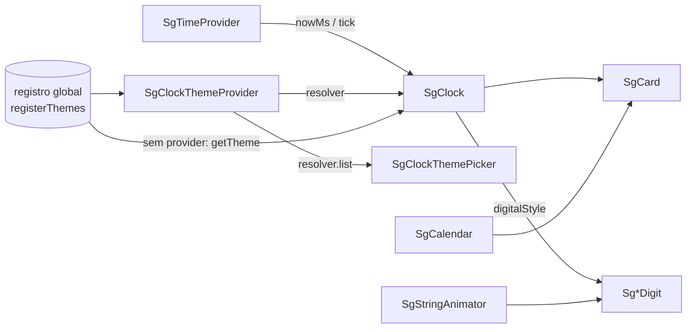

# Gadgets (`src/gadgets`) — React

> **Plataforma: React** (`@seedgrid/fe-components`). Equivalente em **Flutter**: [[SeedGrid/SeedGrid-components/flutter/gadgets/Visao-geral|Visão geral — Gadgets (relógio, calendário, gauges, QR) (Flutter)]]. Escolha entre as duas plataformas e placar de paridade: [[SeedGrid/SeedGrid-components/Plataformas|Plataformas: React × Flutter]].

Widgets visuais autocontidos: calendário, relógio (digital/analógico com temas), medidores linear e radial, QR Code e animador de strings, além do provider de tempo sincronizado com o servidor e do sistema de temas do relógio. `SgCalendar` e `SgClock` já vêm embrulhados num `SgCard` recolhível e arrastável.

- API completa: [[SeedGrid/SeedGrid-components/gadgets/API|API dos gadgets]]
- Exemplos TSX: [[SeedGrid/SeedGrid-components/gadgets/Exemplos|Exemplos dos gadgets]]
- Dígitos usados por `SgClock`/`SgStringAnimator`: [[SeedGrid/SeedGrid-components/digits/Visao-geral|Dígitos animados]]
- `SgCard` (contêiner de calendário e relógio): [[SeedGrid/SeedGrid-components/layout/API|API de layout]]
- i18n (rótulos `components.gadgets.*`) e CSS: [[SeedGrid/SeedGrid-components/fundamentos/Visao-geral|Fundamentos]]

## Componentes e símbolos

| Componente / símbolo | Exportado | Para que serve | Showcase |
|---|---|---|---|
| `SgCalendar` | sim | Calendário mensal (1–12 meses), seleção controlada/não controlada, limites e datas desabilitadas. | `/components/gadgets/sg-calendar` |
| `SgClock` | sim | Relógio digital (9 estilos) ou analógico com temas SVG. | `/components/gadgets/sg-clock` |
| `SgTimeProvider` + `useSgTime` | sim | Hora sincronizada com o servidor (`initialServerTime` + `performance.now()`), `tick` por segundo. | `/components/providers/sg-time-provider`, `/components/hooks/use-sg-time` |
| `SgClockThemeProvider` + `useSgClockThemeResolver` + `createThemeResolver` | sim | Resolvedor de temas por contexto (temas locais + globais, modo `strict`/`fallback`). | `/components/providers/sg-clock-theme-provider` |
| `registerTheme(s)`, `getTheme`, `hasTheme`, `listThemes`, `unregisterTheme`, `clearThemes`, `resolveTheme`, `ThemeLayer`, `useDarkFlag`, `sgClockThemesBuiltIn` | sim | Registro global e renderização de temas do relógio. | — |
| `SgClockThemePicker` | sim (tipo de props **não** exportado) | Seletor de tema com preview e busca. | `/components/gadgets/sg-clock-theme-picker` |
| `SgClockThemePreview` | sim | Miniatura SVG de um tema. | `/components/gadgets/sg-clock-theme-preview` |
| `SgLinearGauge` | sim | Medidor linear com faixas e ponteiros arrastáveis. | `/components/gadgets/sg-linear-gauge` |
| `SgRadialGauge` | sim | Medidor radial (needle/marker/range), anotações e conteúdo central. | `/components/gadgets/sg-radial-gauge` |
| `SgQRCode` | sim | QR Code SVG com logo central e fallback. | `/components/gadgets/sg-qr-code` |
| `SgStringAnimator` + `SG_STRING_ANIMATOR_DEFAULT_CHARSET` | sim | Anima texto de origem → destino caractere a caractere com dígitos animados. | `/components/gadgets/sg-string-animator` |
| `useSgTimeContext` | não (interno) | Contexto bruto do `SgTimeProvider` (`null` sem provider), usado por `SgClock`. | — |
| `filterClockThemes`, `resolveClockThemeSelection` (`themes/search.ts`) | não (interno) | Busca/seleção do picker (testados em `clock-theme-picker.test.mjs`). | — |
| `gauge/math.ts` (`clampGaugeValue`, `valueToGaugeRatio`…) | não (interno) | Matemática dos medidores (testada em `gauge-math.test.mjs`). | — |

Exportação conferida em `src/index.ts` (Confirmado). Não há subpath exports: tudo vem de `@seedgrid/fe-components`.

## Como se compõem

Pontos importantes (Confirmado):
- `SgTimeProvider` e `SgClockThemeProvider` são opcionais para `SgClock`, mas **`SgClockThemePicker` exige `SgClockThemeProvider`** (sem ele a lista é vazia).
- **Os temas embutidos (`sgClockThemesBuiltIn`) não são registrados automaticamente**; chame `registerThemes(sgClockThemesBuiltIn)` uma vez (o showcase faz isso em `apps/showcase/src/app/components/gadgets/sg-clock/sg-clock-showcase-client.tsx`) ou passe `theme`/`value.themes`.
- Com `SgTimeProvider` presente, `SgClock.initialServerTime` é ignorado em favor do contexto.

## Dependências

- `qrcode.react` `^4.2.0` (dependência do pacote) — `SgQRCode`.
- `@pqina/flip` (via `SgFlipDigit`) — `SgClock` com `digitalStyle="flip"` e `SgStringAnimator` com `"flip"`.
- Internas: `SgCard` (layout), `SgAutocomplete` (inputs, busca do picker), i18n do pacote.
- Tokens CSS do tema (`--sg-*`, `hsl(var(--primary))`, `--border`, `--secondary`) para cores padrão.

## Testes (não executados nesta análise)

| Arquivo | Cobre |
|---|---|
| `tests/gadgets.test.mjs` | Rótulos traduzidos de `SgQRCode`, `SgCalendar`, `SgClock`, `SgClockThemePicker` e gauges; período AM/PM localizado no 12h; semântica de listbox do picker. |
| `tests/gadgets-dom.test.mjs` | Picker abre e seleciona tema; filtro pela busca; arraste de ponteiro em `SgLinearGauge` e `SgRadialGauge` (jsdom). |
| `tests/gauge-math.test.mjs` | Funções de `gauge/math.ts` (normalização de faixa, inversão de eixo, conversões ponto/ângulo→valor). |
| `tests/clock-theme-picker.test.mjs` | `filterClockThemes` e `resolveClockThemeSelection`. |

## Limitações e lacunas

- Gauges não têm interação por teclado (só Pointer Events); `SgCalendar` não tem navegação por setas na grade; `SgClockThemePicker` não fecha com `Escape` (nada encontrado no código).
- `ThemeLayer` injeta SVG remoto (`theme.url`) com `dangerouslySetInnerHTML` sem sanitização (Inferência de risco: use só fontes confiáveis).
- `SgStringAnimator` não emite evento de término da animação.
