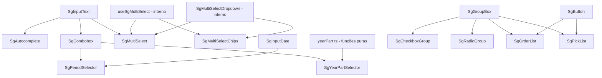

# Inputs de seleção — React

> **Plataforma: React** (`@seedgrid/fe-components`). Equivalente em **Flutter**: [[SeedGrid/SeedGrid-components/flutter/inputs-selecao/Visao-geral|Visão geral — Inputs de seleção e valores (Flutter)]]. Escolha entre as duas plataformas e placar de paridade: [[SeedGrid/SeedGrid-components/Plataformas|Plataformas: React × Flutter]].

São 15 componentes públicos de escolha (de lista, booleana, numérica ou de período) do pacote `@seedgrid/fe-components` (v`2026.7.1`), mais 2 peças internas (`SgMultiSelectDropdown`, `useSgMultiSelect`). Props completas, eventos e refs: [[SeedGrid/SeedGrid-components/inputs-selecao/API|API dos inputs de seleção]]. Código: [[SeedGrid/SeedGrid-components/inputs-selecao/Exemplos|Exemplos dos inputs de seleção]]. Base compartilhada: [[SeedGrid/SeedGrid-components/inputs-texto/Visao-geral|inputs de texto]].

## Quando usar cada um

| Componente | Use para | Valor emitido |
|---|---|---|
| `SgAutocomplete` | Busca em fonte grande ou remota, com sugestões enquanto o usuário digita (debounce, cache, agrupamento) | texto do item (`string`); objeto via `onSelect` |
| `SgCombobox` | Select de uma opção a partir de lista fixa ou carregada uma vez (type-ahead, agrupamento) | `id` do item (`string \| number \| null`); objeto cru via `onSelect` |
| `SgCheckboxGroup` | Poucas opções, várias escolhas, todas visíveis; "selecionar todos" | `(string \| number)[]` |
| `SgRadioGroup` | Poucas opções, uma escolha, todas visíveis | `string \| number \| null` |
| `SgMultiSelect` | Várias escolhas em dropdown compacto (resumo "N selecionadas") | `(string \| number)[]` |
| `SgMultiSelectChips` | Várias escolhas exibidas como chips removíveis | `(string \| number)[]` |
| `SgOrderList` | Ordenar uma lista (prioridade, etapas) | `SgOrderListItem[]` |
| `SgPickList` | Transferir itens entre "disponíveis" e "selecionados" | `{source, target, type}` |
| `SgPeriodSelector` | Filtro de período relativo a hoje ("este mês", "últimos…", personalizado) | `ResolvedPeriod` (RHF guarda o preset) |
| `SgYearPartSelector` | Recorte absoluto do ano (semestre, trimestre ou bimestre de um ano X) | `ResolvedYearPart` |
| `SgToggleSwitch` | Liga/desliga booleano | `boolean` |
| `SgRating` | Avaliação por estrelas (inteiras ou meias) | `number` |
| `SgSlider` | Número em faixa contínua (range nativo) | `number` |
| `SgStepperInput` | Número inteiro ou com passo, com botões +/− | `number` |

A grafia antiga `groupped` ainda é aceita como alias de `grouped` em `SgAutocomplete` e `SgCombobox`. **Confirmado**.

## Composição

- **Dropdowns:** são renderizados em **portal** em `document.body`, com `position: fixed` e `z-index` 1100. A posição é recalculada em `resize` e `scroll` (captura). Vale para Autocomplete, Combobox e MultiSelect/Chips.
- **Lógica pura reaproveitável:** `resolvePeriod`/`buildPeriodOptions` e as funções de `yearPart.ts` são exportadas e funcionam sem React.

**Confirmado**.

## Dependências

- **Peers:** `react`, `react-hook-form` (importado estaticamente) e `lucide-react` (ícones `ChevronDown`, `Check`, `X`). `react-dom` é usado via `createPortal`. Ele não está em `peerDependencies`, só em devDependencies (**Confirmado**). Na prática vem junto com o React DOM da aplicação (**Inferência**).
- **Componentes internos do pacote:** `SgInputText`, `SgInputDate`, `SgGroupBox` (`src/layout/SgGroupBox`) e `SgButton` (`src/buttons/SgButton`).

## Tema e estilos

- O CSS é injetado automaticamente na importação do pacote; também existe `@seedgrid/fe-components/style.css`. Ver [[SeedGrid/SeedGrid-components/inputs-texto/Visao-geral#Tema e estilos|Tema e estilos]].
- **Variáveis do tema:**
  - Listas e grupos usam variáveis RGB: `--sg-surface`, `--sg-bg`, `--sg-text`, `--sg-fg`, `--sg-border`, `--sg-primary-500`, `--sg-ring`, `--sg-muted`.
  - Inputs usam as HSL do tema (`--primary`, `--destructive`, `--muted-foreground`).
  - `SgRating` usa `hsl(var(--primary))` e `hsl(var(--muted-foreground))` como cores padrão.
- **Customização:** `className`, `style`, `optionClassName`, `listClassName`, `itemClassName`, `groupBoxProps`, além dos `*ClassName` do switch.

**Confirmado**.

## Internacionalização

- **Provider:** textos padrão via `useComponentsI18n()`. Chaves usadas por este grupo:
  - `components.autocomplete.{empty,loading}`;
  - `components.actions.{openList,clearSelection,search,top,up,down,bottom}`;
  - `components.inputs.{select.placeholder,multiSelect.summary,multiSelect.removeChip,toggle.ariaLabel,stepper.increase,stepper.decrease,required}`;
  - `components.checkboxgroup.checkAll`, `components.orderlist.*`, `components.picklist.*`, `components.rating.{cancel,required}`.
- **Exceção:** `SgPeriodSelector` e `SgYearPartSelector` **não** usam o provider. Eles têm tabelas próprias de rótulos (pt-BR, en-US, es, pt-PT, fr) e um prop `locale`, que por padrão é `"pt-BR"`.

**Confirmado**.

## Testes existentes (lidos, **não executados**)

- `tests/inputs-dom.test.mjs`: `SgAutocomplete` (4 cenários), `SgMultiSelect` (6), `SgMultiSelectChips` (6).
- `tests/inputs-i18n.test.mjs`: `aria-label` do `SgToggleSwitch`.
- `tests/rhf-components-contract.test.mjs`: confere, por regex no código-fonte, os caminhos RHF de Autocomplete, Slider, StepperInput, Combobox, MultiSelect, MultiSelectChips, OrderList e PickList.
- `tests/period-resolver.test.mjs` e `tests/year-part-resolver.test.mjs`: lógica de datas.

## Limitações e pontos de atenção

- **Abertura das listas:** `SgCombobox` e `SgMultiSelect` abrem no clique (`onMouseDown`) ou pelo teclado (↓/Enter/Espaço). O `SgAutocomplete` abre ao digitar ou pelo botão dropdown. Abrir ao receber foco não é suportado: o `SgInputText` sobrescreve o `inputProps.onFocus`. **Confirmado** pela ordem dos atributos no JSX.
- **Integração com RHF incompleta:**
  - `SgCombobox`, `SgMultiSelect`, `SgMultiSelectChips`, `SgOrderList`, `SgPickList`, `SgPeriodSelector` e `SgRating` integram só por `control` + `name`.
  - `SgYearPartSelector` não tem integração.
  - `required` só vira regra RHF automaticamente em Autocomplete, CheckboxGroup, RadioGroup, ToggleSwitch e Rating.

  **Confirmado**.
- **Ref:** o `SgCheckboxGroup` perde o ref imperativo quando usado com `control`. **Confirmado**.
- **Acessibilidade:**
  - `SgRating` não é operável por teclado.
  - `SgAutocomplete` e `SgCombobox` não expõem roles ARIA de combobox/listbox, ao contrário de `SgMultiSelect`/`SgMultiSelectChips`.

  **Confirmado**.
- **`inputProps` espalhado por último:** em `SgSlider`/`SgStepperInput`, o `{...inputProps}` vem depois dos handlers internos, o que pode anular o `onChange` interno no caminho `register`. **Inferência**.
