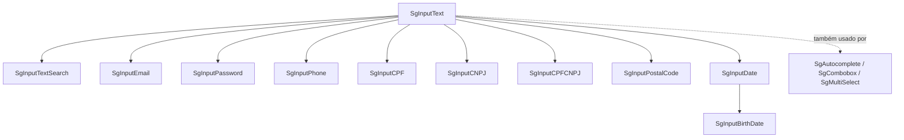

# Inputs de texto (SgInput*)

Este grupo reúne os 15 campos de digitação do pacote `@seedgrid/fe-components` (v`2026.7.1`). Todos estão em `src/inputs/` e todos são exportados pela raiz do pacote. Detalhe de props, eventos e ref: [[SeedGrid/SeedGrid-components/inputs-texto/API|API dos inputs de texto]]. Código: [[SeedGrid/SeedGrid-components/inputs-texto/Exemplos|Exemplos dos inputs de texto]]. Grupos vizinhos: [[SeedGrid/SeedGrid-components/inputs-selecao/Visao-geral|inputs de seleção]], [[SeedGrid/SeedGrid-components/datatable/Visao-geral|SgDatatable]], [[SeedGrid/SeedGrid-components/editor/Visao-geral|SgTextEditor]].

## Objetivo

Os componentes oferecem campos de formulário prontos, com as seguintes características comuns:
- rótulo flutuante, no topo ou à esquerda;
- validação embutida, com mensagens traduzidas;
- máscaras brasileiras (CPF, CNPJ alfanumérico, telefone, CEP);
- integração opcional com react-hook-form, por `register` ou por `control`.

O padrão de nomes de eventos vem da casa: `onEnter` no foco, `onExit` no blur, `onChange(value)` com o valor já tratado e `onValidation(msg | null)`. **Confirmado**: comentários "padrao seedgrid" nos tipos.

## Quando usar cada um

| Componente | Use para | Base |
|---|---|---|
| `SgInputText` | Texto curto livre (nome, título, código). É a base dos demais. | própria |
| `SgInputTextArea` | Texto longo multilinha, com mínimo de linhas e palavras. | própria (`<textarea>`) |
| `SgInputTextSearch` | Caixa de busca com debounce (`onSearchChange`). | `SgInputText` |
| `SgInputEmail` | E-mail com validação de formato e bloqueio de domínios temporários. | `SgInputText` |
| `SgInputPassword` | Senha com política configurável, barra de força, olho e gerador. | `SgInputText` |
| `SgInputPhone` | Telefone BR com máscara (10 ou 11 dígitos). | `SgInputText` |
| `SgInputCPF` | CPF com máscara e dígito verificador. | `SgInputText` |
| `SgInputCNPJ` | CNPJ numérico ou alfanumérico, com consulta pública opcional. | `SgInputText` |
| `SgInputCPFCNPJ` | Campo único que aceita CPF ou CNPJ e detecta qual é. | `SgInputText` |
| `SgInputPostalCode` | CEP/código postal de BR, PT, US, ES, UY, AR e PY, com ViaCEP opcional. | `SgInputText` |
| `SgInputDate` | Data com o widget nativo (`type="date"`) e limites min/max. | `SgInputText` |
| `SgInputBirthDate` | Data de nascimento com idade mínima/máxima. | `SgInputDate` |
| `SgInputNumber` | Número decimal formatado pelo locale, com min/max. | própria |
| `SgInputCurrency` | Valor monetário com símbolo via `Intl` (padrão BRL). | própria (derivada do código do `SgInputNumber`) |
| `SgInputOTP` | Código de uso único segmentado, com máscara (`999999`, `###-###`). | própria |

Para escolhas fechadas, como combos e listas, use o grupo [[SeedGrid/SeedGrid-components/inputs-selecao/Visao-geral|inputs de seleção]]. Para texto rico, use o [[SeedGrid/SeedGrid-components/editor/Visao-geral|SgTextEditor]]. Esses mesmos encaminhamentos aparecem nos `aiHints.avoidUseCases` de `SgInputText.meta.ts`. **Confirmado**.

## Composição

- Os wrappers usam `Omit<SgInputTextProps, …>`, acrescentam as próprias props e repassam o resto ao `SgInputText`. A integração com o RHF fica no `SgInputText`.
- Cada wrapper mantém **o próprio erro interno** e o passa como `error` ao `SgInputText`, junto com o erro de `fieldState` via `resolveFieldError`. Como o `SgInputText` também valida (required/maxLength…), uma mensagem do wrapper tem precedência sobre a dele. **Confirmado**.
- `SgInputTextArea`, `SgInputNumber`, `SgInputCurrency` e `SgInputOTP` repetem o padrão visual do `SgInputText`, mas têm implementação própria.

## Dependências

- **Peers obrigatórios do pacote:**
  - `react` `^18.2.0 || ^19.0.0`;
  - `react-hook-form` `^7.0.0`, importado estaticamente (`Controller`) pelos inputs, mesmo sem uso de formulário;
  - `lucide-react` `^0.468.0 || ^1.0.0` (ícone `X` do botão limpar).

  **Confirmado** em `package.json` e nos imports.
- **Peers TipTap:** não são usados por este grupo, mas são carregados pela raiz do pacote. Ver [[SeedGrid/SeedGrid-components/editor/Visao-geral|SgTextEditor]].
- **Rede:** `SgInputCNPJ` (`validateWithPublicaCnpj`) e `SgInputPostalCode` (`validateWithViaCep`) chamam `fetch` para `publica.cnpj.ws` e `viacep.com.br` por padrão. Ambos aceitam uma função de consulta própria (`publicaCnpjFetch`, `viaCepFetch`).
- **APIs do navegador:** `SgInputPassword` usa `crypto.getRandomValues` para gerar senha.
- **"use client":** todos os arquivos começam com `"use client"`, o que serve ao Next.js App Router.

## Tema e estilos

- O CSS compilado (Tailwind) é **injetado automaticamente** no `<head>` quando o pacote é importado (`ensureSeedgridStylesInjected()` em `src/injectStyles.ts`, chamado no topo de `src/index.ts`). A injeção tem proteção para SSR e para dupla injeção (id `seedgrid-fe-components-styles`). Também existe `@seedgrid/fe-components/style.css` para quem prefere importar o arquivo. **Confirmado**.
- **Tokens:**
  - Cores via variáveis CSS do tema: `hsl(var(--primary))`, `--destructive`, `--foreground`, `--muted`, `--border`.
  - Variáveis específicas de input, com fallback: `--sg-input-bg`, `--sg-input-fg`, `--sg-input-placeholder`, `--sg-input-disabled-bg`, `--sg-input-disabled-fg`.

  O pacote `@seedgrid/fe-theme` aparece só como devDependency. A relação exata entre ele e essas variáveis é **Inferência**.
- **Customização:**
  - Props: `className` (no `SgInputText` **substitui** as classes do input), `labelClassName`, `width`, `borderRadius`, `elevation`, `withBorder`, `filled`.
  - Dark mode do `SgInputDate`: `color-scheme` via `useDarkFlag()`.

## Internacionalização

- **Provider:** textos padrão vêm de `useComponentsI18n()` (`src/i18n/index.ts`). Locales embutidos: `pt-BR`, `pt-PT`, `en-US` (alias `en`), `es`, `fr`.
- **Sem provider:** vale o i18n global, que por padrão é **`en-US`**. Para trocar, use `<SgComponentsI18nProvider locale="pt-BR" messages={…}>` ou `setComponentsI18n(...)`. As mensagens passadas sobrescrevem as embutidas, chave por chave.
- **Chaves deste grupo:** `components.inputs.*`, `components.password.*`, `components.validators.*` e `components.actions.clear`.
- **Props `*Message`:** sempre têm precedência sobre a tradução.

**Confirmado**.

## Testes existentes (lidos, **não executados**)

- `tests/inputs-dom.test.mjs` (jsdom) cobre:
  - `SgInputText` controlado via `inputProps.value` e via RHF;
  - `onChange` do `SgInputPassword` e o tamanho da senha gerada;
  - asterisco do `SgInputPhone`;
  - debounce, `minChars` e "distinct" do `SgInputTextSearch`.
- `tests/inputs-i18n.test.mjs`: rótulos de acessibilidade do `SgInputOTP`.
- `tests/rhf.test.mjs` e `tests/rhf-components-contract.test.mjs`: `resolveFieldError`, `mergeRequiredRule` e presença dos caminhos `register`/`control` no `SgInputTextArea`.
- `tests/i18n-components-contract.test.mjs`: garante que os componentes usam `t(...)` em vez de texto fixo.

O script `test` do pacote roda `pnpm run build` antes.

## Limitações e pontos de atenção

- `SgInputBirthDate` sem `minAge` nem `maxAge` acusa erro de configuração para qualquer data preenchida. **Confirmado**.
- `SgInputPassword` tem `maxLength` padrão **15**. `SgInputCPF`, `SgInputCNPJ` e `SgInputCPFCNPJ` têm `maxLength` padrão 18. **Confirmado**.
- `SgInputCPF`, `SgInputCNPJ`, `SgInputCPFCNPJ`, `SgInputPostalCode`, `SgInputDate` e `SgInputBirthDate` não repassam `required` ao `SgInputText`. Consequências:
  - o rótulo fica sem `*`;
  - as rules do RHF ficam sem `required` automático (a validação interna continua funcionando).

  `SgInputPhone`, `SgInputEmail` e `SgInputPassword` repassam. **Confirmado** (`required={required}` só aparece nesses três).
- O erro não é anunciado a leitores de tela no `SgInputText` (sem `aria-invalid`/`aria-describedby`). O `SgToggleSwitch` e o `SgInputOTP` fazem isso. **Confirmado**.
- Para reagir ao foco, use `onEnter`: o `inputProps.onFocus` não é chamado pelo `SgInputText`. **Confirmado**; ver [[SeedGrid/SeedGrid-components/inputs-texto/API#Contrato base SgInputText|contrato base]].
- Os tipos de props de `SgInputEmail`, `SgInputPassword`, `SgInputDate` e `SgInputBirthDate` não são reexportados. **Confirmado**.
