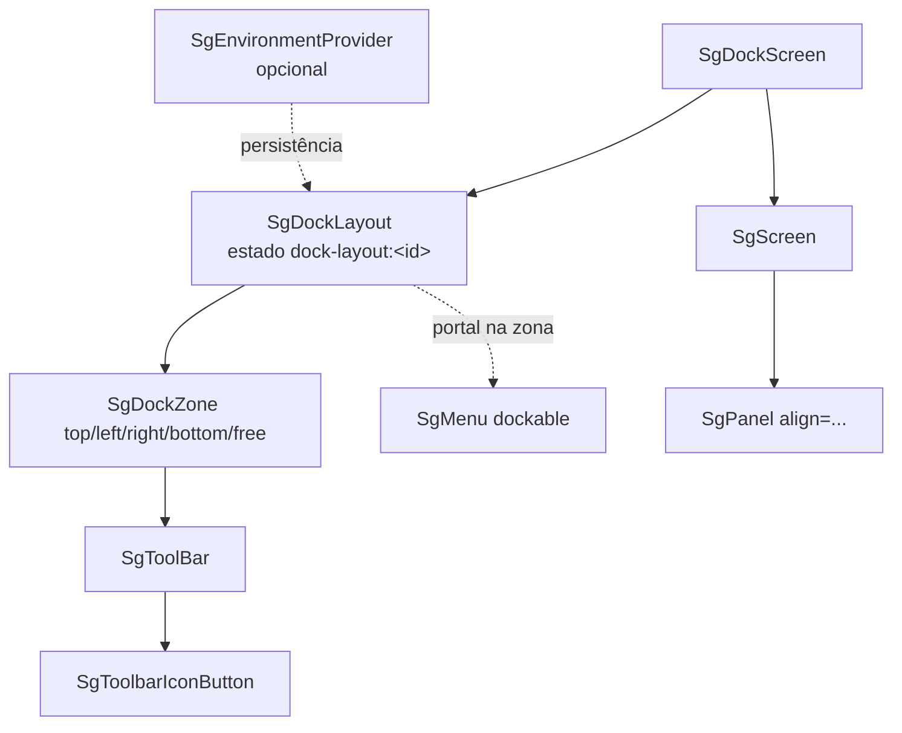

# Layout — visão geral — React

> **Plataforma: React** (`@seedgrid/fe-components`). Equivalente em **Flutter**: [[SeedGrid/SeedGrid-components/flutter/layout/Visao-geral|Visão geral — Layout e containers (Flutter)]]. Escolha entre as duas plataformas e placar de paridade: [[SeedGrid/SeedGrid-components/Plataformas|Plataformas: React × Flutter]].

Componentes de estrutura de tela do `@seedgrid/fe-components` (pasta `src/layout`): primitivas de composição (pilha, grade, painel com docking, tela), containers (card, accordion, abas, painel expansível, carrossel), navegação (breadcrumb, menu, árvore) e o sistema de **docking** de toolbars (`SgDockLayout`/`SgDockZone`/`SgDockScreen`/`SgToolBar`).

- API completa (props, eventos, ref, a11y, funções): [[SeedGrid/SeedGrid-components/layout/API|Layout — API]]
- Exemplos verificados: [[SeedGrid/SeedGrid-components/layout/Exemplos|Layout — exemplos]]
- Instalação, CSS, i18n e utilitários: [[SeedGrid/SeedGrid-components/fundamentos/Visao-geral|Fundamentos]]
- Persistência (`SgEnvironmentProvider`, `useSgPersistence`, `useSgPersistentState`): [[SeedGrid/SeedGrid-components/providers/Visao-geral|Providers]]

## Componentes

"Exportado" = presente em `src/index.ts` (barrel do pacote; único entry point JS em `exports["."]` do `package.json`). Rotas do showcase relativas ao app `apps/showcase`.

| Componente | Exportado | Para que serve | Showcase |
|---|---|---|---|
| `SgStack` | sim | Flex em linha/coluna com `gap`, `justify`, `align`, `wrap`, `grow`. | `/components/sg-stack` |
| `SgGrid` | sim | Grade CSS com colunas por breakpoint ou `minItemWidth` (auto-fit); respeita `span`/`rowSpan` dos filhos. | `/components/sg-grid` |
| `SgPanel` | sim | Painel com borda/scroll e **docking** de painéis filhos por `align` (top/left/right/bottom/client). | `/components/sg-panel` |
| `SgScreen` | sim | Raiz de tela (100% × 100dvh por padrão) com o mesmo docking de `SgPanel`. | `/components/sg-screen` |
| `SgGroupBox` | sim | `fieldset` + `legend` para agrupar campos. | `/components/sg-group-box` |
| `SgCard` | sim | Card com cabeçalho/rodapé, clicável, colapsável e arrastável (posição persistida). | `/components/sg-card` |
| `SgAccordion` | sim | Seções colapsáveis verticais ou horizontais, controladas ou não. | `/components/sg-accordion` |
| `SgPageControl` | sim | Abas com páginas declarativas; select nativo opcional no celular. | `/components/sg-page-control` |
| `SgPageControlPage` | sim | Declaração de uma página do `SgPageControl`. | `/components/sg-page-control` |
| `SgExpandablePanel` | sim | Painel expansível inline ou overlay (drawer) com resize, foco preso e Esc. | `/components/sg-expandable-panel` |
| `SgCarousel` | sim | Carrossel com vários itens visíveis, circular, autoplay, navegadores e indicadores. | `/components/sg-carousel` |
| `SgBreadcrumb` | sim | Trilha de navegação com colapso de excedentes ou rolagem. | `/components/sg-breadcrumb` |
| `SgMenu` | sim | Menu de navegação: sidebar, drawer, inline, híbrido; variantes painel, em camadas e mega menu; busca; encaixe em dock. | `/components/sg-menu` |
| `SgTreeView` | sim | Árvore com busca, checkboxes em cascata, modo confirmação, trilhas extras e ref imperativa. | `/components/sg-tree-view` |
| `SgDockLayout` | sim | Provedor de zonas de encaixe e do estado persistido das toolbars. | `/components/sg-dock-layout` |
| `SgDockZone` | sim | Zona nomeada (`top`/`bottom`/`left`/`right`/`free`) de um `SgDockLayout`. | `/components/sg-dock-layout` |
| `SgDockScreen` | sim | `SgScreen` + `SgDockLayout` com grade 3×3 pronta. | `/components/sg-dock-screen` |
| `SgToolBar` | sim | Barra de ferramentas colapsável, arrastável entre zonas ou livre. | `/components/sg-toolbar` |
| `SgToolbarIconButton` | sim | Botão de toolbar com ícone, rótulo, `hint` (tooltip), severidade e loading automático para `onClick` assíncrono. | `/components/sg-toolbar` |
| `useSgDockLayout` | não (interno) | Hook do contexto do dock (exportado só de `SgDockLayout.tsx`). | — |
| `renderDockContent` e helpers de `sgDocking.tsx` | não (interno) | Motor de docking de `SgPanel`/`SgScreen`. | — |

## Funções e tipos exportados relacionados

- Árvore: `sgTreeFromJson`, `sgTreeFromJsonWithChecked`; tipos `SgTreeViewRef`, `SgTreeNode`, `SgTreeNodeJson`, `SgTreeIconRegistry`, `SgTreeConfirmBar`, `SgSize`, `SgDensity`, `SgTone`.
- Lógica pura de menu (`src/layout/menu-logic.ts`): `buildMenuMaps`, `collectMenuSearchEntries`, `collectParentChain`, `computeActiveSets`, `filterMenuNodes`, `flattenVisibleNodes`, `mergeExpandedIdsForActivePath`, `resolveEffectiveActiveId`, `resolveExpandedIdsToggle`, `resolveHorizontalDockAlign`, `resolveMegaMenuActiveNode`, `resolveMegaMenuHoverActiveId`, `resolveMegaMenuInteraction`, `resolveMenuAutocompleteItems`, `resolveMenuHintPosition`, `resolveMenuKeyboardAction`, `resolveMenuLayoutState`, `resolveMenuNodeActionIntent`, `resolveMenuSearchSelectionState`, `resolveTieredActiveState`, `resolveTieredClickState`, `resolveTieredHoverIntent`, `resolveTieredHoverPath`, `resolveTieredNodeClickIntent` (24 funções) + tipos `MenuKeyboardAction`, `MenuVisibleNode`, `MenuLogicNode`.
- Toolbar (`toolbar-logic.ts`): `buildToolbarLayoutState`, `resolveToolbarDockOrientationDirection`, `resolveToolbarOrientationDirection`.
- Posição de arraste (`drag-position.ts`): `parseStoredPanelDragPosition`, `buildToolbarStorageKey`, `buildDockMenuStorageKey`.
- Assinaturas completas: [[SeedGrid/SeedGrid-components/layout/API|API › Funções utilitárias exportadas]].

## Como se compõem

- **Docking de painéis** (`SgPanel`/`SgScreen`): sem contexto; o pai inspeciona filhos `SgPanel` com `align` e monta as faixas. **Docking de toolbars** (`SgDockLayout`): contexto React + portal das toolbars/menus na zona atribuída — são mecanismos independentes (Confirmado).
- **Persistência** (Confirmado): `SgDockLayout` usa `useSgPersistentState` (chave base `dock-layout:<id>`); `SgCard` (`sg-card-pos:<id>` ou `dragPersistKey`), `SgToolBar` com `freeDrag` (`sg-toolbar-pos:<id>`) e `SgMenu` (`sg-menu:<id>:collapsed`) usam `useSgPersistence` quando há `SgEnvironmentProvider` e `localStorage` direto quando não há.
- **i18n**: textos padrão (rótulos ARIA, "vazio", placeholder de busca) vêm de `useComponentsI18n` — ver [[SeedGrid/SeedGrid-components/fundamentos/API|Fundamentos › i18n]].
- `SgMenu` reutiliza `SgExpandablePanel` (drawer/hybrid), `SgAutocomplete` (busca), `SgAvatar` e `SgCard` (bloco do usuário).

## Dependências externas

- `react` (peer `^18.2.0 || ^19.0.0`), `react-dom` (`createPortal` em `SgExpandablePanel`, `SgMenu`, `SgToolBar`).
- `lucide-react` (peer): ícones de `SgBreadcrumb`, `SgCarousel`, `SgMenu`.
- Estilos via classes Tailwind compiladas no CSS do pacote (ver Fundamentos).

## Testes que cobrem o grupo (não executados)

| Arquivo | Cobertura relacionada |
|---|---|
| `tests/menu-logic.test.mjs` | Todas as funções de `menu-logic.ts` (mapas, cadeia de pais, ativo por id/url, busca, filtro, nós visíveis, teclado, tiered/mega, layout) e que o `SgMenu` consome os helpers. |
| `tests/buttons-menus.test.mjs` | Rótulos traduzidos/ARIA de `SgMenu`, `SgToolBar`, `SgExpandablePanel`, `SgTreeView`, `SgCard`, `SgCarousel`, `SgBreadcrumb`, `SgPageControl`; helpers de `drag-position.ts` e `toolbar-logic.ts`. |
| `tests/buttons-menus-dom.test.mjs` | DOM (jsdom): `SgToolBar` alterna conteúdo e notifica colapso; persistência do arraste livre em `localStorage`. |
| `tests/i18n-components-contract.test.mjs` | Contrato de chaves i18n usadas em `SgMenu`, `SgCard`, `SgToolBar`, `SgExpandablePanel`, `SgCarousel`, `SgBreadcrumb`, `SgPageControl`. |

Os testes rodam após `pnpm run build` (script `test` do pacote); não foram executados nesta análise.

## Limitações e lacunas (Confirmado no código, salvo indicação)

- `SgTreeView`: sem `role="tree"`/`treeitem` e sem navegação por setas; os tipos `SgTreeTrack*` da prop `tracks` não são exportados pelo barrel.
- `SgCarousel`: botões anterior/próximo sem `aria-label`; sem teclado; índice não controlável de fora.
- `SgToolBar`: sem `role="toolbar"`; `hideLabel` de `SgToolbarIconButton` não está em `SgToolbarIconButtonProps` (só na assinatura do componente).
- `SgMenu`: item com `url` e sem `onNavigate` navega com `window.location.assign` (recarga completa) — em apps SPA passe `onNavigate`. `SgMenuOrientationDirection` não exportado.
- `SgAccordion` vertical anima `max-height` até 960px (conteúdo maior pode ser cortado — Inferência).
- `SgDockZone` sem `className` assume grade 3×3; com `className` o posicionamento é todo do chamador.
- Componentes deste grupo não usam `forwardRef`, exceto `SgExpandablePanel` (`HTMLDivElement`) e `SgTreeView` (`SgTreeViewRef`).
