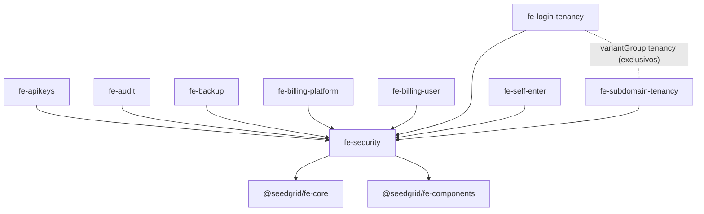

# Módulos front (`packages/modules/*`)

Os módulos são pacotes npm `@seedgrid/fe-<domínio>` que entregam a parte **front-end** de uma funcionalidade de plataforma (autenticação, API keys, auditoria, backup, billing, tenancy, auto-cadastro) para apps Next.js gerados pela **CLI SeedGrid**. Cada um conversa com uma extension backend (Quarkus/Rust) via HTTP.

Relacionados: [[SeedGrid/SeedGrid-components/pacotes/fe-core|@seedgrid/fe-core]] (contrato do manifesto e `createApiClient`) · [[SeedGrid/SeedGrid-components/pacotes/Visao-geral|Pacotes de base]].

## Modelo de distribuição: lib + scaffold

Decisão registrada em `packages/modules/SECURITY-EXTRACTION-MAP.md` e `FE-SECURITY-PACKAGE-CONTRACT.md` (Confirmado no código):

- **Lógica** (sessão, refresh, permissões, DTOs, paths, chamadas HTTP, mensagens i18n) → **lib versionada** em `dist/` (compilada com `tsc`).
- **Telas** (pages, forms, route handlers, menus) → **`scaffold/`** publicado junto (campo `files`), copiado pela CLI para dentro do app (modelo "shadcn": a lib dá as peças, a tela é do app). As referências `from: "@/modules/<nome>"` dos manifestos apontam para esse código copiado.
- **Variantes** (ex.: tenancy por login × por subdomínio) são escolhidas na montagem pela CLI (`variantGroup`), não em runtime.
- **Separação client/server**: a maioria expõe `./server` (código só-servidor: cookies httpOnly, Bearer, refresh) separado do `.` client-safe, para que `next/headers` não vaze para o bundle do browser. O browser fala *same-origin* com route handlers do Next; o servidor do Next segura o token e chama o backend.

## Como se registram no fe-core

**Não há registro em runtime** no `SeedGridRegistry` (Confirmado: nenhum módulo chama `registry.add*`). Cada pacote exporta `module: SeedGridCliModuleManifest` em `src/module.ts`; o `postbuild` (`scripts/emit-module-manifest.mjs`) importa `dist/module.js` e grava `dist/module.json`, **único artefato lido pela CLI** (comentário em `fe-core/src/cli-module-manifest.ts`).

Campos do contrato: `id`, `requires`, `variantGroup`, `configKey`, `env`, `provider[]`, `navigation`, `messages`, `postAuthResolver` — ver [[SeedGrid/SeedGrid-components/pacotes/fe-core|fe-core › Módulos e registry]].

| Pacote | Versão | `id` | `requires` | `variantGroup` | `env` | `provider` | `navigation` | `messages` | `postAuthResolver` | Nota |
|---|---|---|---|---|---|---|---|---|---|---|
| `@seedgrid/fe-security` | 2026.7.3 | `security` | — | — | — | `AuthProvider` (`@/modules/security`) | `useSecurityAppShellSections` | `securityMessages` | — | [[SeedGrid/SeedGrid-components/modulos/fe-security\|fe-security]] |
| `@seedgrid/fe-apikeys` | 2026.7.0 | `api-keys` | `security` | — | — | — | — | — | — | [[SeedGrid/SeedGrid-components/modulos/fe-apikeys\|fe-apikeys]] |
| `@seedgrid/fe-audit` | 2026.7.0 | `audit` | `security` | — | — | — | — | — | — | [[SeedGrid/SeedGrid-components/modulos/fe-audit\|fe-audit]] |
| `@seedgrid/fe-backup` | 2026.7.0 | `backup` | `security` | — | — | — | `useBackupAppShellSections` | `backupMessages` | — | [[SeedGrid/SeedGrid-components/modulos/fe-backup\|fe-backup]] |
| `@seedgrid/fe-billing-platform` | 2026.7.0 | `billing-platform` | `security` | — | — | — | `useBillingPlatformAppShellSections` | `billingPlatformMessages` | — | [[SeedGrid/SeedGrid-components/modulos/fe-billing-platform\|fe-billing-platform]] |
| `@seedgrid/fe-billing-user` | 2026.7.0 | `billing-user` | `security` | — | — | — | `useBillingUserAppShellSections` | `billingUserMessages` | — | [[SeedGrid/SeedGrid-components/modulos/fe-billing-user\|fe-billing-user]] |
| `@seedgrid/fe-login-tenancy` | 2026.7.0 | `login-tenancy` | `security` | `tenancy` | — | — | — | `loginTenancyMessages` | `resolveLoginTenancyPostAuthPath` | [[SeedGrid/SeedGrid-components/modulos/fe-login-tenancy\|fe-login-tenancy]] |
| `@seedgrid/fe-self-enter` | 2026.7.0 | `self-enter` | `security` | — | — | — | — | — | — | [[SeedGrid/SeedGrid-components/modulos/fe-self-enter\|fe-self-enter]] |
| `@seedgrid/fe-subdomain-tenancy` | 2026.7.0 | `subdomain-tenancy` | `security` | `tenancy` | — | `TenantProvider` (`@seedgrid/fe-subdomain-tenancy/client`) | — | — | — | [[SeedGrid/SeedGrid-components/modulos/fe-subdomain-tenancy\|fe-subdomain-tenancy]] |

Todos Confirmados em `packages/modules/<pasta>/src/module.ts`. `configKey` = `id` em todos.

## Pacotes: exports, dependências, scaffold e testes

| Pacote | `exports` | peerDependencies | Arquivos em `scaffold/` | Testes (`node --test`, não executados) |
|---|---|---|---|---|
| fe-security | `.`, `./server`, `./client`, `./paths` | fe-core, fe-components, `next` (opcional), `react` (opcional) | 56 | `paths`, `module-manifest`, `permissions` |
| fe-apikeys | `.`, `./server` | fe-core, fe-security | 1 | `module-manifest` |
| fe-audit | `.`, `./server` | fe-core, fe-security | 0 (sem pasta no `files`) | `module-manifest` |
| fe-backup | `.`, `./server` | fe-core, fe-security | 17 | `module-manifest`, `export-status` |
| fe-billing-platform | `.`, `./server` | fe-core, fe-security | 18 | `module-manifest` |
| fe-billing-user | `.`, `./server` | fe-core, fe-security | 19 | `module-manifest` |
| fe-login-tenancy | `.`, `./client`, `./server` | fe-components (opcional), fe-core, fe-security, react | 12 | `module-manifest` |
| fe-self-enter | `.`, `./server` | fe-core, fe-security | 3 | `module-manifest` |
| fe-subdomain-tenancy | `.`, `./server`, `./client` | fe-core, fe-security, react (opcional) | 10 | `module-manifest`, `subdomain-rules` |

Build de todos: `tsc -p tsconfig.json` + `postbuild` `node scripts/emit-module-manifest.mjs`. Contagem de `scaffold/` por `find -type f`.

## Relação com as extensions backend

| Módulo front | Extension backend | Observação |
|---|---|---|
| fe-security | [[SeedGrid/Extensions/security/Visao-geral\|security]] | sessão, usuários, roles, companies, 2FA, self-enter, apikeys (paths) |
| fe-apikeys | [[SeedGrid/Extensions/apikeys/Visao-geral\|apikeys]] | `ApiKeyPaths` espelha `RestControllerPath.java` da extension (Confirmado na nota do módulo) |
| fe-audit | [[SeedGrid/Extensions/audit/Visao-geral\|audit]] | `/audit-logs` e sub-rotas |
| fe-backup | [[SeedGrid/Extensions/backup/Visao-geral\|backup]] | `/exports/**` |
| fe-billing-platform | [[SeedGrid/Extensions/billing/Visao-geral\|billing]] | `/admin/plans/**` (backoffice) |
| fe-billing-user | [[SeedGrid/Extensions/billing/Visao-geral\|billing]] | `/me/*` do assinante (atenção aos endpoints de uso — ver nota) |
| fe-login-tenancy | [[SeedGrid/Extensions/login-tenancy/Visao-geral\|login-tenancy]] + [[SeedGrid/Extensions/security/Visao-geral\|security]] | signup de empresa + `/me/companies`, `/me/select-company` |
| fe-self-enter | [[SeedGrid/Extensions/security/Visao-geral\|security]] | não há extension própria; usa `SecurityPaths.selfEnter` |
| fe-subdomain-tenancy | [[SeedGrid/Extensions/subdomain-tenancy/Visao-geral\|subdomain-tenancy]] | `/public/tenants`, validação/reenvio de e-mail |

Detalhes de endpoints (método + path), permissões e telas em cada nota de módulo.

## Configuração

Variáveis de ambiente encontradas (detalhe e tabelas completas nas notas):
- **fe-security** (scaffold): `NEXT_PUBLIC_SECURITY_SELF_ENTER_ENABLED`, `SEEDGRID_SECURITY_ACCESS_COOKIE_NAME`, `SEEDGRID_SECURITY_REFRESH_COOKIE_NAME`, `SEEDGRID_SECURITY_REFRESH_COOKIE_MAX_AGE_SECONDS`, `NODE_ENV` — ver [[SeedGrid/SeedGrid-components/modulos/fe-security|fe-security › Configuração]].
- **fe-billing-platform**, **fe-billing-user**, **fe-login-tenancy** (scaffold, runtime server): `SEEDGRID_SECURITY_ACCESS_COOKIE_NAME` e `SEEDGRID_SECURITY_REFRESH_COOKIE_NAME` (mesmos nomes de cookie do fe-security).
- **fe-subdomain-tenancy** (scaffold, runtime server): `SEEDGRID_CITIES_API_USERNAME` e `SEEDGRID_CITIES_API_KEY` 🔒 (API externa de cidades).
- **fe-apikeys**, **fe-audit**, **fe-backup**, **fe-self-enter**: nenhuma leitura de `process.env` (grep em `src` e `scaffold`); backup usa o objeto `backupConfig`; self-enter depende indiretamente de `NEXT_PUBLIC_SECURITY_SELF_ENTER_ENABLED` (fe-security).
