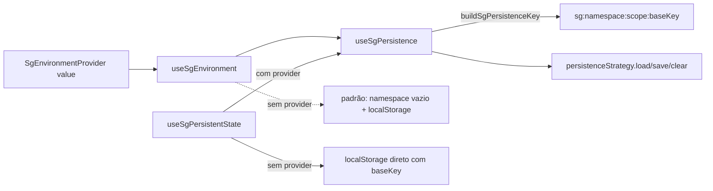
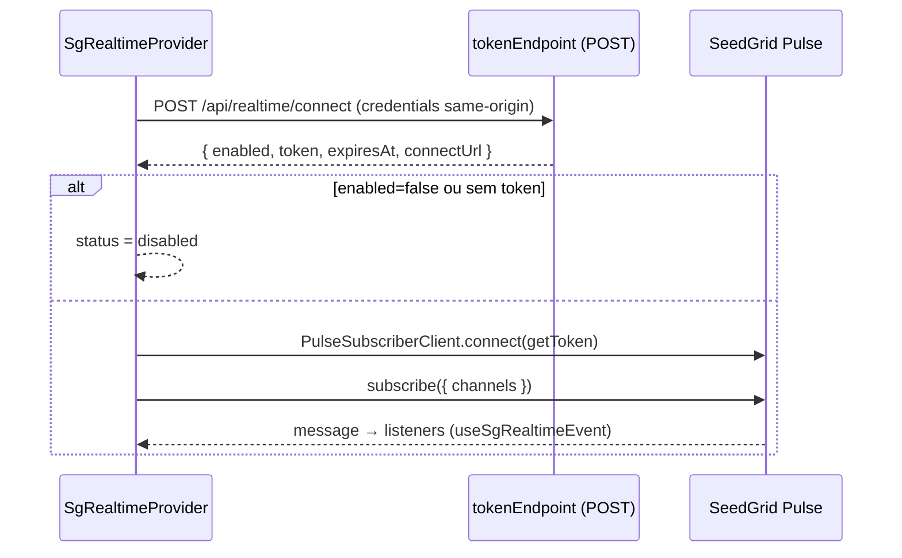

# Providers de ambiente e realtime — visão geral — React

> **Plataforma: React** (`@seedgrid/fe-components`). Equivalente em **Flutter**: [[SeedGrid/SeedGrid-components/flutter/providers/Visao-geral|Visão geral — Providers (ambiente/persistência e realtime) (Flutter)]]. Escolha entre as duas plataformas e placar de paridade: [[SeedGrid/SeedGrid-components/Plataformas|Plataformas: React × Flutter]].

Este grupo reúne os dois providers "de aplicação" do `@seedgrid/fe-components`, montados uma vez perto da raiz da árvore React:

- **`SgEnvironmentProvider`** (`src/environment/`) — define *namespace* (ex.: usuário/tenant), *escopo* e a *estratégia de persistência* que os componentes SeedGrid usam para lembrar estado (posição de FAB/toolbar/dock-menu, layout do dock, cards recolhidos, menu etc.). Acompanha hooks (`useSgEnvironment`, `useSgPersistence`, `useSgPersistentState`…) e fábricas de estratégia (localStorage, API REST e composta).
- **`SgRealtimeProvider`** (`src/realtime/`) — conecta a tela ao SeedGrid Pulse para receber avisos em tempo real do usuário logado, com hooks `useSgRealtimeEvent` e `useSgRealtimeStatus` e degradação para *polling*.

- API completa: [[SeedGrid/SeedGrid-components/providers/API|API dos providers]]
- Exemplos: [[SeedGrid/SeedGrid-components/providers/Exemplos|Exemplos dos providers]]
- Fundamentos do pacote (instalação, i18n, `SgComponentsI18nProvider`, estilos): [[SeedGrid/SeedGrid-components/fundamentos/Visao-geral|Fundamentos]]
- Lado servidor do realtime: [[SeedGrid/Extensions/realtime/Visao-geral|extension realtime]]

Outros providers do pacote ficam nos grupos de origem: `SgTimeProvider` e `SgClockThemeProvider` em [[SeedGrid/SeedGrid-components/gadgets/API|gadgets]]; `SgComponentsI18nProvider` em [[SeedGrid/SeedGrid-components/fundamentos/API|fundamentos]].

## Componentes, hooks e funções

| Símbolo | Tipo | Exportado | Para que serve | Showcase |
|---|---|---|---|---|
| `SgEnvironmentProvider` | componente (provider) | sim | Fornece namespace, estratégia e configuração de persistência | `/components/providers/sg-environment-provider` |
| `useSgEnvironment` | hook | sim | Lê o ambiente (ou o padrão, sem provider) | `/components/hooks/use-sg-environment` |
| `useSgNamespaceProvider` | hook | sim | Atalho para `useSgEnvironment().namespaceProvider` | (página do provider) |
| `useSgPersistence` | hook | sim | `load`/`save`/`clear` com chave isolada por namespace e escopo | `/components/hooks/use-sg-persistence` |
| `useSgPersistentState` | hook | sim | "useState persistido" com hidratação assíncrona | `/components/hooks/use-sg-persistent-state` |
| `useHasSgEnvironmentProvider` | hook | não (interno) | Diz se há provider; usado por FAB, Card, Menu, ToolBar, DockMenu | — |
| `buildSgPersistenceKey` | função | sim | Monta a chave `sg:<namespace>[:<scope>]:<baseKey>` | — |
| `createLocalStorageStrategy` | função | sim | Estratégia sobre `window.localStorage` | — |
| `createApiPersistenceStrategy` | função | sim | Estratégia REST (`GET/POST/DELETE {baseUrl}/sg/persistence`) | — |
| `createCompositePersistenceStrategy` | função | sim | Combina primária + secundária (`strict`/`fallback`/`mirror`) | — |
| `readLocalPersistentState`, `writeLocalPersistentState`, `clearLocalPersistentState`, `resolvePersistedStateValue` | funções | sim | Helpers puros de estado persistido em `Storage` | — |
| `SgRealtimeProvider` | componente (provider) | sim | Conexão ao Pulse e distribuição de avisos | `/components/providers/sg-realtime-provider` |
| `useSgRealtimeEvent` | hook | sim | Registra handler por channel + padrão de evento | `/components/hooks/use-sg-realtime-event` |
| `useSgRealtimeStatus` | hook | sim | `{ status, connected }` para decidir aviso × polling | `/components/hooks/use-sg-realtime-status` |
| `matchesSgRealtimeEvent` | função | sim | Casa nome exato, `prefixo.*` ou `*` | — |

Tipos exportados: `NamespaceProvider`, `PersistenceStrategy`, `SgEnvironment`, `SgEnvironmentValue`, `SgPersistenceMode`, `SgPersistenceConfig`, `SgPersistenceRecordDTO`, `SgRealtimeProviderProps`, `SgRealtimeStatus`, `SgRealtimeEvent`, `SgRealtimeConnectResponse` (Confirmado em `src/index.ts`).

## Como funciona

### Ambiente e persistência (Confirmado — `src/environment/*.ts(x)`)

- Sem provider, `useSgEnvironment()` devolve um ambiente padrão: `getNamespace: () => ""`, `createLocalStorageStrategy()`, `persistence = { scope: "app:unknown", mode: "fallback", stateVersion: 1 }`.
- `buildSgPersistenceKey` devolve `null` quando o namespace é vazio. Consequência: **com** `SgEnvironmentProvider` mas **sem** `namespaceProvider` que retorne algo, `useSgPersistence().load` retorna `null` e `save`/`clear` não fazem nada — a persistência fica desligada (Confirmado; coberto por `tests/providers-hooks.test.mjs` "returns null without namespace").
- `useSgPersistentState` sem provider grava direto em `localStorage` sob a própria `baseKey` (sem prefixo `sg:`), ignorando `serialize` ao gravar (Confirmado: `writeLocalPersistentState({ storage, baseKey, value })`).
- Componentes que consomem a persistência (Confirmado por import): `SgFloatActionButton`, `SgCard`, `SgMenu`, `SgToolBar`, `SgDockMenu` (via `useSgPersistence` + `useHasSgEnvironmentProvider`) e `SgDockLayout` (via `useSgPersistentState`). Também há menção em `SgDatatable` (grupo inputs, não analisado aqui).
- `persistence.mode` e `persistence.stateVersion` do ambiente ficam disponíveis para leitura em `useSgEnvironment().persistence` e no retorno de `useSgPersistence()`. O comportamento de persistência é definido pela estratégia: o modo efetivo é o `mode` passado a `createCompositePersistenceStrategy`, e a versão gravada no servidor é o `stateVersion` passado a `createApiPersistenceStrategy` (Confirmado).

### Realtime (Confirmado — `src/realtime/SgRealtimeProvider.tsx`)

- Usa `PulseSubscriberClient` de `@seedgrid/pulse-subscriber-react/core` (dependência direta do pacote, `^3.0.0`).
- Mapeamento de estado: `connected`/`subscribed` → `connected`; `connecting`, `reconnecting`, `auth-error`, `idle` mantidos; demais (`disconnected`, `error`) → `unavailable`. Falha no pedido do token → `unavailable`; resposta `enabled:false` → `disabled`.
- Reconexão: a cada nova conexão o provider pede um token novo (o primeiro é reaproveitado uma vez).
- Reconecta apenas quando mudam `enabled`, `channels` (comparado por `join(",")`) ou `pulseUrl`; `tokenEndpoint`, `tokenRequestInit`, `fetchToken` e `connectOptions` são lidos por *ref* (valor mais recente, sem reconectar).

## Dependências

- `react` (peer), `@seedgrid/pulse-subscriber-react` (dependência, só realtime).
- Persistência REST: o backend precisa expor `GET/POST/DELETE {baseUrl}/sg/persistence` com o contrato de `SgPersistenceRecordDTO` (ver [[SeedGrid/SeedGrid-components/providers/API|API]]). **Não confirmado** qual extension Java/Rust implementa essa rota — não foi verificado neste grupo.
- Realtime: rota de token (BFF) que repassa ao `POST /realtime/connect` da extension realtime (comentário do sample `layout-com-bff` e JSDoc de `SgRealtimeConnectResponse`).

## Testes existentes (não executados)

| Arquivo | Cobre |
|---|---|
| `tests/providers-hooks.test.mjs` | `buildSgPersistenceKey` (incl. `null` sem namespace); `createLocalStorageStrategy`; `createCompositePersistenceStrategy` (fallback, mirror, strict); `createApiPersistenceStrategy` (fetcher injetado, erros determinísticos); helpers de persistent-state; `SgEnvironmentProvider` expondo sobrescritas; também `SgComponentsI18nProvider` e `SgTimeProvider` |
| `tests/providers-hooks-dom.test.mjs` | `useSgPersistentState` com localStorage e com estratégia do provider (hidratação e `clear`) |
| `tests/realtime-dom.test.mjs` | conexão com token e entrega ao handler (filtro por channel/evento); backend desligado → `disabled`; token 401/503 → `unavailable`; credencial revogada (4403) → `auth-error` sem reconectar; sem provider → `disabled`; `matchesSgRealtimeEvent` |

## Limitações e pontos de atenção

- Nomes de channel com vírgula quebrariam a assinatura (o provider serializa/deserializa `channels` com `","`) — Inferência a partir de `channelsKey.split(",")`.
- Fora de `SgRealtimeProvider`, `useSgRealtimeEvent` não faz nada e `useSgRealtimeStatus` devolve `disabled`.
