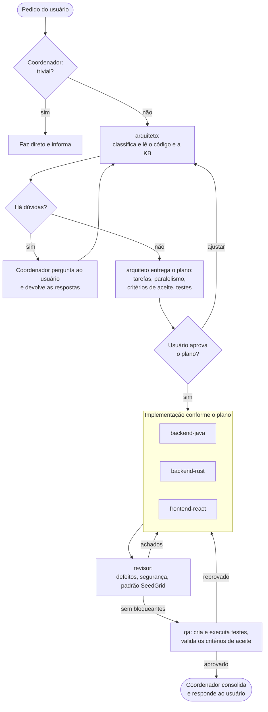
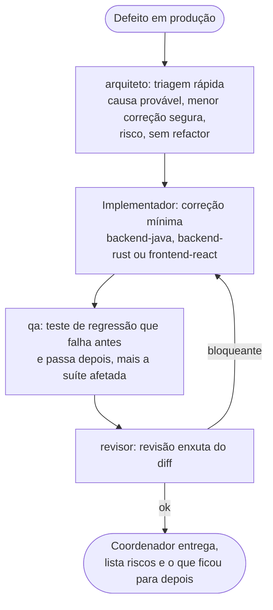

# Fluxo de trabalho dos papéis

O **coordenador** é a sessão principal da ferramenta (Claude Code ou Codex): ele conversa com o usuário e aciona os papéis. Os papéis (subagentes) não falam com o usuário; devolvem resultados e perguntas ao coordenador.

Regra de ouro: **toda tarefa não trivial passa primeiro pelo `arquiteto`**. Ele classifica, tira as dúvidas e planeja; só depois os demais trabalham.

## Quem faz o quê

| Papel | Quando entra | Entrega |
| --- | --- | --- |
| `arquiteto` | Sempre primeiro (tarefa não trivial) | Tipo da tarefa, perguntas, plano com tarefas, paralelismo e critérios de aceite |
| `backend-java` | Tarefa de back em Java | Código, migrations e testes do back, usando as extensions SeedGrid |
| `backend-rust` | Tarefa de back em Rust | Código e testes, usando os crates SeedGrid |
| `frontend-react` | Tarefa de tela ou integração no front | Telas com componentes SeedGrid |
| `revisor` | Depois de implementar | Achados por severidade, com cenário de falha, e conferência do padrão SeedGrid |
| `qa` | Depois da revisão (e, para regressão, junto da correção) | Testes criados e executados, critérios validados com evidência |

Tarefas triviais (pergunta, ajuste de uma linha) o coordenador faz direto, sem papéis.

## Feature, refactor e bug

- **Paralelismo:** o plano marca o que pode rodar junto. Dois papéis nunca escrevem no mesmo arquivo ao mesmo tempo. Quando a tela depende de um endpoint novo, o contrato da API sai primeiro (back antes do front).
- **Testes cedo:** o `qa` pode escrever os testes a partir dos critérios de aceite em paralelo à implementação, sem editar os arquivos do implementador.
- **Perguntas:** o `arquiteto` devolve a lista de dúvidas; o coordenador as faz ao usuário e volta com as respostas, até não restar dúvida relevante. Dúvida pequena vira premissa declarada.

## Hotfix (urgência em produção)

- Sem plano formal e sem perguntas além das indispensáveis.
- Refactors e melhorias encontrados no caminho viram pendência, não entram no hotfix.
- Publicar ou fazer deploy continua sendo decisão do usuário.

## Manutenção (chore)

Bump de versão do projeto, atualização de configuração e tarefas parecidas vão direto para a skill adequada (por exemplo `seedgrid-bump`), sem plano; o `qa` confere build e testes ao final.

## Skills que os papéis usam

- `planejar-mudanca` (arquiteto), `validar-mudanca` (qa), `revisar-codigo` e `seedgrid-review` (revisor).
- `seedgrid-backend-crud` (backend-java), `seedgrid-crud` e `seedgrid-new-screen` (frontend-react), `seedgrid-bump` (versão do projeto).
- A lista completa, com o que cada skill faz, está em `.ai/skills/index.md`.
