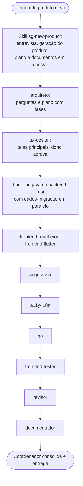
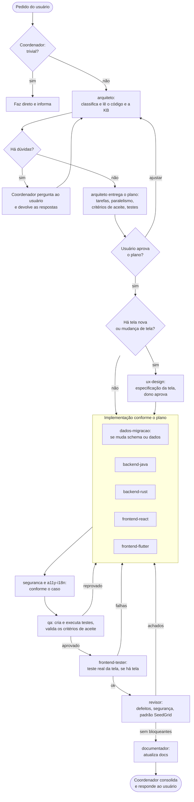
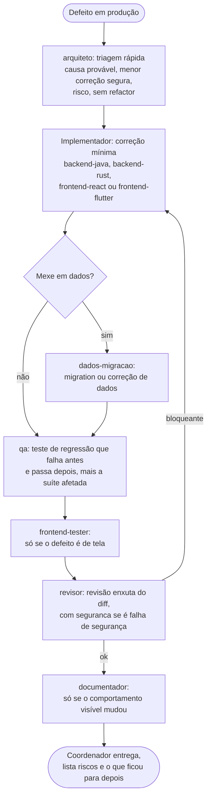

# Fluxo de trabalho dos papéis

O **coordenador** é a sessão principal da ferramenta (Claude Code ou Codex): ele conversa com o usuário e aciona os papéis. Os papéis (subagentes) não falam com o usuário; devolvem resultados e perguntas ao coordenador.

Regra de ouro: **toda tarefa não trivial passa primeiro pelo `arquiteto`**. Ele classifica, tira as dúvidas e planeja; só depois os demais trabalham.

## Quem faz o quê

| Papel | Quando entra | Entrega |
| --- | --- | --- |
| `arquiteto` | Sempre primeiro (tarefa não trivial) | Tipo da tarefa, perguntas, plano com tarefas, paralelismo e critérios de aceite por tarefa |
| `ux-design` | Antes do front, só se a tarefa cria ou muda uma tela | Especificação da tela em `docs/ai/designs/` (estados, componentes SeedGrid, textos e i18n, acessibilidade), que o dono aprova antes do front |
| `backend-java` | Tarefa de back em Java | Código, migrations e testes do back, usando as extensions SeedGrid |
| `backend-rust` | Tarefa de back em Rust | Código e testes, usando os crates SeedGrid |
| `frontend-react` | Tarefa de tela ou integração no front React | Telas com componentes SeedGrid (`@seedgrid/fe-components`) |
| `frontend-flutter` | Tarefa de tela ou integração no front Flutter; ao lado do `frontend-react` quando a tela existe nos dois | Telas com `seedgrid_components`, mantendo a paridade com o React |
| `dados-migracao` | Quando a tarefa muda schema ou mexe em dados existentes | Migrations compatíveis, convergência de schema e conversão de dados |
| `seguranca` | Quando a tarefa toca autenticação, permissões, dados pessoais, dependências ou segredos | Achados de segurança priorizados, com evidência |
| `a11y-i18n` | Quando há texto ou tela nova | Acessibilidade conferida e varredura dos idiomas (pt-BR, pt-PT, en-US, es, fr) |
| `qa` | Depois da implementação (e, para regressão, junto da correção) | Testes criados e executados, critérios validados com evidência |
| `frontend-tester` | Depois do `qa`, quando há tela | Relatório de teste em navegador real e, quando houver, em emulador, com evidência; só reporta, não corrige |
| `revisor` | Antes da entrega | Achados por severidade, com cenário de falha, e conferência do padrão SeedGrid |
| `documentador` | No fim | Documentação do produto em `docs/` e documentos de `docs/ai/` atualizados; não escreve código |

O **coordenador** não está na tabela porque não é um papel: é a sessão principal com quem o dono fala. Ele conduz os passos, aciona os papéis acima, cobra evidência e consolida a resposta.

Tarefas triviais (pergunta, ajuste de uma linha) o coordenador faz direto, sem papéis.

## Projeto novo

Pasta sem `produto.json`: o coordenador aciona a skill `sg-new-product` **antes** do `arquiteto`. Ela conduz a entrevista fixa, gera o produto e escreve o plano e os documentos em `docs/ai/`. Depois disso segue o fluxo da feature, aplicado ao produto inteiro:

## Feature, refactor e bug

- **Condições:** `ux-design` só se há tela; `dados-migracao` só se muda schema ou dados; `seguranca` só se toca autenticação, dados pessoais ou dependência; `a11y-i18n` só se há texto ou tela nova; `frontend-tester` só se há tela. `arquiteto`, `qa`, `revisor` e `documentador` entram sempre.
- **Paralelismo:** o plano marca o que pode rodar junto. Dois papéis nunca escrevem no mesmo arquivo ao mesmo tempo. Quando a tela depende de um endpoint novo, o contrato da API sai primeiro (back antes do front). O `frontend-react` e o `frontend-flutter` rodam em paralelo quando a tela existe nos dois lados.
- **Testes cedo:** o `qa` pode escrever os testes a partir dos critérios de aceite em paralelo à implementação, sem editar os arquivos do implementador.
- **Perguntas:** o `arquiteto` devolve a lista de dúvidas; o coordenador as faz ao usuário e volta com as respostas, até não restar dúvida relevante. Dúvida pequena vira premissa declarada.

## Hotfix (urgência em produção)

- Sem plano formal e sem perguntas além das indispensáveis.
- Refactors e melhorias encontrados no caminho viram pendência, não entram no hotfix.
- Não entram no hotfix `ux-design` e `a11y-i18n`, salvo se o defeito for de idioma ou acessibilidade.
- Publicar ou fazer deploy continua sendo decisão do usuário.

## Manutenção (chore)

Bump de versão do projeto, atualização de configuração e tarefas parecidas vão direto para a skill adequada (por exemplo `sg-bump`), sem plano; o `qa` confere build e testes ao final.

## Skills que os papéis usam

- `sg-new-product` (projeto novo, antes do arquiteto), `sg-plan-goal` e `sg-plan-change` (arquiteto), `sg-validate-change` (qa), `sg-code-review` e `sg-review` (revisor).
- `sg-crud-back` (backend-java), `sg-crud-front` e `sg-new-screen` (frontend-react), `sg-crud-front-flutter` (frontend-flutter), `sg-bump` (versão do projeto).
- Não existe `skills/index.md`: para achar uma skill, liste a pasta `Toolkit/skills/` (no produto, `.ai/skills/`); cada skill tem a descrição no cabeçalho do próprio `SKILL.md`. O uso de cada uma também está no mapa do toolkit.
